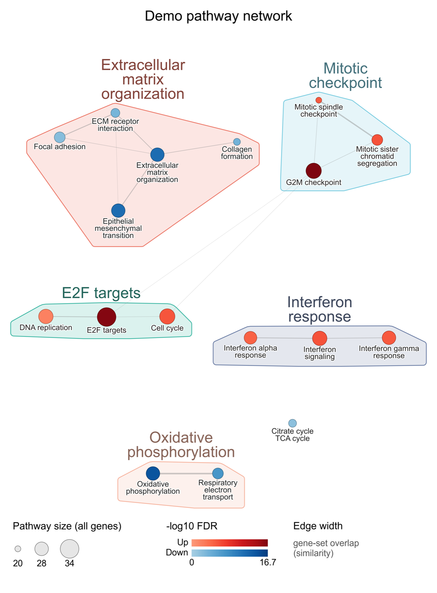
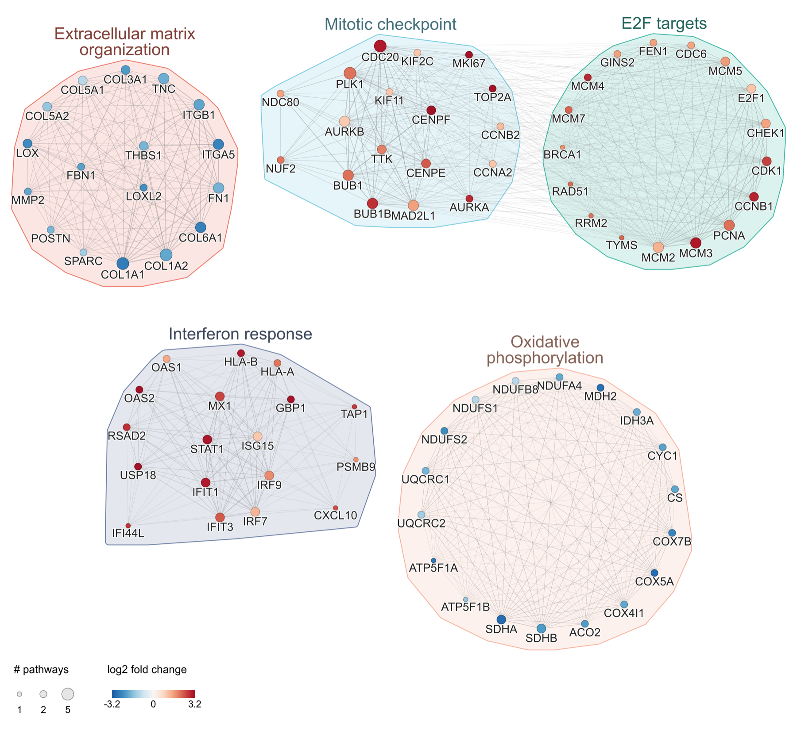
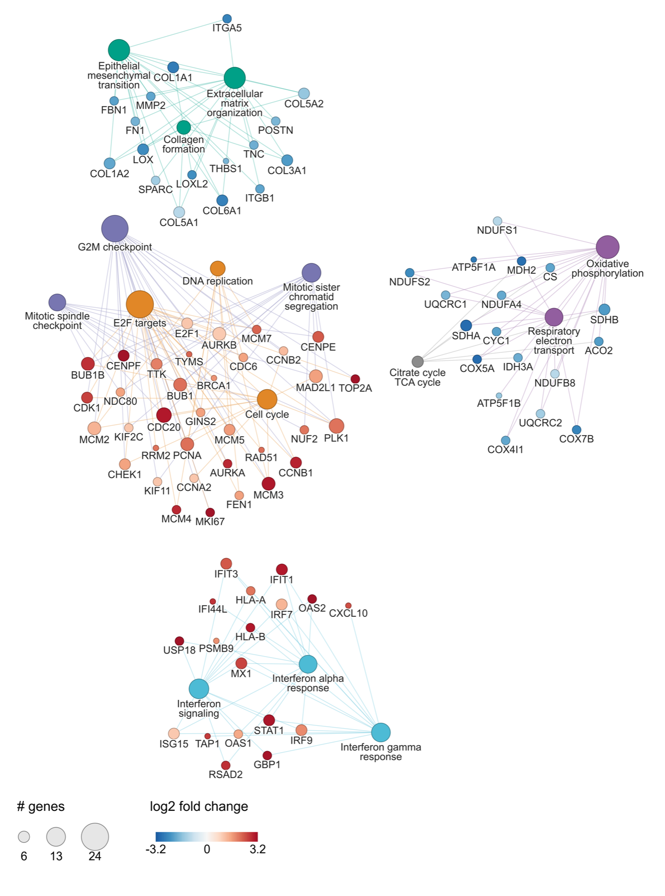
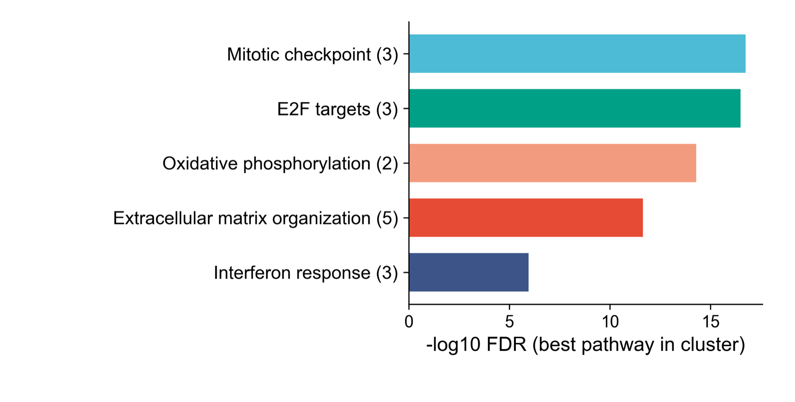

# SimpNetworkViz: pathway enrichment and network figures in Python

[](docs/index.md)
[](https://github.com/helenhuangmath/SimpNetworkViz/actions/workflows/tests.yml)

[](LICENSE)

**[Software website](https://helenhuangmath.github.io/SimpNetworkViz/) · [Documentation and tutorials](docs/index.md)**

## Introduction

SimpNetworkViz is an open-source Python package for pathway enrichment analysis and network visualization. It takes a gene list, an enrichment table or a list of pathways and draws **EnrichmentMap / AutoAnnotate-style network figures**, the Cytoscape look you see in many papers. You don't need to install Cytoscape or click through it by hand.

An enrichment analysis usually returns dozens to hundreds of significant pathways, and many of them are the same biology under different names. A clustered pathway network collapses those overlapping pathways into a handful of labeled themes. SimpNetworkViz draws that network from one command, and then draws a matching gene network so you can go from each theme to the genes behind it.

<table>
  <tr>
    <td width="50%"><a href="docs/images/tutorial/demo_pathway_network.png"></a></td>
    <td width="50%"><a href="docs/images/tutorial/demo_gene_network.png"></a></td>
  </tr>
  <tr>
    <td><b>Pathway network.</b> Each node is a pathway and each edge joins two pathways that share genes. Outlines are clusters with automatic labels. Red is up, blue is down.</td>
    <td><b>Gene network.</b> The genes behind each theme, colored by log2FC. Clusters keep the same color and label as in the pathway network.</td>
  </tr>
  <tr>
    <td><a href="docs/images/tutorial/demo_gene_pathway_network.png"></a></td>
    <td><a href="docs/images/tutorial/demo_cluster_barplot.png"></a></td>
  </tr>
  <tr>
    <td><b>Gene–pathway network.</b> Each gene is linked to the pathways it belongs to.</td>
    <td><b>Cluster bar plot.</b> The themes ranked by their most significant pathway.</td>
  </tr>
</table>

All four figures come from `snv demo`, which runs offline on the bundled demo data.

What it does:

* **Gene list → pathway enrichment.** A hypergeometric test with Benjamini–Hochberg FDR. With log2FC, up- and down-regulated genes are tested separately.
* **Pathways → clustered pathway network.** Gene-set similarity, MCL clusters and word labels, following EnrichmentMap and AutoAnnotate.
* **Pathways → gene networks.** Genes linked by shared pathways, by STRING protein–protein interactions, or to their pathways in a "cnet" plot.
* **It starts from what you already have.** A gene list, a DESeq2-style table, an Enrichr, clusterProfiler, g:Profiler or GSEA result table, or a list of pathway names.
* **Many output formats.** PNG, PDF and SVG with editable text, an interactive HTML viewer, files for Cytoscape desktop, GraphML and CSV tables.
* **Three ways to use it.** The `snv` command, a Python API, and a point-and-click web app.

## Authors

Hua Huang ([helenhuangmath](https://github.com/helenhuangmath))

## Installation

SimpNetworkViz needs Python 3.9 or newer. Install it from GitHub with pip:

```bash
pip install git+https://github.com/helenhuangmath/SimpNetworkViz
```

Or install from a clone, which also gives you the examples and tests:

```bash
git clone https://github.com/helenhuangmath/SimpNetworkViz
cd SimpNetworkViz
pip install -e .            # command line + Python API
pip install -e ".[gui]"     # optional point-and-click web app
```

Check the install with the offline demo:

```bash
snv --version
snv demo                    # writes figures and tables to demo_output/
```

See the [install guide](docs/install.md) for details.

<a name="22-input-formats"></a>

## Usage

From a gene list, or a differential expression table with a log2FC column:

```bash
snv run degs.csv --library MSigDB_Hallmark_2020 --background measured_genes.txt
```

From an enrichment table you already have (Enrichr, clusterProfiler, g:Profiler, GSEA):

```bash
snv run --enrichment clusterProfiler_enrichGO.csv --gmt c5.go.bp.v2024.1.Hs.symbols.gmt
```

From a list of pathway names:

```bash
snv run --pathways my_pathways.txt --library Reactome_2022 --gene-network cnet
```

In Python:

```python
import simpnetworkviz as snv

genes = snv.read_gene_list("degs.csv")                     # {gene: log2FC or None}
gene_sets = snv.load_gene_sets("MSigDB_Hallmark_2020")     # Enrichr name, .gmt path, or "demo"

table = snv.analyze_genes(genes, gene_sets)                # enrichment
pnet = snv.build_pathway_network(table, gene_sets)         # similarity + clusters + labels
pnet.plot("pathway_network.pdf")

gnet = snv.build_gene_network(pnet, gene_sets, gene_values=genes)
gnet.plot("gene_network.pdf")
```

Or start the web app with `snv gui`.

| Subcommand | Description |
|---|---|
| [`run`](docs/commands/run.md) | Main workflow: gene list, enrichment table or pathway list in; pathway and gene networks out. |
| [`enrich`](docs/commands/enrich.md) | Run only the enrichment test and write the table. |
| [`demo`](docs/commands/demo.md) | Run the full workflow on the bundled demo data, offline. |
| [`libraries`](docs/commands/libraries.md) | List popular gene-set libraries. |
| [`gui`](docs/commands/gui.md) | Start the point-and-click web app. |

<a name="2-how-to-use-in-detail"></a>

## Documentation

Start with the [documentation index](docs/index.md) or the [detailed user guide](docs/user-guide.md). The [software website](https://helenhuangmath.github.io/SimpNetworkViz/) includes a live example.

* **Tutorials:** [demo walkthrough](docs/tutorial/demo.md), [analyze your own data](docs/tutorial/your_data.md), [step-by-step in Python](docs/tutorial/python.md), [publication figures and Cytoscape](docs/tutorial/figures.md)
* **Reference:** [subcommands](docs/commands/index.md), [file formats](docs/fileformats.md), [how the network is built](docs/method.md), [API](docs/api.md)
* **Help:** [common Q & A](docs/qa.md)

## Contribute

Questions, bug reports and pull requests are welcome.

* Open an [issue](https://github.com/helenhuangmath/SimpNetworkViz/issues) for a question or a bug. For a bug, include the command you ran, the output of `snv --version`, and a small input file that reproduces it if you can share one.
* See the [contributing guide](docs/contributing.md) for how to set up, test and submit a change.

## Citation

There is no paper for SimpNetworkViz yet. If you use it, please cite the repository and state the version you used:

> Huang H. SimpNetworkViz: pathway enrichment and EnrichmentMap-style network figures in Python. https://github.com/helenhuangmath/SimpNetworkViz

Please also cite the methods and resources it builds on, as they apply to your analysis:

* **EnrichmentMap:** Merico D. et al. *PLoS ONE* 5, e13984 (2010).
* **AutoAnnotate:** Kucera M. et al. *F1000Research* 5, 1717 (2016).
* **MCL clustering:** Enright A.J., Van Dongen S., Ouzounis C.A. *Nucleic Acids Res.* 30, 1575–1584 (2002).
* **Enrichr libraries:** Kuleshov M.V. et al. *Nucleic Acids Res.* 44, W90–W97 (2016).
* **STRING:** Szklarczyk D. et al. *Nucleic Acids Res.* 51, D638–D646 (2023).
* The gene-set collection you used (MSigDB, GO, Reactome, KEGG, …).

## License

SimpNetworkViz is released under the [MIT License](LICENSE).
