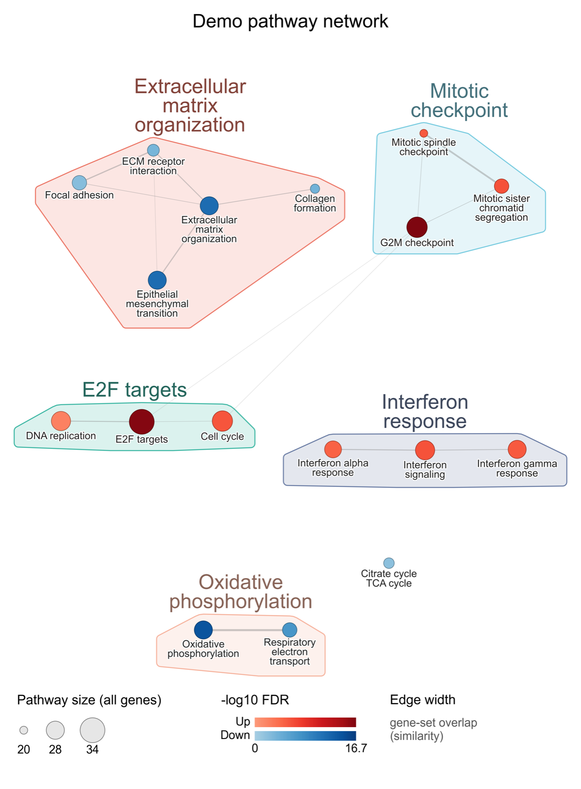

# SimpNetworkViz: pathway enrichment and network figures

[](https://github.com/helenhuangmath/SimpNetworkViz/actions/workflows/tests.yml)

[](https://github.com/helenhuangmath/SimpNetworkViz/blob/main/LICENSE)

## Introduction

SimpNetworkViz is an open-source Python package for pathway enrichment analysis and network visualization. It takes a gene list, an enrichment table or a list of pathways and draws **EnrichmentMap / AutoAnnotate-style network figures**, the Cytoscape look you see in many papers. You don't need to install Cytoscape or click through it by hand.

An enrichment analysis usually returns dozens to hundreds of significant pathways, and many of them are the same biology under different names. A clustered pathway network collapses those overlapping pathways into a handful of labeled themes. SimpNetworkViz draws that network from one command, and then draws a matching gene network so you can go from each theme to the genes behind it.

[](images/tutorial/demo_pathway_network.png)

*The pathway network from `snv demo`. Each node is a pathway, each edge joins two pathways that share genes, and each outline is a cluster with its automatic label.*

It comes in three forms:

* a command-line tool, `snv`
* a Python API, `import simpnetworkviz as snv`
* an optional point-and-click web app, `snv gui`

## Install

SimpNetworkViz needs Python 3.9 or newer. Install it from GitHub with pip:

```bash
pip install git+https://github.com/helenhuangmath/SimpNetworkViz
```

Then check the install with the offline demo:

```bash
snv --version
snv demo
```

See [Install SimpNetworkViz](install.md) for the requirements, the editable install and the optional web app.

## Usage

Example for a gene list, or a differential expression table with a log2FC column:

```bash
snv run degs.csv --library MSigDB_Hallmark_2020 --background measured_genes.txt
```

Example for an enrichment table you already have (Enrichr, clusterProfiler, g:Profiler, GSEA):

```bash
snv run --enrichment clusterProfiler_enrichGO.csv --gmt c5.go.bp.v2024.1.Hs.symbols.gmt
```

Example for a list of pathway names:

```bash
snv run --pathways my_pathways.txt --library Reactome_2022 --gene-network cnet
```

These are the subcommands:

| Subcommand | Description |
|---|---|
| [`run`](commands/run.md) | Main workflow: gene list, enrichment table or pathway list in; pathway and gene networks out. |
| [`enrich`](commands/enrich.md) | Run only the enrichment test and write the table. |
| [`demo`](commands/demo.md) | Run the full workflow on the bundled demo data, offline. |
| [`libraries`](commands/libraries.md) | List popular gene-set libraries. |
| [`gui`](commands/gui.md) | Start the point-and-click web app. |

New users should start with the [tutorial](tutorial/index.md). The [detailed user guide](user-guide.md) covers comparisons, ranked enrichment, single-cell markers, and interactive pathway maps.

## Contribute

Questions, bug reports and pull requests are welcome. See [Contributing](contributing.md).

## Citation

There is no paper for SimpNetworkViz yet. If you use it, please cite the repository and state the version you used:

> Huang H. SimpNetworkViz: pathway enrichment and EnrichmentMap-style network figures in Python. <https://github.com/helenhuangmath/SimpNetworkViz>

Please also cite the methods and resources it builds on, as they apply to your analysis:

* **EnrichmentMap:** Merico D. et al. *PLoS ONE* 5, e13984 (2010).
* **AutoAnnotate:** Kucera M. et al. *F1000Research* 5, 1717 (2016).
* **MCL clustering:** Enright A.J., Van Dongen S., Ouzounis C.A. *Nucleic Acids Res.* 30, 1575–1584 (2002).
* **Enrichr libraries:** Kuleshov M.V. et al. *Nucleic Acids Res.* 44, W90–W97 (2016).
* **STRING:** Szklarczyk D. et al. *Nucleic Acids Res.* 51, D638–D646 (2023).
* The gene-set collection you used (MSigDB, GO, Reactome, KEGG, …).

## Other useful links

* [Cytoscape](https://cytoscape.org/), with the [EnrichmentMap](https://apps.cytoscape.org/apps/enrichmentmap) and [AutoAnnotate](https://apps.cytoscape.org/apps/autoannotate) apps
* [Enrichr gene-set libraries](https://maayanlab.cloud/Enrichr/#libraries)
* [MSigDB gene-set downloads](https://www.gsea-msigdb.org/gsea/downloads.jsp)
* [STRING](https://string-db.org/)

```{toctree}
:maxdepth: 2
:hidden:

install
commands/index
fileformats
tutorial/index
method
qa
contributing
api
user-guide
```
