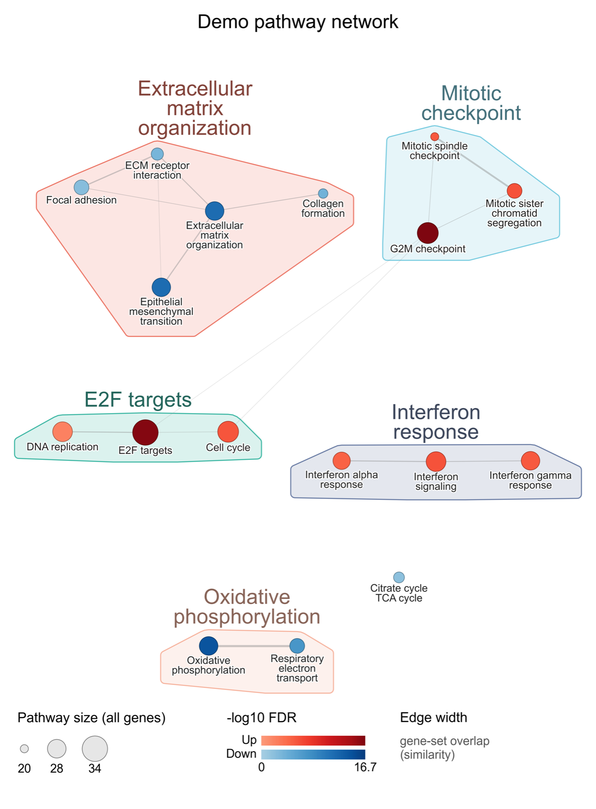
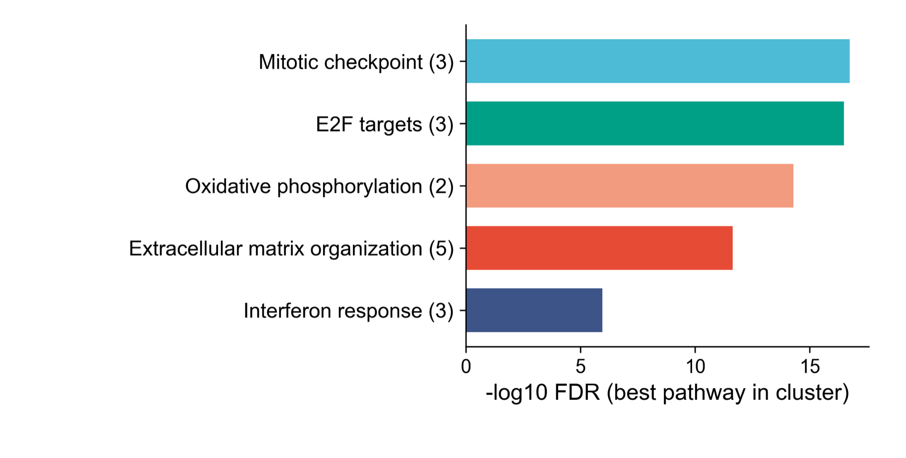
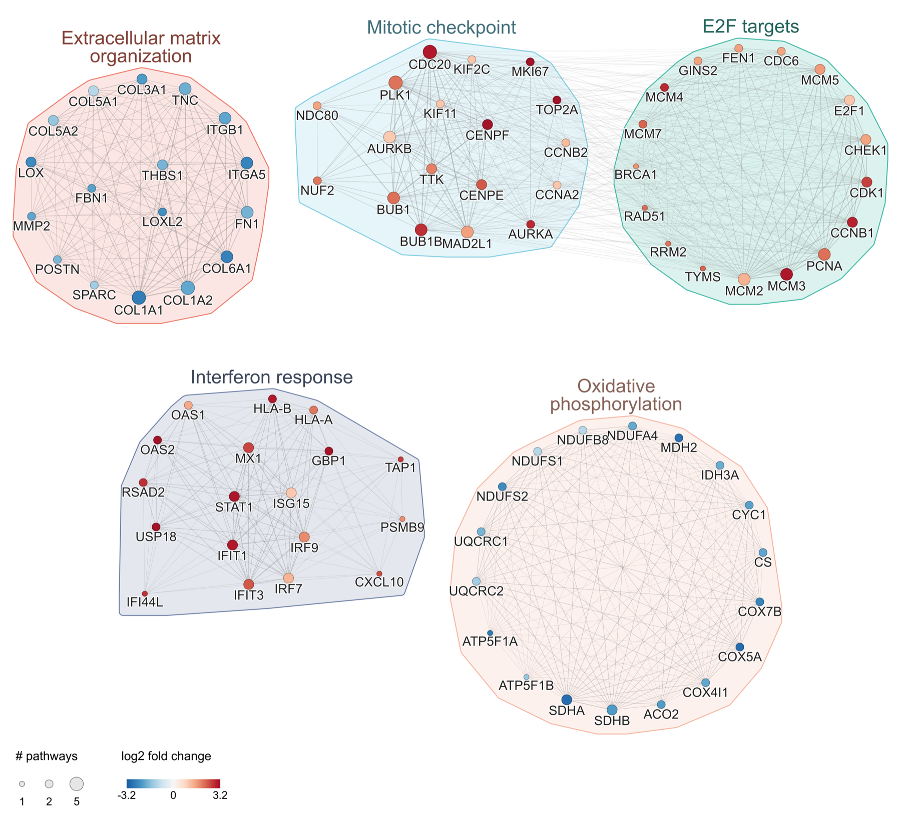
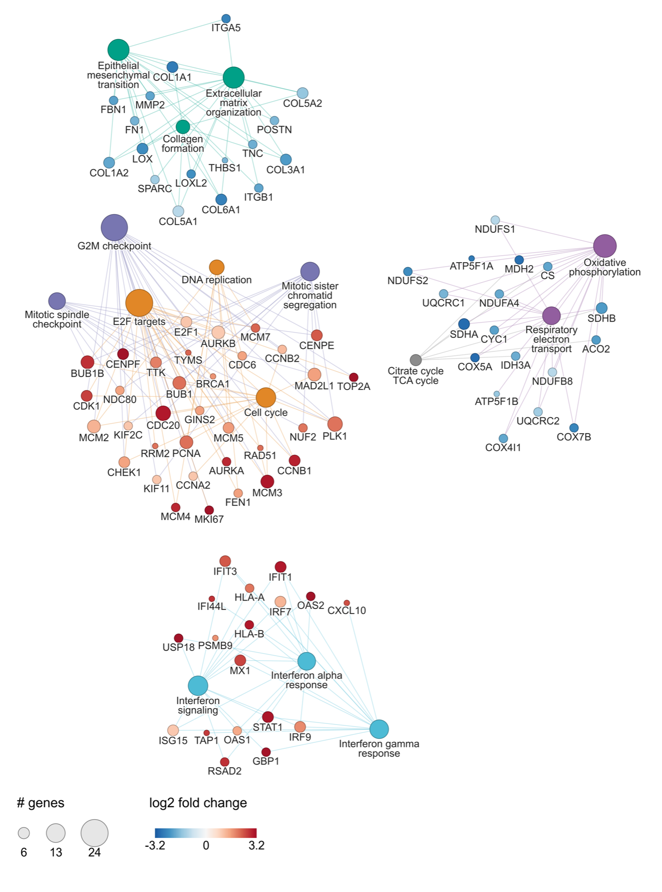

# Demo walkthrough

This tutorial runs the whole workflow once on the bundled demo data and goes through the output. It takes a few minutes and needs no input files and no internet.

The demo data are 88 genes with log2FC (53 up, 35 down) and 32 gene sets.

:::{warning}
The demo gene sets are shortened versions of real pathways, meant only for testing and demos. Do not draw biological conclusions from them.
:::

## Step 1: Run the demo

```bash
snv demo
```

The command prints a summary and writes everything to `demo_output/`:

```text
Pathway network: 17 pathways, 16 edges, 5 clusters
  [ 1] Extracellular matrix organization  (5 pathways)
  [ 2] Mitotic checkpoint  (3 pathways)
  [ 3] E2F targets  (3 pathways)
  [ 4] Interferon response  (3 pathways)
  [ 5] Oxidative phosphorylation  (2 pathways)
Gene network: 88 genes, 893 edges

Results written to .../demo_output/
```

:::{note}
Cluster 1 may be labeled "Epithelial mesenchymal transition" on your machine. Its two top pathways have the same FDR, and the tie can break either way. See [Why do two runs give slightly different figures?](../qa.md#why-do-two-runs-give-slightly-different-figures)
:::

## Step 2: Look at the enrichment table

Open `demo_output/enrichment.csv`. Because the demo genes have fold changes, up- and down-regulated genes were tested separately, and the `direction` column says which list each row comes from.

20 of the 32 gene sets overlap the genes, and 17 of those have FDR ≤ 0.05. The top rows:

| pathway | direction | overlap | set_size | fold_enrichment | fdr |
|---|---|---|---|---|---|
| HALLMARK_G2M_CHECKPOINT | up | 23 | 30 | 7.0 | 1.8e-17 |
| HALLMARK_E2F_TARGETS | up | 24 | 34 | 6.5 | 3.2e-17 |
| HALLMARK_OXIDATIVE_PHOSPHORYLATION | down | 18 | 28 | 8.9 | 5.2e-15 |
| HALLMARK_EPITHELIAL_MESENCHYMAL_TRANSITION | down | 16 | 28 | 7.9 | 2.3e-12 |
| REACTOME_EXTRACELLULAR_MATRIX_ORGANIZATION | down | 16 | 28 | 7.9 | 2.3e-12 |

Even in this small example the table is redundant: G2M checkpoint, E2F targets and cell cycle are largely the same genes. The network is there to sort that out. The columns are described in [File formats](../fileformats.md#enrichmentcsv).

## Step 3: Read the pathway network

Open `demo_output/pathway_network.png`.

[](../images/tutorial/demo_pathway_network.png)

How to read it:

* **Node:** one pathway. Its size is the gene-set size.
* **Node color:** red for pathways enriched among up-regulated genes, blue for down-regulated. A darker shade means a smaller FDR.
* **Edge:** the two pathways share genes. A thicker edge means more overlap.
* **Outline and large label:** one cluster of similar pathways, with a label made from its pathway names.
* **Node without an outline:** a pathway that shares too few genes with the others to join a cluster. Here that is the citrate cycle.

The 17 significant pathways collapse into five themes. Proliferation (mitotic checkpoint, E2F targets) and interferon response go up; extracellular matrix and oxidative phosphorylation go down.

The same themes are listed in `pathway_network_clusters.csv`, one row per cluster with its members, and ranked in `cluster_barplot.png`:

[](../images/tutorial/demo_cluster_barplot.png)

## Step 4: Read the gene networks

Open `demo_output/gene_network.png`.

[](../images/tutorial/demo_gene_network.png)

* **Node:** one of your genes. Its color is the log2FC, and its size is the number of pathways it belongs to.
* **Edge:** the two genes belong to the same pathway.
* **Outline:** the pathway cluster the gene belongs to most. The outline color and label are the same as in the pathway network, so you can go from a theme to its genes.

`gene_pathway_network.png` shows the same genes another way, as a gene–pathway ("cnet") plot. Each gene is linked to the pathways it belongs to, which shows the genes that bridge several pathways:

[](../images/tutorial/demo_gene_pathway_network.png)

## Step 5: Explore the interactive viewer

Open `demo_output/pathway_network.html` in a browser. You can drag nodes, search for a pathway, and click a node to see its genes. `gene_network.html` and `gene_pathway_network.html` work the same way.

The viewer loads the Cytoscape.js library from the internet. To make an HTML file that works offline, see [Q & A](../qa.md#how-do-i-make-the-html-viewer-work-offline).

## Step 6: Know the other files

| File | Use |
|---|---|
| `*.pdf` | Vector figures with editable text, for Illustrator or Inkscape |
| `*.cyjs`, `*_style.xml` | Cytoscape desktop; see [Fine-tune in Cytoscape](figures.md#fine-tune-in-cytoscape) |
| `*.graphml` | Other network tools |
| `*_nodes.csv`, `*_edges.csv` | The network as tables |

## Next

* Run it on your data: [Analyze your own data](your_data.md).
* Take control of each step: [Step-by-step in Python](python.md).
