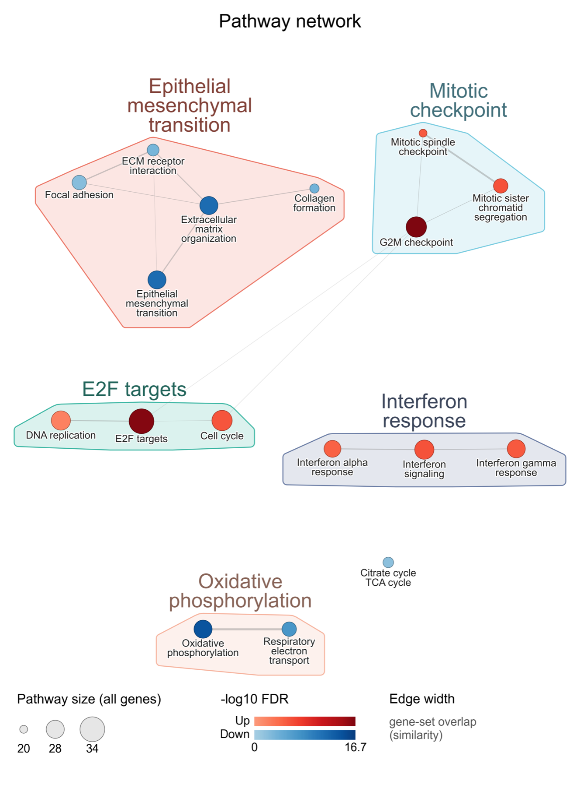
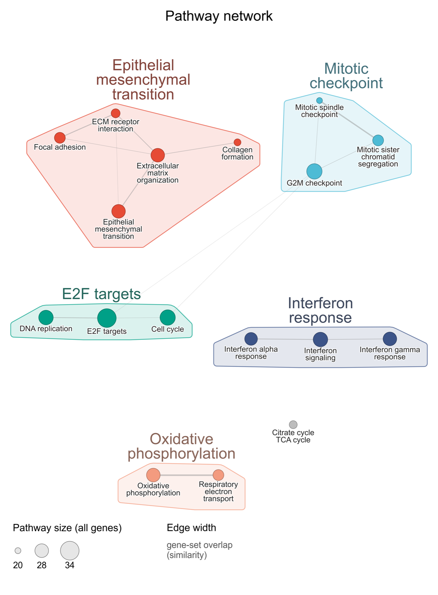
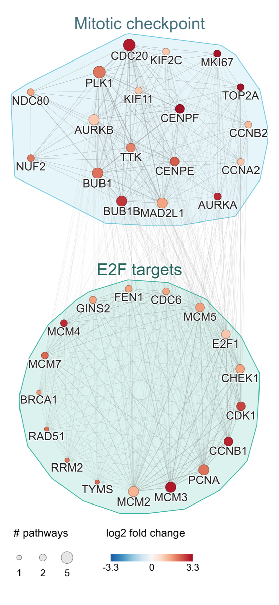
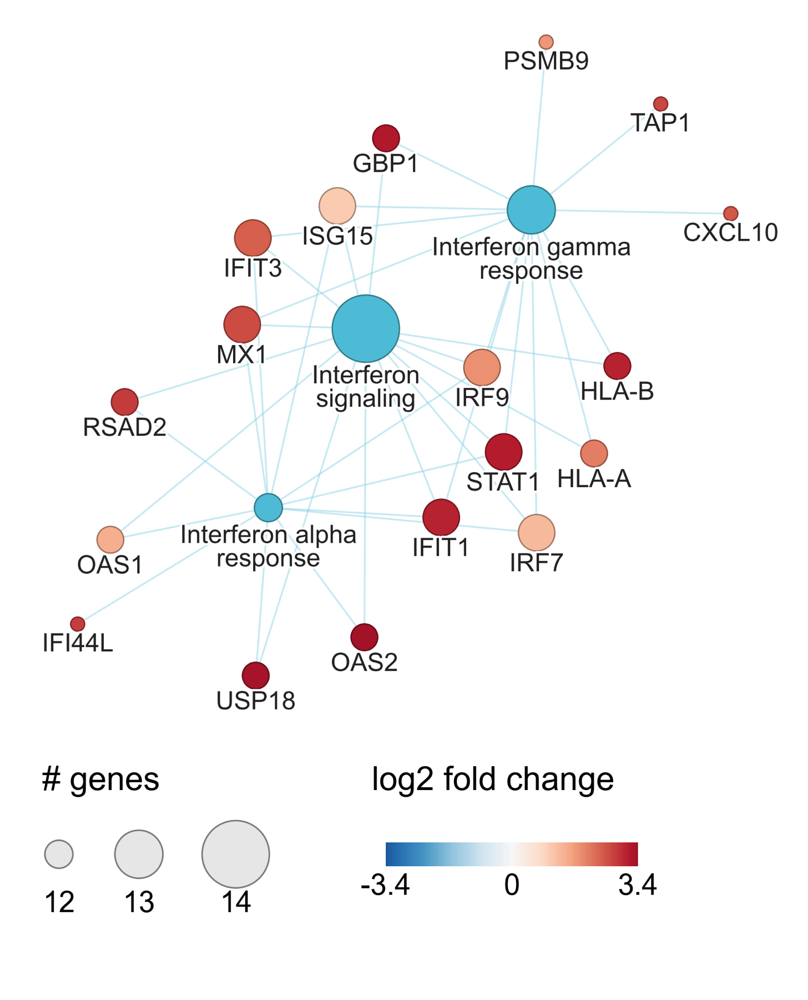

# Step-by-step in Python

`snv run` does six things in a row. This tutorial does each one as a separate Python call, so you can inspect the result of every step and change it before the next. It runs offline on the bundled demo data.

A shorter script with the same steps is in `examples/quickstart.py`.

```python
import simpnetworkviz as snv
```

## Step 1: Read the genes

```python
genes = snv.read_gene_list(snv.genesets.demo_path("demo_genes.tsv"))
len(genes)                 # 88
list(genes.items())[:3]    # [('MCM2', 1.34), ('MCM3', 3.12), ('MCM4', 2.91)]
```

`read_gene_list` returns a dictionary from gene to fold change. For a plain list with no fold changes, every value is `None`. You can also build the dictionary yourself, for example from a pandas data frame:

```python
genes = dict(zip(degs["gene"], degs["log2FoldChange"]))
```

## Step 2: Load the gene sets

```python
gene_sets = snv.load_gene_sets("demo")
len(gene_sets)             # 32
```

`load_gene_sets` takes `"demo"`, an Enrichr library name such as `"MSigDB_Hallmark_2020"`, the path of a `.gmt` file, or several of these joined with commas. It returns a dictionary from pathway name to its list of genes.

## Step 3: Run the enrichment test

```python
table = snv.analyze_genes(genes, gene_sets)
table[["pathway", "direction", "overlap", "set_size", "fdr"]].head()
```

```text
                                   pathway direction  overlap  set_size          fdr
                   HALLMARK_G2M_CHECKPOINT        up       23        30 1.828495e-17
                      HALLMARK_E2F_TARGETS        up       24        34 3.200497e-17
        HALLMARK_OXIDATIVE_PHOSPHORYLATION      down       18        28 5.150481e-15
HALLMARK_EPITHELIAL_MESENCHYMAL_TRANSITION      down       16        28 2.281712e-12
REACTOME_EXTRACELLULAR_MATRIX_ORGANIZATION      down       16        28 2.281712e-12
```

`table` is a pandas data frame, so you can filter or edit it before drawing. Options:

* `background=` takes the list of measured genes. Pass it for real data.
* `split_updown=False` tests all genes together.
* `min_size=` and `max_size=` limit the gene-set sizes tested.

If you already have results from another tool, skip this step and read them instead:

```python
table = snv.read_enrichment("clusterProfiler_enrichGO.csv")
```

## Step 4: Build the pathway network

```python
pnet = snv.build_pathway_network(table, gene_sets, fdr_cutoff=0.05, similarity_cutoff=0.3)
pnet.graph.number_of_nodes(), pnet.graph.number_of_edges()    # (17, 16)
pnet.cluster_table()[["cluster", "label", "n_nodes"]]
```

```text
 cluster                             label  n_nodes
       1 Epithelial mesenchymal transition        5
       2                Mitotic checkpoint        3
       3                       E2F targets        3
       4               Interferon response        3
       5         Oxidative phosphorylation        2
```

This one call filters the pathways, computes gene-set similarity, clusters the network, labels the clusters and lays them out. The main arguments:

| Argument | Default | Meaning |
|---|---|---|
| `fdr_cutoff` | 0.05 | Keep pathways at or below this FDR |
| `max_pathways` | 100 | Keep at most this many |
| `similarity_metric` | `"combined"` | `"combined"`, `"jaccard"` or `"overlap"` |
| `similarity_cutoff` | 0.375 | Draw an edge at or above this similarity |
| `cluster_method` | `"mcl"` | `"mcl"`, `"louvain"`, `"components"` or `"none"` |
| `min_cluster_size` | 2 | Smaller groups are left as single nodes |
| `cluster_labels` | `None` | Your own labels, as `{cluster number: text}` |

The result is a `Network` object. Its parts:

```python
pnet.graph              # the networkx graph
pnet.groups             # pathway -> cluster number (0 = no cluster)
pnet.group_labels       # cluster number -> label
pnet.node_table()       # pandas tables
pnet.edge_table()
pnet.cluster_table()
```

:::{note}
Cluster 1 may be labeled "Extracellular matrix organization" on your machine, because its two top pathways tie on FDR. See [Why do two runs give slightly different figures?](../qa.md#why-do-two-runs-give-slightly-different-figures)
:::

## Step 5: Plot and export the pathway network

```python
pnet.plot("pathway_network.pdf", title="Pathway network")
pnet.plot("pathway_network_by_cluster.png", color_by="cluster", title="Pathway network")
```

The file extension sets the format. `color_by="direction"` is the red/blue look, and `color_by="cluster"` gives one color per theme:

| `color_by="direction"` (the default here) | `color_by="cluster"` |
|---|---|
| [](../images/tutorial/py_pathway_network.png) | [](../images/tutorial/py_pathway_network_by_cluster.png) |

Export the other formats:

```python
pnet.to_html("pathway_network.html")          # interactive viewer
pnet.to_cytoscape("pathway_network.cyjs")     # also writes pathway_network_style.xml
pnet.to_graphml("pathway_network.graphml")
snv.plot_cluster_barplot(pnet, "cluster_barplot.png")
```

Or write everything at once, as the command line does:

```python
pnet.save("out", prefix="pathway_network", formats=("png", "pdf", "html", "cyjs", "graphml", "csv"))
```

### Rename a cluster

The automatic labels come from the pathway names. Change any of them and plot again:

```python
pnet.group_labels[1] = "ECM remodelling"
pnet.plot("pathway_network_renamed.png", color_by="cluster")
```

## Step 6: Build the gene networks

A gene network is built from the pathway network, so it knows the clusters. Use all clusters, or pick some with `clusters=`:

```python
gnet = snv.build_gene_network(pnet, gene_sets, mode="shared", clusters=[2, 3], gene_values=genes)
gnet.graph.number_of_nodes(), gnet.graph.number_of_edges()    # (35, 470)
gnet.plot("gene_network.pdf")
```

[](../images/tutorial/py_gene_network_2_3.png)

Each gene sits in the cluster it belongs to most, under the same color and label as in the pathway figure. `gene_values=genes` colors the nodes by fold change.

The three modes:

| `mode` | Edges | Needs internet |
|---|---|---|
| `"shared"` | Two genes belong to the same pathway | No |
| `"string"` | Protein–protein interactions from STRING | Yes |
| `"cnet"` | A gene belongs to a pathway (gene–pathway plot) | No |

A gene–pathway plot for the interferon cluster alone:

```python
cnet = snv.build_gene_network(pnet, gene_sets, mode="cnet", clusters=[4], gene_values=genes)
cnet.graph.number_of_nodes(), cnet.graph.number_of_edges()    # (21, 39)
cnet.plot("gene_pathway_network.pdf")
```

[](../images/tutorial/py_cnet_4.png)

For STRING, set the species with `string_species=`: 9606 for human, 10090 for mouse.

To put the pathway network and a gene network side by side in one two-panel figure:

```python
snv.plot_pathway_gene_network(pnet, gnet, "pathway_gene_network.pdf")
```

## All steps in one call

`run_pipeline` does steps 3 to 6 and writes every file, exactly as `snv run` does:

```python
res = snv.run_pipeline(genes=genes, gene_sets="demo", outdir="snv_output", similarity_cutoff=0.3)
sorted(res)
# ['enrichment', 'files', 'gene_network', 'gene_pathway_network', 'pathway_network']
```

It returns the enrichment table and the `Network` objects, so you can keep working with them. To start from a table or a pathway list, pass `enrichment=` or `pathways=` in place of `genes=`.

## Many comparisons at once

```python
contrasts = {"day3": "degs_day3.csv", "day7": "degs_day7.csv"}
background = list(snv.read_gene_list("measured_genes.txt"))
gene_sets = snv.load_gene_sets("GO_Biological_Process_2023")     # load once

for name, path in contrasts.items():
    snv.run_pipeline(genes=snv.read_gene_list(path), gene_sets=gene_sets,
                     background=background, outdir=f"networks/{name}", title=name)
```

The full list of functions and arguments is in the [API reference](../api.md).
