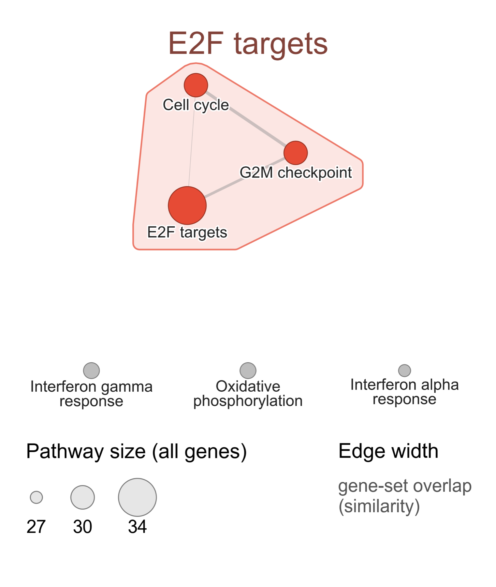
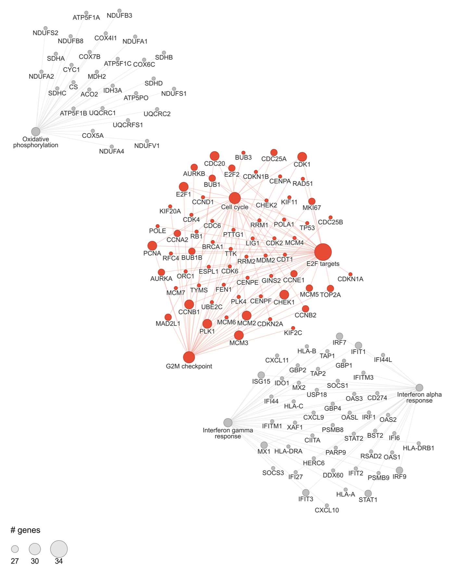

# Analyze your own data

`snv run` has three starting points. Pick the one that matches what you have.

| You have | Go to |
|---|---|
| A gene list or a differential expression table | [Start from a gene list](#start-from-a-gene-list) |
| Enrichment results from another tool | [Start from an enrichment table](#start-from-an-enrichment-table) |
| A set of pathways you want to draw | [Start from a pathway list](#start-from-a-pathway-list) |

## Start from a gene list

### Step 1: Prepare the gene list

Make a file with your differentially expressed genes. Keep the fold change if you have it:

```text
gene,log2FoldChange
MKI67,2.8
TOP2A,3.1
COL1A1,-2.4
```

SimpNetworkViz treats every gene in the file as a hit, so filter your results table first. For example, with a DESeq2 result saved as `deseq2_results.csv`, in Python:

```python
import pandas as pd

res = pd.read_csv("deseq2_results.csv", index_col=0)
res = res.dropna(subset=["padj"])                       # genes that were tested
res.index.to_series().to_csv("measured_genes.txt", index=False, header=False)

degs = res[(res["padj"] < 0.05) & (res["log2FoldChange"].abs() > 1)]
degs[["log2FoldChange"]].to_csv("degs.csv", index_label="gene")
```

This writes two files: `degs.csv`, the hits, and `measured_genes.txt`, the background.

### Step 2: Prepare the background

The background is every gene that could have been a hit. For RNA-seq that is the genes that were expressed and tested, not the whole genome. The script above saves it as `measured_genes.txt`.

:::{important}
Without `--background`, the universe is every gene in the gene-set library. That usually makes the p-values too small, because genes that are not expressed in your cells could never have been hits.
:::

### Step 3: Choose gene sets

List some common libraries:

```bash
snv libraries
```

Good starting points are `MSigDB_Hallmark_2020` for a small, non-redundant overview and `GO_Biological_Process_2023` or `Reactome_2022` for detail. For mouse gene symbols, human libraries still match because symbols are compared without regard to case, but genes without a one-to-one human ortholog of the same name are lost. A mouse library such as `KEGG_2019_Mouse`, or a mouse GMT file, avoids that.

### Step 4: Run

```bash
snv run degs.csv --library GO_Biological_Process_2023 --background measured_genes.txt -o go_bp
```

The library is downloaded once and cached. The output folder has the same files as in the [demo walkthrough](demo.md).

### Step 5: Tune the network

Look at the summary the command prints, and at `pathway_network.png`. Then adjust:

| What you see | What to change |
|---|---|
| No pathways, or very few | Check the gene symbols and the species of the library. Then try `--fdr 0.1`. |
| Too many pathways to read | `--max-pathways 50`, or a stricter `--fdr 0.01` |
| Mostly single, unconnected nodes | Lower `--cutoff`, for example `--cutoff 0.3` |
| One giant cluster | Raise `--cutoff`, for example `--cutoff 0.5` |
| The red/blue coloring is not what you want | `--color-by cluster` gives one color per theme |

Each run overwrites the files in the output folder, so use a new `-o` folder to keep both versions.

## Start from an enrichment table

Use this when you have already run Enrichr, clusterProfiler, g:Profiler or GSEA and want the network for those results.

### Step 1: Export the table

Save the result as CSV or TSV, with the column names the tool gives it. For clusterProfiler in R:

```r
ego <- enrichGO(gene = degs, OrgDb = org.Hs.eg.db, keyType = "SYMBOL", ont = "BP")
write.csv(as.data.frame(ego), "clusterProfiler_enrichGO.csv", row.names = FALSE)
```

The recognized columns are listed in [File formats](../fileformats.md#enrichment-table).

### Step 2: Run

Pass the table, and the gene sets it was computed from:

```bash
snv run --enrichment clusterProfiler_enrichGO.csv --gmt c5.go.bp.v2024.1.Hs.symbols.gmt -o go_bp
```

No test is run. The FDR values in the table are used as they are, and `--fdr` and `--max-pathways` still choose which pathways are drawn.

The gene sets are used to measure how much two pathways overlap. If you leave them out, the overlap is computed from the genes listed in the table, which are only your hits in each pathway. That works, but it is not what EnrichmentMap does, and it is not possible for GSEA tables, which list no genes.

### Step 3: Color the gene network

To color gene nodes by fold change, pass the gene list too:

```bash
snv run degs.csv --enrichment clusterProfiler_enrichGO.csv --gmt c5.go.bp.v2024.1.Hs.symbols.gmt
```

For a GSEA table, `--color-by nes` colors the pathways by normalized enrichment score.

## Start from a pathway list

Use this to draw a chosen set of pathways, for example the ones you discuss in a paper.

### Step 1: Write the list

One pathway name per line. Matching ignores case and punctuation:

```text
G2M checkpoint
E2F targets
KEGG cell cycle
Interferon gamma response
Interferon alpha response
Oxidative phosphorylation
```

### Step 2: Run

This example uses the bundled demo gene sets, so you can try it as it is. Save the list above as `my_pathways.txt`:

```bash
snv run --pathways my_pathways.txt --library demo --gene-network cnet --cutoff 0.3 -o my_pathways
```

```text
Pathway network: 6 pathways, 3 edges, 1 clusters
  [ 1] E2F targets  (3 pathways)
Gene network: 145 genes, 177 edges
```

All six pathways are drawn. There is no enrichment test, so there is no FDR, no red/blue coloring and no FDR cutoff. Three of the pathways overlap enough to form a cluster, and the other three stay single nodes:

[](../images/tutorial/pathways_network.png)

With `--gene-network cnet`, the gene network is a gene–pathway plot, saved as `gene_network.png`. Because no gene list was given, it shows the full gene sets:

[](../images/tutorial/pathways_cnet.png)

### Step 3: Restrict to your genes

Pass a gene list as well to draw only your genes in those pathways, colored by fold change:

```bash
snv run degs.csv --pathways my_pathways.txt --library Reactome_2022 --gene-network cnet
```

## Many comparisons at once

To draw the same figure for every contrast in a study, loop over the files in the shell:

```bash
for f in degs/*.csv; do
    name=$(basename "$f" .csv)
    snv run "$f" --library GO_Biological_Process_2023 --background measured_genes.txt -o "networks/$name"
done
```

The same settings and the same look are applied to every contrast.
