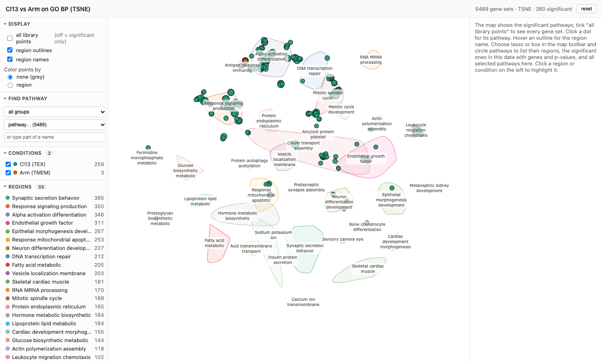

# The whole-library view and the pathway map

## The whole-library view

`--whole-library` draws **every pathway of the library** as a node, clusters the library itself, and highlights the pathways enriched in your data; the rest are grey, and clusters without any enriched pathway get a grey outline. This shows which part of the pathway landscape your genes, or each single-cell cluster, fall into, and makes figures from different experiments directly comparable because the layout describes the library, not the hits.

```bash
snv run degs.csv --library MSigDB_Hallmark_2020 --whole-library
snv markers markers.csv --library KEGG_2021_Human --whole-library
```

Libraries with more than 400 gene sets are trimmed to the enriched pathways plus the largest others; GO is too large to draw whole as a network. For large libraries use the pathway map below instead.


## The pathway map: a fixed coordinate system for a whole library

`snv map` embeds every gene set of a library in two dimensions (UMAP, or t-SNE when `umap-learn` is not installed) from gene-set similarity, divides the map into labelled regions, and saves it as a CSV. Every later analysis can be drawn on that same map, so results from different experiments, conditions or cell clusters are directly comparable: the enriched pathways are colored points (or pies, for comparisons) on a grey background of the whole library, and `pathway_map_regions.csv` counts how many hits fall into each region.

```bash
pip install "simpnetworkviz[map]"                                   # umap-learn + scikit-learn, once
snv map --gmt m5.go.bp.v2025.1.Mm.symbols.gmt -o gobp_map.csv       # once per library (writes gobp_map.pdf too)
snv run genes.txt --gmt m5.go.bp.v2025.1.Mm.symbols.gmt --map gobp_map.csv
snv compare KO=ko.csv WT=wt.csv --gmt m5.go.bp.v2025.1.Mm.symbols.gmt --map gobp_map.csv
```

Each run adds `pathway_map.pdf`, `pathway_map.html` (interactive, see below), `pathway_map_hits.csv` (every enriched pathway with its coordinates and region) and `pathway_map_regions.csv` (hits per region and condition). The map is built once and reused; keep the CSV with the library it was built from. `--method tsne|umap`, `--neighbors` and `--resolution` (more or fewer regions) tune the map. Region names are drawn on a translucent white backing, wrapped to two or three lines, and nudged apart when they would overlap; the `label_top` most significant hits get a boxed label with a thin leader line to their point (`label_top=0` turns these off). The regions do not depend on the embedding (they are Louvain communities in the 50-dimensional similarity space), so t-SNE and UMAP maps of the same library share their region labels and counts; UMAP keeps related regions closer together and leaves more white space, t-SNE spreads the regions more evenly (compare the two in the gallery, [Gallery of outputs](../gallery.md)). Both maps of the example are included under `examples/Cl13_vs_Arm`. In Python: `build_pathway_map`, `save_map`, `load_map`, `plot_pathway_map`, `map_hits`, `region_summary`.


## One map per MSigDB collection

MSigDB bundles its collections in one file (`msigdb.v2025.1.Hs.symbols.gmt`, or the mouse `msigdb.v2025.1.Mm.symbols.gmt`) and prefixes every set with its collection (`HALLMARK_`, `GOBP_`, `GOCC_`, `GOMF_`, `KEGG_`, `REACTOME_`, `WP_`, `PID_`, `BIOCARTA_`, `HP_` ...). `snv map --by-category` splits a library by these prefixes and builds a separate t-SNE **and** UMAP map for every collection, so Hallmark, GO BP, GO CC, GO MF, KEGG, Reactome and WikiPathways each get their own coordinate system instead of being mixed into one picture:

```bash
snv map --gmt msigdb.v2025.1.Mm.symbols.gmt --by-category -o msigdb_maps          # t-SNE + UMAP per collection
snv map --gmt msigdb.v2025.1.Mm.symbols.gmt --by-category --method umap -o msigdb_maps
snv map --gmt mh.all.v2025.1.Mm.symbols.gmt --gmt m5.go.bp.v2025.1.Mm.symbols.gmt --by-category -o maps   # one category per file
snv run genes.txt --gmt msigdb.v2025.1.Mm.symbols.gmt --map msigdb_maps/go_biological_process_map_umap.csv
```

The output folder holds `<collection>_map_tsne.csv` / `_umap.csv` (each reusable with `--map`), a PDF of each, an index `category_maps.csv` (collection, method, number of sets and regions) and an overview `category_maps.pdf` with one panel per collection and method. When several `--gmt` files are given, each file is a category named after the file (`m5.go.bp.v2025.1.Mm.symbols.gmt` → `m5.go.bp`); `--categories FILE` (pathway, category per line) defines any other grouping. Collections with fewer than `--min-sets` (20) sets inside the size limits are skipped, and the t-SNE and UMAP maps of one collection share their regions and labels. In Python: `split_by_category`, `build_category_maps`, `save_category_maps`, `plot_category_maps`. For a map built from several databases at once, `plot_pathway_map(pmap, table, color_by_category=True)` colors the points by database. Ready-made maps of the MSigDB collections (Hallmark, GO, KEGG, Reactome, WikiPathways, C7 ...) and an overall GO + KEGG + Reactome + WikiPathways map are in `examples/msigdb_maps`.


## The interactive map

`pathway_map.html` (also written by `snv map` next to the CSV, and by `write_map_html` in Python) opens in any browser as a three-pane explorer in the style of cellxgene: a left sidebar with collapsible panels (display options, pathway search, conditions, collections, regions, each row with its color, count and a show/hide or highlight control), the map in the middle, and a detail panel on the right. Clicking a dot shows that pathway's set size, region, collection and, when it is significant in this data, the condition, FDR, p-value, overlap and genes; clicking a region or condition in the sidebar or on the map rings its members, zooms to them and lists their statistics. With results loaded the map shows only the significant pathways over the region outlines; the "all library points" box adds every gene set as a grey dot, and a menu colors those dots by region, or by source database for a map built from several collections. In every detail view the significant pathways come first and the non-significant ones sit in a collapsed, expandable list. Region outlines are colored, and the enriched pathways are larger points colored by condition. Dragging pans and scrolling zooms; the toolbar's lasso and box tools select. Hovering a point shows the pathway name, its region, set size and, for enriched pathways, the condition, FDR and overlapping genes; hovering a region outline shows the region's name and size. Drag to lasso (or box-select from the toolbar) any group of pathways, "circling" them, and the side panel lists the regions they belong to with counts, then every selected pathway that is significant in this data with its condition, FDR, p-value, overlap and the overlapping genes (expandable; a button copies the table as TSV), then the other selected pathways. To find a pathway, pick a group (a region, a collection, or the pathways significant in one condition) and a pathway from the two dropdowns, or type part of a name in the box, which autocompletes and also accepts free text; a single match shows its statistics and genes in the panel, several matches are listed and ringed on the map. Check boxes toggle region outlines, region names and the library points; the camera button saves a PNG; a reset button (top bar and panel) clears the selection, highlights, search and zoom. The outlines are smooth curves (Chaikin-rounded convex hulls) around the dense core of each region, since regions are defined in similarity space and a few members sit elsewhere on the map. Only plotly.js is loaded from a CDN; everything else is in the file.

[](../../docs/images/pathway_map_html.png)

A live example is the [interactive Cl13 vs Arm map](https://helenhuangmath.github.io/SimpNetworkViz/examples/cl13-vs-arm.html).
