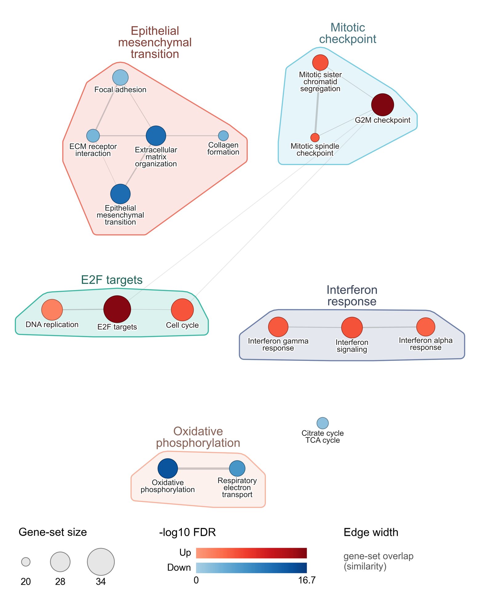
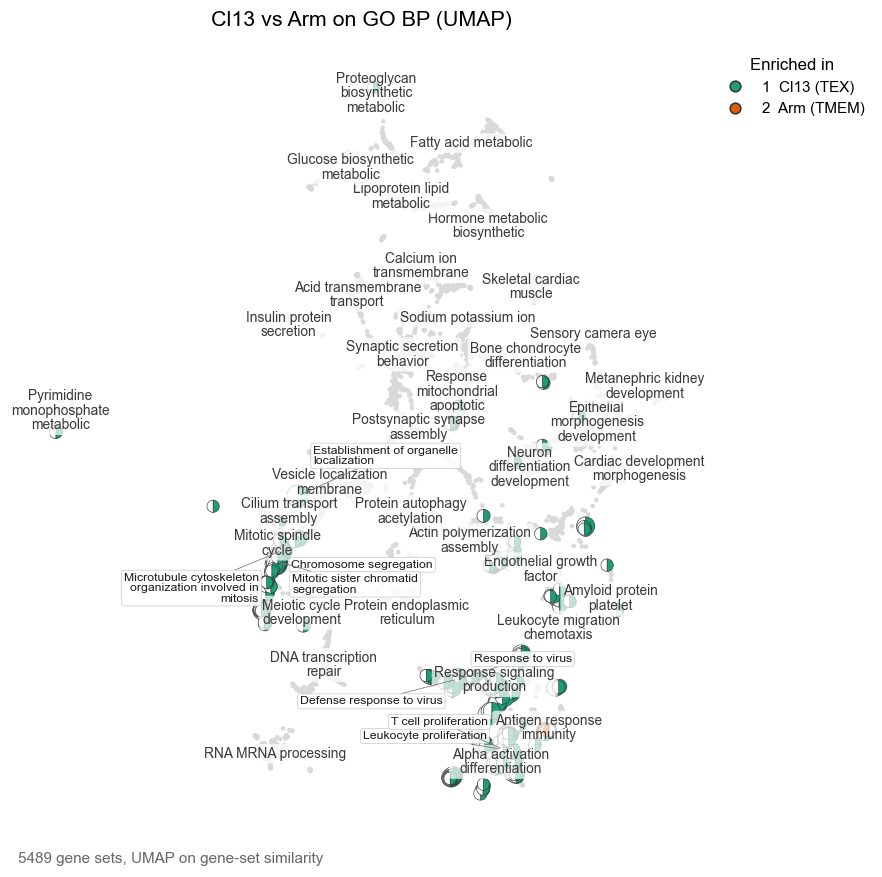

# SimpNetworkViz: pathway enrichment and network visualization

[](https://github.com/helenhuangmath/SimpNetworkViz/actions/workflows/tests.yml)

[](https://github.com/helenhuangmath/SimpNetworkViz/blob/main/LICENSE)
[](https://github.com/helenhuangmath/SimpNetworkViz/releases/tag/V1.0)

## Introduction

SimpNetworkViz is an open-source Python package that turns gene lists, ranked scores or existing enrichment results into annotated pathway and gene networks, the EnrichmentMap / AutoAnnotate figures usually made by hand in Cytoscape. It also compares several conditions in one network and places their hits on a map of an entire gene-set library.

Pathway enrichment analysis typically yields tens to hundreds of overlapping gene sets. An enrichment map connects the gene sets that share genes and groups related sets into labeled clusters, so the result can be read as a handful of themes. SimpNetworkViz makes that figure from a gene list in a single command:

* It runs over-representation analysis or preranked GSEA, or reads an enrichment table from another tool.
* It builds the gene-set similarity network, finds and labels clusters by Markov clustering, and computes a layout without overlaps.
* It draws a matching gene network whose modules carry the same labels and colors.
* It compares several conditions, including the marker genes of single-cell clusters, in one network through pie-chart nodes.
* It renders an entire gene-set library as a fixed 2-D map with the enriched sets highlighted.
* It writes vector figures (PDF, SVG), interactive HTML viewers, tables and Cytoscape files.

| Pathway network | Pathway map |
|---|---|
| [](../docs/images/pathway_network.png) | [](../docs/images/pathway_map_umap.png) |
| Each node is a pathway and each outline a labeled cluster of related pathways (`snv demo`). | The hits of a Cl13 vs Arm comparison on a map of all mouse GO biological process terms. |

Explore a result yourself in the [interactive Cl13 vs Arm map](https://helenhuangmath.github.io/SimpNetworkViz/examples/cl13-vs-arm.html), and see more figures in the [gallery](gallery.md).

## Quick start

Install from GitHub and run the bundled demo. It generates an enrichment table, network figures and an interactive HTML viewer.

```bash
git clone https://github.com/helenhuangmath/SimpNetworkViz.git
cd SimpNetworkViz
python -m pip install -e .
snv demo
```

See [Install SimpNetworkViz](install.md) for the requirements and the optional extras.

## Usage

Example for a differential expression table with a log2 fold-change column:

```bash
snv run degs.csv --library MSigDB_Hallmark_2020 --background measured.txt -o results
```

Example for preranked GSEA on all measured genes:

```bash
snv run deseq2_all_genes.csv --method gsea --library MSigDB_Hallmark_2020 --fdr 0.25
```

Example for comparing several conditions in one network:

```bash
snv compare KO=ko_degs.csv WT=wt_degs.csv Day7=day7_degs.csv --library Reactome_2022
```

Example for single-cell marker genes:

```bash
snv markers markers.csv --library MSigDB_Hallmark_2020 --whole-library
```

Example for mouse genes on a fixed map of all GO biological process terms:

```bash
snv map --msigdb GO_BP --species mouse -o gobp_map.csv
snv run degs.csv --msigdb GO_BP --species mouse --map gobp_map.csv
```

These are the subcommands:

| Subcommand | Description |
|---|---|
| [`run`](commands/run.md) | Gene list, ranked table, enrichment table or pathway list in; pathway and gene networks out. |
| [`compare`](commands/compare.md) | Several conditions in one network, with pie-chart nodes. |
| [`markers`](commands/markers.md) | Single-cell marker table in; one pie slice per cell cluster. |
| [`map`](commands/map.md) | Build a fixed 2-D map of a whole gene-set library, to reuse with `--map`. |
| [`enrich`](commands/enrich.md) | Run only the enrichment test and write the table. |
| [`demo`](commands/demo.md) | Run the full workflow on the bundled demo data, offline. |
| [`libraries`](commands/libraries.md) | List the MSigDB collections and common Enrichr libraries. |
| [`gui`](commands/gui.md) | Start the point-and-click app. |

## Tutorials

| Tutorial | What you learn |
|---|---|
| [Demo walkthrough](tutorial/demo.md) | What one run produces and how to read each figure and table. Runs offline in a minute. |
| [Comparing gene groups of two conditions: Cl13 vs Arm](tutorial/cl13_vs_arm.md) | A real comparison of exhausted and memory CD8 T cells: gene groups from a wide table, pie-chart networks, the pathway map and the result tables. |

The [standard workflow](workflow.md) explains the usual single-list analysis step by step.

## Contribute

Questions, bug reports and pull requests are welcome. Open an [issue](https://github.com/helenhuangmath/SimpNetworkViz/issues) on GitHub. For a bug, include the command you ran, the output of `snv --version`, and a small input file that reproduces it if you can share one.

## Author

Hua Huang

## Citation

There is no paper for SimpNetworkViz yet. If you use it, please cite the repository and state the version you used:

> Huang H. SimpNetworkViz: pathway enrichment and EnrichmentMap-style network figures from a gene list. <https://github.com/helenhuangmath/SimpNetworkViz>

Please also cite the methods it builds on, listed in [Theory behind SimpNetworkViz](theory.md#references), and the gene-set collection you used.

## Other useful links

* [Cytoscape](https://cytoscape.org/), with the [EnrichmentMap](https://apps.cytoscape.org/apps/enrichmentmap) and [AutoAnnotate](https://apps.cytoscape.org/apps/autoannotate) apps
* [MSigDB gene-set collections](https://www.gsea-msigdb.org/gsea/msigdb/)
* [Enrichr gene-set libraries](https://maayanlab.cloud/Enrichr/#libraries)
* [STRING](https://string-db.org/)

```{toctree}
:maxdepth: 2
:hidden:

install
workflow
commands/index
fileformats
tutorial/index
guide/index
gallery
theory
qa
api
```
