# Comparing gene groups of two conditions: Cl13 vs Arm

This tutorial walks through a real comparison with SimpNetworkViz: six gene subgroups from exhausted CD8 T cells (chronic LCMV clone 13 infection, `TEX_G1`–`TEX_G6`) against six subgroups from memory CD8 T cells (acute LCMV Armstrong infection, `TMEM_G1`–`TMEM_G6`). It shows how to load gene groups from a wide table, which comparisons to run, how to read the pie-chart networks, and what the result tables contain. Every figure is a PDF with editable text.

The data, scripts and figures of this tutorial are in [`examples/Cl13_vs_Arm`](https://github.com/helenhuangmath/SimpNetworkViz/tree/main/examples/Cl13_vs_Arm) in the repository. Click a figure to see it at full size; the link above each figure opens the PDF.

:::{tip}
To explore the result before reading, open the [interactive Cl13 vs Arm map](https://helenhuangmath.github.io/SimpNetworkViz/examples/cl13-vs-arm.html).
:::

## Step 1: Get the data and the gene sets

**Gene groups.** Two CSV files in `data/`, one per condition, with one column per subgroup (header = group name, mouse symbols, columns of different length):

| File | Groups | Genes per group |
|---|---|---|
| `data/Cl13_groups.csv` | TEX_G1 … TEX_G6 | 308, 146, 114, 78, 65, 46 |
| `data/Arm_groups.csv` | TMEM_G1 … TMEM_G6 | 225, 102, 71, 33, 33, 19 |

```
TEX_G1,TEX_G2,TEX_G3,TEX_G4,TEX_G5,TEX_G6
Ccl5,Rnf213,Adam19,Plek,Chsy1,Tox
Prex1,Arl6ip1,Bcl2,Sh2d2a,Nsmaf,Tnfaip3
...
```

This wide layout is read by `snv.read_gene_groups()` or `snv compare --groups FILE`.

**Gene sets.** Because the symbols are mouse, mouse gene-set collections from MSigDB are used rather than the human Enrichr libraries:

* `genesets/mh.all.v2025.1.Mm.symbols.gmt`: the 50 mouse Hallmark sets (bundled here).
* `m5.go.bp.v2025.1.Mm.symbols.gmt`: 7,855 GO Biological Process sets, restricted to sets of 10–500 genes. `run_comparison.py` fetches it once with `snv.fetch_msigdb("GO_BP", species="mouse")` (cached under `~/.cache/simpnetworkviz/msigdb`); on the command line the equivalent is `--msigdb GO_BP --species mouse`. A local copy can be passed with `--gobp`.

Hallmark gives a compact overview that can be drawn as a whole library; GO BP gives the detailed network.

**Background.** No list of measured genes was available, so the universe of each test is the set of genes in the library. With your own data, pass the measured genes (`background=` / `--background`) so the statistics are not inflated.

## Step 2: Run the comparison

```bash
pip install -e .                                   # from the repository root
python examples/Cl13_vs_Arm/run_comparison.py            # --species mouse is the default; downloads mouse GO BP once
```

`run_comparison.py` performs three sets of analyses and writes them under `results/` (not kept in git; the key PDFs are copied to `figures/`):

| Folder | Comparison | Why |
|---|---|---|
| `1_Cl13_vs_Arm_pooled/<library>/` | all Cl13 genes vs all Arm genes (2 slices) | the overall difference between the conditions |
| `2_matched_groups/G<n>/<library>/` | TEX_Gn vs TMEM_Gn (2 slices) | whether subgroup *n* means the same thing in both conditions |
| `3_within_Cl13/`, `3_within_Arm/` | the six subgroups of one condition (6 slices) | which subgroups share a program and which are specific |
| `4_pathway_map/` | the hits of 1 and 3 drawn on the fixed GO BP map | where in the whole pathway landscape each condition and subgroup falls |

Each folder holds `pathway_network.pdf` (+ `.html`), `gene_network.pdf`, `gene_pathway_network.pdf`, `cluster_barplot.pdf`, `enrichment.csv`, `enrichment_matrix.csv`, the node/edge/cluster CSVs and `run_params.json`. `results/summary.csv` lists every analysis with its number of enriched pathways and clusters. Figures referenced below are copies in `figures/`.

The script is short; the core of each analysis is one call:

```python
import simpnetworkviz as snv

cl13 = snv.read_gene_groups("data/Cl13_groups.csv")        # {"TEX_G1": {gene: None}, ...}
arm = snv.read_gene_groups("data/Arm_groups.csv")
hallmark = snv.load_gene_sets("genesets/mh.all.v2025.1.Mm.symbols.gmt")

pooled = {"Cl13 (TEX)": {g: None for grp in cl13.values() for g in grp},
          "Arm (TMEM)": {g: None for grp in arm.values() for g in grp}}
snv.run_pipeline(conditions=pooled, gene_sets=hallmark, outdir="results/pooled_hallmark",
                 library_network=True, formats=("pdf", "html", "csv"))
```

The same from the command line, with the two conditions as separate files:

```bash
snv compare "Cl13=cl13_all.txt" "Arm=arm_all.txt" --gmt genesets/mh.all.v2025.1.Mm.symbols.gmt \
    --whole-library --formats pdf,html,csv -o results/pooled_hallmark
```

## Step 3: Compare Cl13 and Arm, all genes pooled

**Hallmark, whole library** — [`figures/pooled_Hallmark_library.pdf`](https://github.com/helenhuangmath/SimpNetworkViz/blob/main/examples/Cl13_vs_Arm/figures/pooled_Hallmark_library.pdf)

[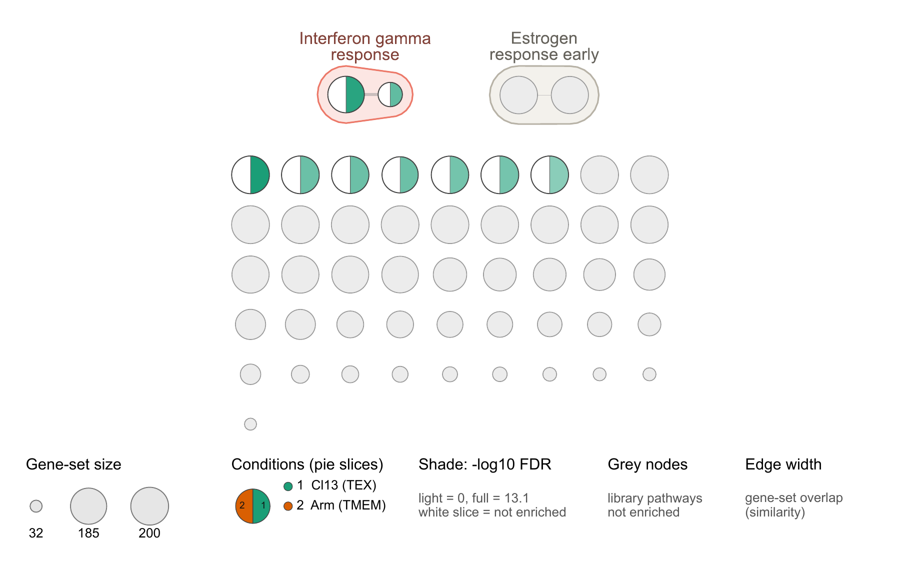](../images/tutorial/pooled_Hallmark_library.png)


All 50 Hallmark sets are drawn; enriched ones carry a pie with two slices (slice 1, green = Cl13; slice 2, orange = Arm), the rest are grey. Nine sets are enriched, every one of them in Cl13 only:

| Pathway | Cl13 −log10 FDR | Arm −log10 FDR |
|---|---|---|
| IL2–STAT5 signaling | 13.1 | 1.0 (not significant) |
| Interferon gamma response | 11.6 | 0 |
| Interferon alpha response | 5.8 | – |
| Mitotic spindle | 4.8 | 0 |
| Complement | 4.7 | 0 |
| G2M checkpoint | 4.7 | – |
| TNFα signaling via NF-κB | 3.8 | 0 |
| E2F targets | 3.7 | 0 |
| KRAS signaling up | 1.6 | 0.3 |

Hallmark sets share few genes, so at the default similarity cutoff only two pairs are connected (the two interferon responses; the two estrogen-response sets, which are not enriched and therefore drawn with a grey outline). The figure's value here is the library context: the exhausted program occupies the inflammatory and proliferative corner of the Hallmark landscape, and the memory genes occupy none of it.

**GO Biological Process** — [`figures/pooled_GOBP.pdf`](https://github.com/helenhuangmath/SimpNetworkViz/blob/main/examples/Cl13_vs_Arm/figures/pooled_GOBP.pdf), gene network [`figures/pooled_GOBP_genes.pdf`](https://github.com/helenhuangmath/SimpNetworkViz/blob/main/examples/Cl13_vs_Arm/figures/pooled_GOBP_genes.pdf), bar plot [`figures/pooled_GOBP_barplot.pdf`](https://github.com/helenhuangmath/SimpNetworkViz/blob/main/examples/Cl13_vs_Arm/figures/pooled_GOBP_barplot.pdf)

[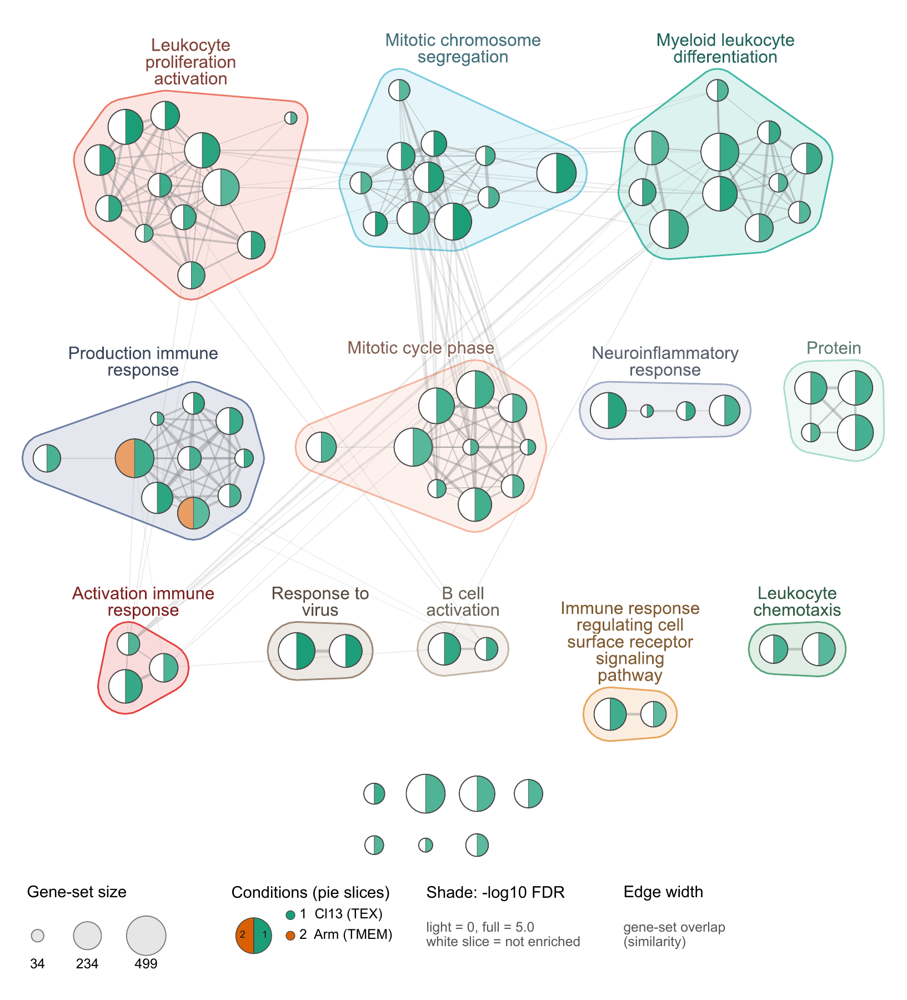](../images/tutorial/pooled_GOBP.png)


259 GO BP terms are enriched in Cl13 and 3 in Arm; the 80 most significant are drawn and fall into 12 clusters:

| # | Cluster | Terms | Best FDR |
|---|---|---|---|
| 1 | Leukocyte proliferation / activation | 12 | 1e-5 |
| 2 | Mitotic chromosome segregation | 11 | 1e-5 |
| 3 | Myeloid leukocyte differentiation | 11 | 3e-5 |
| 4 | Production of immune mediators | 10 | 5e-5 |
| 5 | Mitotic cell-cycle phase transition | 10 | 3e-4 |
| 6 | Neuroinflammatory response | 4 | 3e-5 |
| 7 | Negative regulation of protein modification | 4 | 5e-4 |
| 8 | Activation involved in immune response | 3 | 1e-4 |
| 9 | Response to virus | 2 | 1e-5 |
| 10 | B cell activation | 2 | 8e-5 |
| 11 | Immune-receptor signaling | 2 | 3e-4 |
| 12 | Leukocyte chemotaxis | 2 | 8e-4 |

Reading the pies: almost every node has only the Cl13 slice filled. The two nodes in the "Production of immune mediators" cluster with both slices filled are *regulation of immune effector process* and *positive regulation of immune effector process*, the only terms shared by the two conditions. The third Arm term, *positive regulation of natural killer cell mediated immunity* (driven by Klrk1, Klrd1, Klrc2, Klrb1c in TMEM_G1), is not significant in Cl13 and sits in the unclustered row.

The two themes of the exhausted program are visible as two halves of the figure: proliferation and chromosome segregation (clusters 2 and 5, from TEX_G2, see Step 5) and immune activation / interferon response (clusters 1, 4, 6, 8, 9). The gene network groups the Cl13 genes by these themes, so the proliferation module (Top2a, Mki67, Cdk1, Plk1, Kif11, Bub1b, …) and the interferon module (Ifit1, Ifit3, Irf9, Stat1, Rsad2, Mx1, Usp18, …) are drawn apart.

| Gene network | Cluster bar plot |
|---|---|
| [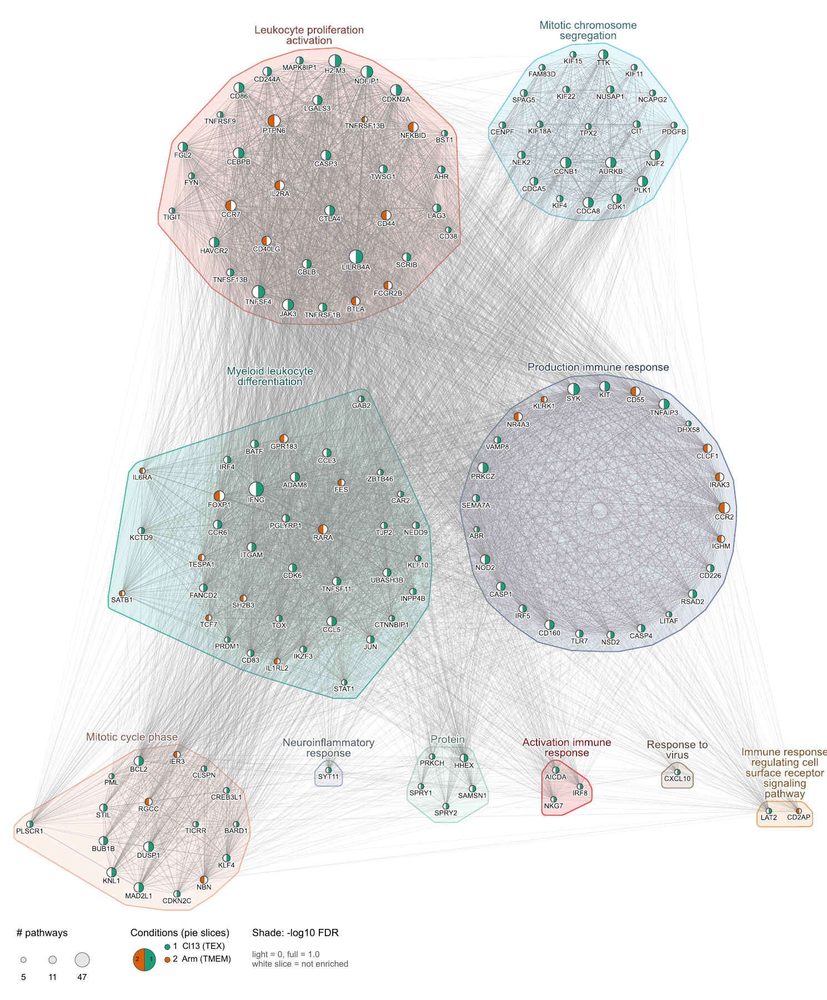](../images/tutorial/pooled_GOBP_genes.png) | [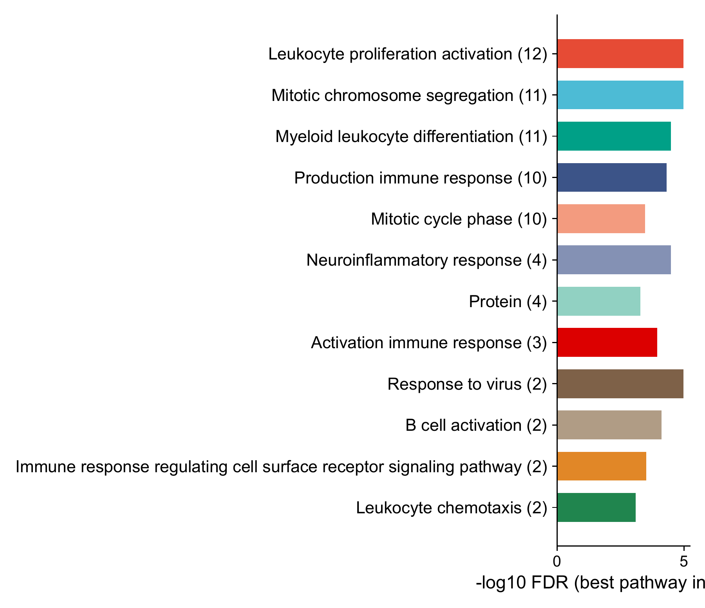](../images/tutorial/pooled_GOBP_barplot.png) |


## Step 4: Compare matched subgroups, TEX_Gn versus TMEM_Gn

Group numbers are not comparable across conditions by construction, so this analysis asks whether they nonetheless describe the same biology. Each pair gets a two-slice network; `results/summary.csv` shows how much each pair yields:

| Pair | Hallmark (enriched) | GO BP (enriched, clusters) |
|---|---|---|
| G1: 308 vs 225 genes | 7 | 35, 5 clusters |
| G2: 146 vs 102 | 4 | 40, 5 clusters |
| G3: 114 vs 71 | 2 | none |
| G4: 78 vs 33 | 0 | 5, 2 clusters |
| G5: 65 vs 33 | 0 | 9, 2 clusters |
| G6: 46 vs 19 | 1 | none |

**G1** — [`figures/G1_TEX_vs_TMEM_GOBP.pdf`](https://github.com/helenhuangmath/SimpNetworkViz/blob/main/examples/Cl13_vs_Arm/figures/G1_TEX_vs_TMEM_GOBP.pdf). TEX_G1 is enriched for *natural immune response* (interferon and antiviral terms), *sister chromosome segregation*, *production of immune mediators*, *leukocyte proliferation* and *neuroinflammatory response*; on Hallmark it carries interferon-γ response, mitotic spindle, G2M checkpoint, complement, E2F targets, IL2–STAT5 and TNFα/NF-κB. TMEM_G1 contributes two small nodes in the natural-immune cluster (the NK-receptor terms above). The two G1 groups therefore share an "innate-like cytotoxic" fringe but are otherwise different programs.

[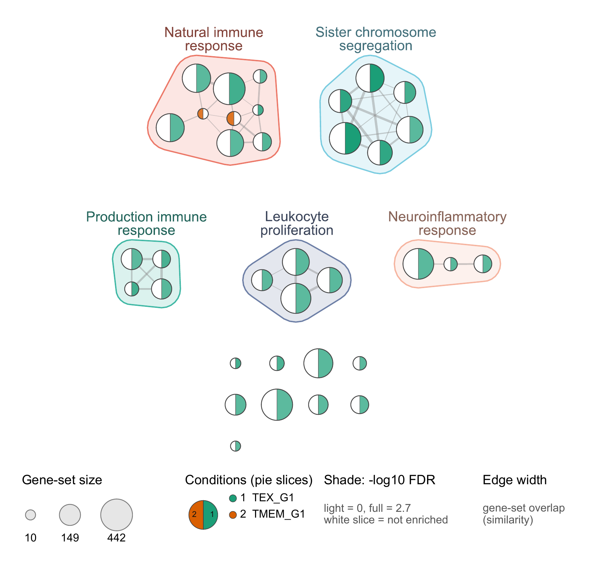](../images/tutorial/G1_TEX_vs_TMEM_GOBP.png)


**G2** — [`figures/G2_TEX_vs_TMEM_GOBP.pdf`](https://github.com/helenhuangmath/SimpNetworkViz/blob/main/examples/Cl13_vs_Arm/figures/G2_TEX_vs_TMEM_GOBP.pdf). TEX_G2 is a pure cell-cycle group: *cell-cycle phase transition* (16 terms), *mitotic chromosome segregation* (12), *spindle localization*, *telomere maintenance*, *double-strand break repair*; on Hallmark E2F targets, G2M checkpoint and both interferon responses. TMEM_G2 has no enriched term at all.

[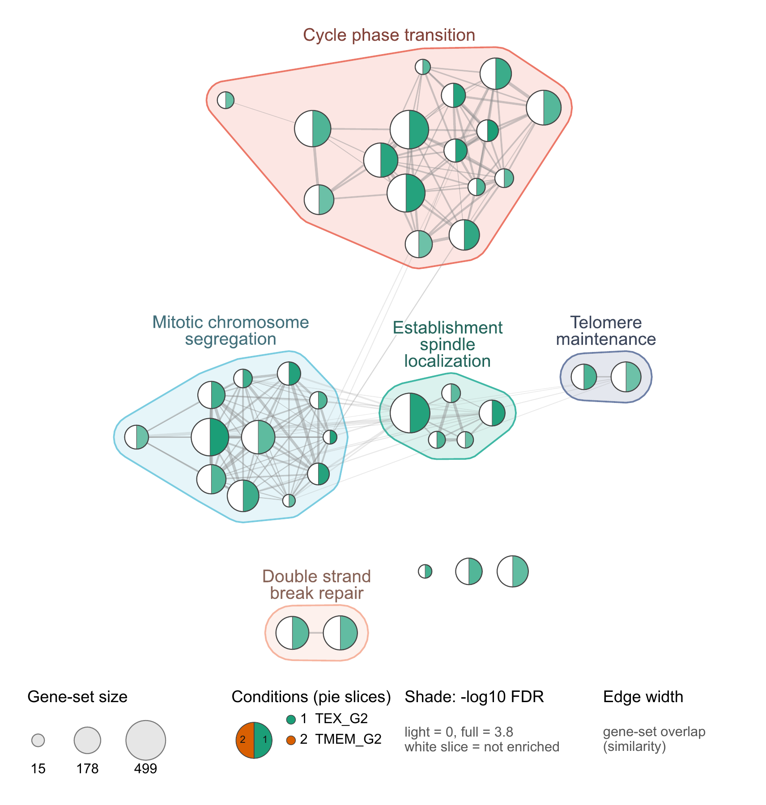](../images/tutorial/G2_TEX_vs_TMEM_GOBP.png)


**G3–G6.** With 19–114 genes per group, few terms reach FDR ≤ 0.05, and those that do in G4 and G5 (*regulation of hemopoiesis*, *neuron apoptotic process*, *alpha-beta T cell activation*, several developmental terms with the same three or four genes) are borderline (−log10 FDR ≈ 1.3–1.4) and should be read as hints, not results. For small groups, consider `--fdr 0.1` and look at `enrichment.csv` rather than the network.

## Step 5: Compare the six subgroups within one condition

**Cl13, GO BP** — [`figures/within_Cl13_GOBP.pdf`](https://github.com/helenhuangmath/SimpNetworkViz/blob/main/examples/Cl13_vs_Arm/figures/within_Cl13_GOBP.pdf); **Hallmark, whole library** — [`figures/within_Cl13_Hallmark_library.pdf`](https://github.com/helenhuangmath/SimpNetworkViz/blob/main/examples/Cl13_vs_Arm/figures/within_Cl13_Hallmark_library.pdf)

| Six Cl13 subgroups, GO BP | Six Cl13 subgroups, Hallmark whole library |
|---|---|
| [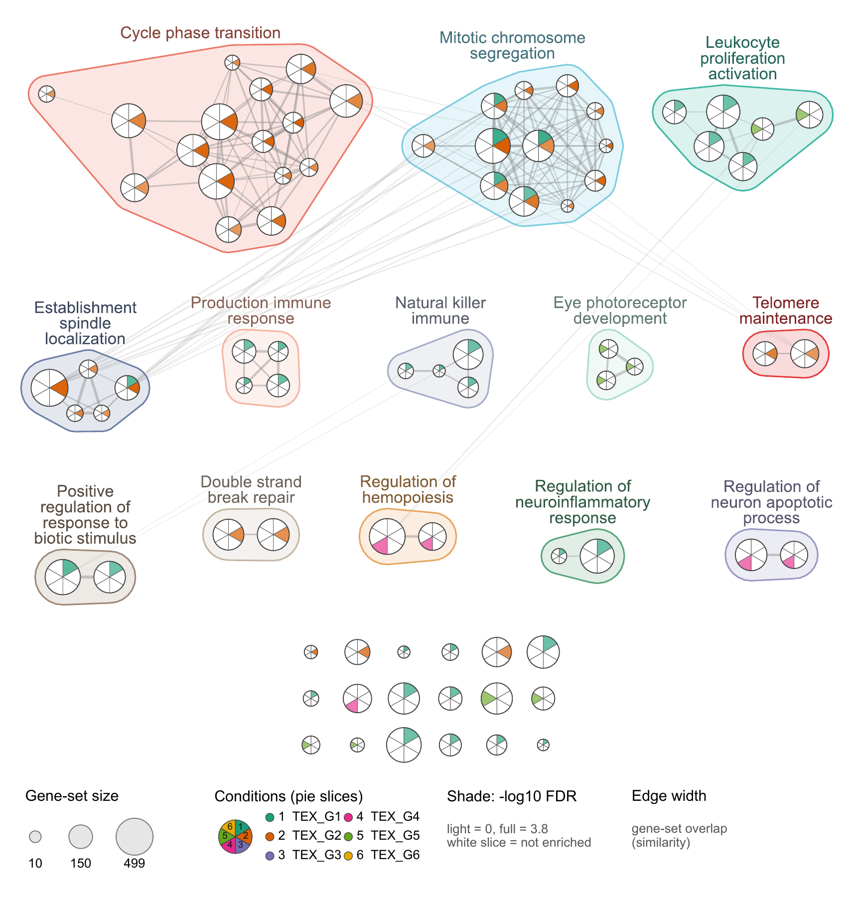](../images/tutorial/within_Cl13_GOBP.png) | [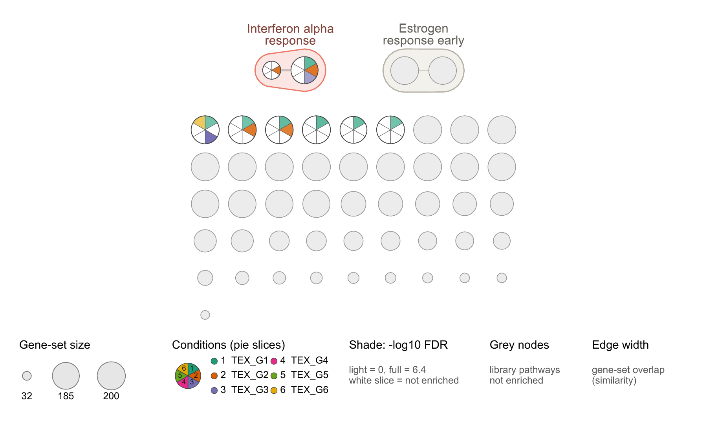](../images/tutorial/within_Cl13_Hallmark_library.png) |


Six slices per node (1 = TEX_G1 green, 2 = TEX_G2 orange, 3 = TEX_G3 purple, 4 = TEX_G4 pink, 5 = TEX_G5 light green, 6 = TEX_G6 yellow; clockwise from 12 o'clock). Thirteen clusters; the pies separate the subgroups cleanly:

* **TEX_G2 (orange)** owns the proliferation clusters: *cycle phase transition*, *spindle localization*, *telomere maintenance*, *double-strand break repair*, and shares *mitotic chromosome segregation* with TEX_G1.
* **TEX_G1 (green)** owns *leukocyte proliferation / activation*, *natural killer immune*, *production of immune mediators*, *response to biotic stimulus* and *neuroinflammatory response*: the activated / interferon-responsive program.
* **TEX_G4 (pink)** appears in *regulation of hemopoiesis* and *regulation of neuron apoptotic process*; **TEX_G5** in the small *eye photoreceptor development* cluster (three or four genes), which is the kind of GO term to disregard.
* TEX_G3 and TEX_G6 have no GO BP cluster of their own at this cutoff.

The Hallmark matrix (`3_within_Cl13/Hallmark/enrichment_matrix.csv`) says the same more compactly: IL2–STAT5 signaling is strongest in TEX_G3 (−log10 FDR 6.4) and present in G1 and G6; interferon-α/γ responses, E2F targets and G2M checkpoint belong to TEX_G2 (with interferon-γ also in G1 and G3); mitotic spindle, complement and TNFα/NF-κB to TEX_G1.

**Arm.** Only two GO BP terms are enriched across the six TMEM groups (both in TMEM_G1: *positive regulation of NK cell mediated immunity*, *response to lectin*) and no Hallmark set. The memory subgroups are small and many of their genes are unannotated (`Gm…`, `…Rik`), so they carry little pathway signal with these libraries; a background of measured genes, a larger marker list, or cell-type-specific gene sets (e.g. ImmuneSigDB, `m7` in MSigDB) would be the next step.

## Step 6: Place every analysis on the pathway map

The networks above are laid out afresh for each analysis, so two figures cannot be compared position by position, and GO BP is too large to draw whole. The **pathway map** solves both: all 5,489 GO BP terms (10–500 genes) are embedded once in two dimensions from their gene-set similarity, the map is divided into 35 labelled regions, and every analysis is drawn on that fixed background.

Build it once per library (about 15 s for GO BP with t-SNE; UMAP is used when `umap-learn` is installed):

```bash
snv map --gmt m5.go.bp.v2025.1.Mm.symbols.gmt -o genesets/gobp_map.csv
```

The map used here is included: [`genesets/gobp_map.csv`](https://github.com/helenhuangmath/SimpNetworkViz/blob/main/examples/Cl13_vs_Arm/genesets/gobp_map.csv), drawn without hits in [`figures/map_GOBP.pdf`](https://github.com/helenhuangmath/SimpNetworkViz/blob/main/examples/Cl13_vs_Arm/figures/map_GOBP.pdf). Immune regions (*antigen response immunity*, *alpha activation differentiation*, *leukocyte migration chemotaxis*) sit in the upper left, cell-cycle and DNA regions top centre, metabolism lower left, development and tissue morphogenesis lower right.

[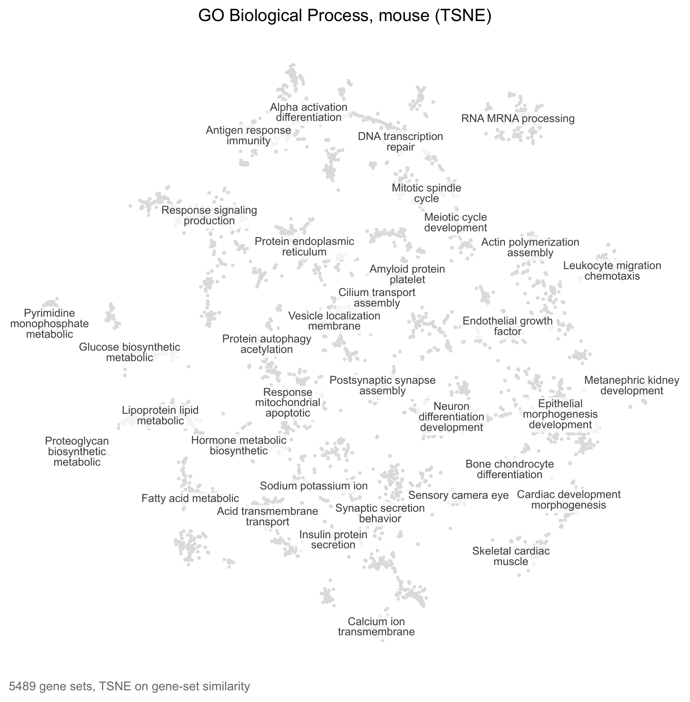](../images/tutorial/map_GOBP.png)


Overlay any analysis with `--map`:

```bash
snv compare "Cl13=cl13_all.txt" "Arm=arm_all.txt" --gmt m5.go.bp.v2025.1.Mm.symbols.gmt --map genesets/gobp_map.csv -o results/pooled_map
```

**Cl13 vs Arm** — [`figures/map_pooled_Cl13_vs_Arm.pdf`](https://github.com/helenhuangmath/SimpNetworkViz/blob/main/examples/Cl13_vs_Arm/figures/map_pooled_Cl13_vs_Arm.pdf). Every enriched term is a small pie on the grey map (slice 1 = Cl13, slice 2 = Arm; size = significance; the eight most significant are named). The Cl13 hits form three clumps: immune activation and interferon response (upper left), mitosis and DNA (top centre), and leukocyte migration (right). Arm's three hits sit in the *antigen response immunity* region. The region table (`figures/map_pooled_regions.csv`) quantifies this:

[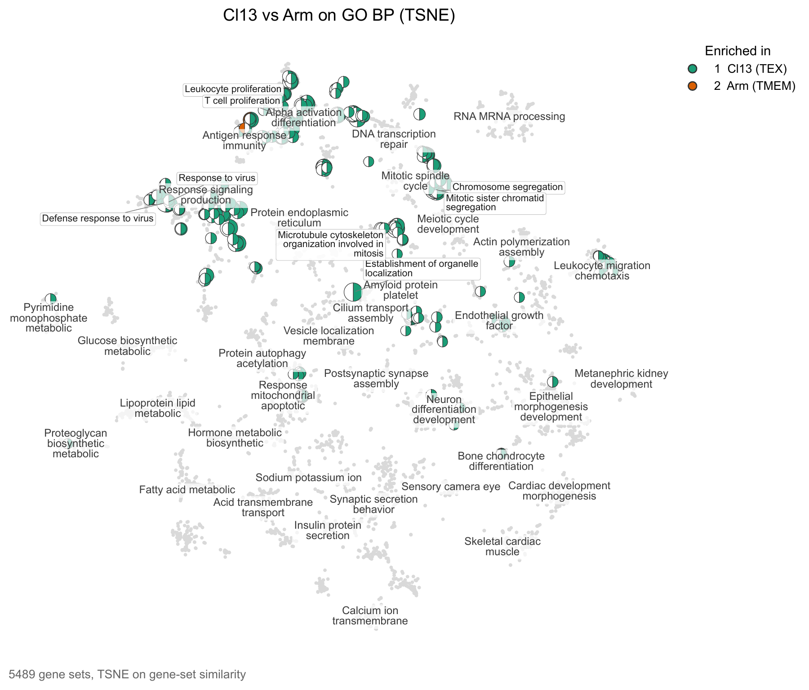](../images/tutorial/map_pooled_Cl13_vs_Arm.png)


| Region | Terms in region | Cl13 hits | Arm hits |
|---|---|---|---|
| Alpha activation differentiation (T-cell activation) | 346 | 76 (22 %) | 0 |
| Response signaling production (cytokine production) | 350 | 59 (17 %) | 0 |
| Mitotic spindle cycle | 168 | 53 (32 %) | 0 |
| Endothelial growth factor | 311 | 22 (7 %) | 0 |
| Leukocyte migration chemotaxis | 102 | 16 (16 %) | 0 |
| Antigen response immunity | 79 | 8 (10 %) | 3 (4 %) |
| Response mitochondrial apoptotic | 253 | 9 (4 %) | 0 |

**The six Cl13 subgroups** — [`figures/map_within_Cl13.pdf`](https://github.com/helenhuangmath/SimpNetworkViz/blob/main/examples/Cl13_vs_Arm/figures/map_within_Cl13.pdf), region counts in `figures/map_within_Cl13_regions.csv`. The same map, six slices per pie. TEX_G2's 31 hits in *mitotic spindle cycle* and 6 in *DNA transcription repair* are its whole program; TEX_G1's hits spread over *response signaling production* (13), *mitotic spindle cycle* (8), *alpha activation differentiation* (5) and *antigen response immunity* (5); TEX_G4 lands in *response mitochondrial apoptotic* (3) and *alpha activation differentiation* (2); TEX_G5 in *sensory camera eye* (3), *epithelial morphogenesis development* (2) and *alpha activation differentiation* (2). Because the coordinates never change, these maps can be placed next to the maps of any future experiment analysed with the same library.

[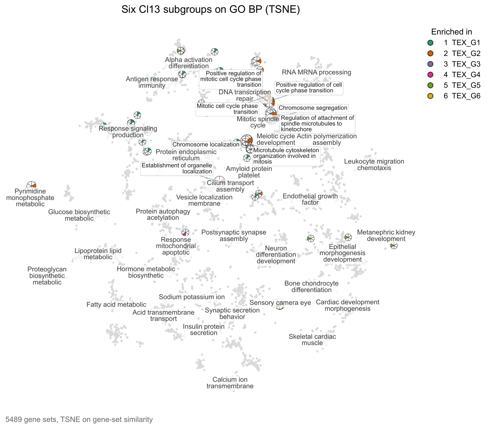](../images/tutorial/map_within_Cl13.png)


**The same map with UMAP** — the bundled map was built with t-SNE. With `umap-learn` installed, `snv map --method umap` (or `run_comparison.py --map-method umap`) embeds the same TF-IDF/SVD vectors with UMAP instead; this version is included too: [`genesets/gobp_map_umap.csv`](https://github.com/helenhuangmath/SimpNetworkViz/blob/main/examples/Cl13_vs_Arm/genesets/gobp_map_umap.csv), drawn in [`figures/map_GOBP_umap.pdf`](https://github.com/helenhuangmath/SimpNetworkViz/blob/main/examples/Cl13_vs_Arm/figures/map_GOBP_umap.pdf), with the overlays [`figures/map_pooled_Cl13_vs_Arm_umap.pdf`](https://github.com/helenhuangmath/SimpNetworkViz/blob/main/examples/Cl13_vs_Arm/figures/map_pooled_Cl13_vs_Arm_umap.pdf) and [`figures/map_within_Cl13_umap.pdf`](https://github.com/helenhuangmath/SimpNetworkViz/blob/main/examples/Cl13_vs_Arm/figures/map_within_Cl13_umap.pdf) and their region tables. The 35 regions and their labels are identical, because regions are clustered in the similarity space, not in the picture; only the layout changes. UMAP places the immune regions (*alpha activation differentiation*, *antigen response immunity*, *response signaling production*) together at the bottom, the cell-cycle and DNA regions on the left and metabolism at the top, with more white space between groups than t-SNE. Pick one and keep it: the point of the map is that every later analysis uses the same coordinates.

[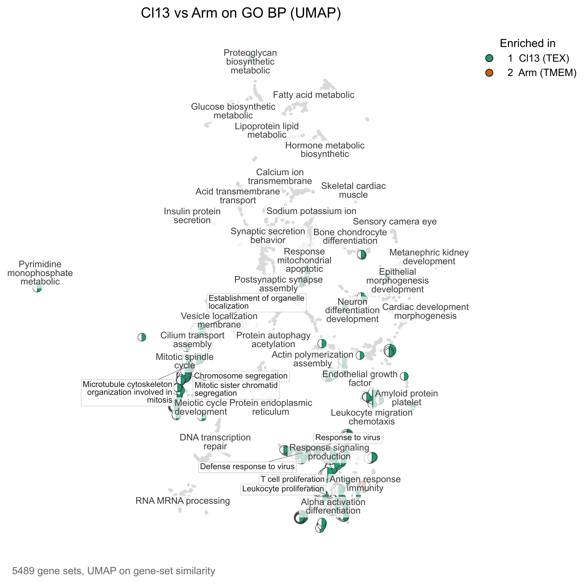](../images/tutorial/map_pooled_Cl13_vs_Arm_umap.png)


**The same analyses on MSigDB C7 ImmuneSigDB** — the immunologic signature collection (4,854 sets of the human v7.4 `c7.all` file; mouse symbols are matched case-insensitively). Its maps are in [`../msigdb_maps/c7.all`](https://github.com/helenhuangmath/SimpNetworkViz/tree/main/examples/msigdb_maps/c7.all) (built with `snv map --gmt c7.all.v7.4.symbols.gmt --by-category --method both`). The pooled comparison network is [`figures/pooled_C7.pdf`](https://github.com/helenhuangmath/SimpNetworkViz/blob/main/examples/Cl13_vs_Arm/figures/pooled_C7.pdf): ImmuneSigDB sets are 200-gene up/down halves of single GEO comparisons and rarely overlap, so the 80 most significant sets form only 19 edges and 12 small clusters (Treg vs Tconv, effector vs memory CD8, stimulated DC). The maps make up for that by placing every hit in a region: [`figures/map_pooled_Cl13_vs_Arm_C7_tsne.pdf`](https://github.com/helenhuangmath/SimpNetworkViz/blob/main/examples/Cl13_vs_Arm/figures/map_pooled_Cl13_vs_Arm_C7_tsne.pdf) / [`_umap.pdf`](https://github.com/helenhuangmath/SimpNetworkViz/blob/main/examples/Cl13_vs_Arm/figures/map_pooled_Cl13_vs_Arm_C7_umap.pdf) and [`figures/map_within_Cl13_C7_tsne.pdf`](https://github.com/helenhuangmath/SimpNetworkViz/blob/main/examples/Cl13_vs_Arm/figures/map_within_Cl13_C7_tsne.pdf) / [`_umap.pdf`](https://github.com/helenhuangmath/SimpNetworkViz/blob/main/examples/Cl13_vs_Arm/figures/map_within_Cl13_C7_umap.pdf), with region tables `figures/map_*_C7_*_regions.csv`. Pooled T-cell gene lists are enriched in almost half of this collection at FDR 0.05 (2,262 sets), so these overlays use FDR ≤ 1e-8 (300 sets).

[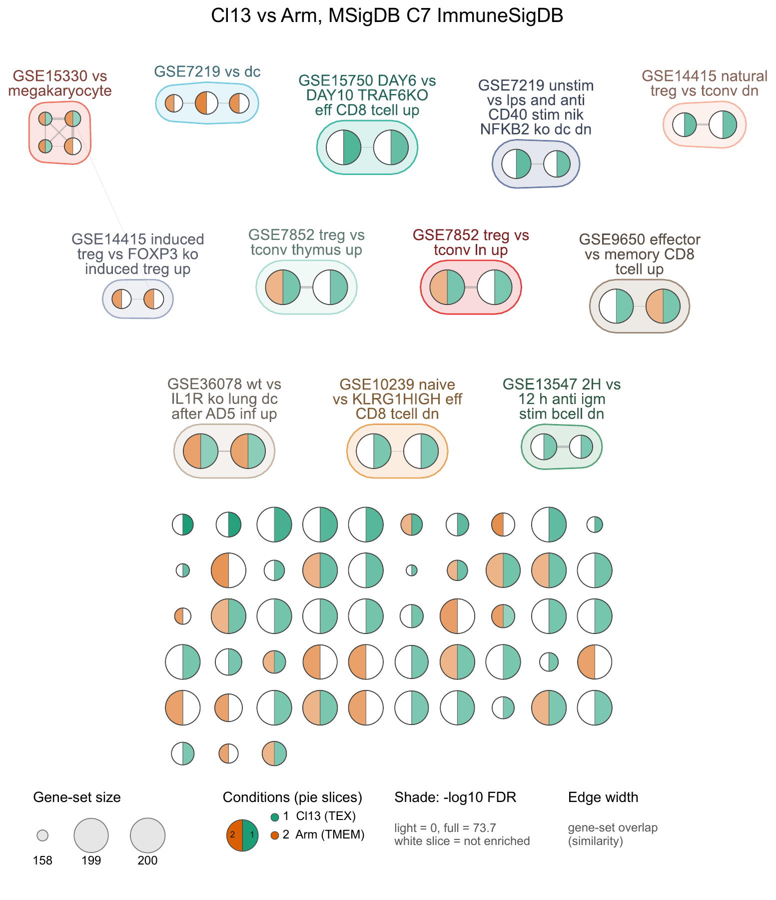](../images/tutorial/pooled_C7.png)


**Every MSigDB collection at once, mouse collections** — the genes are mouse symbols, so the right libraries are MSigDB's native mouse collections (release 2025.1), which the package downloads once per species (`snv.fetch_msigdb(name, species="mouse")`, `--msigdb NAME --species mouse`). Their maps are in [`../msigdb_maps/mouse`](https://github.com/helenhuangmath/SimpNetworkViz/tree/main/examples/msigdb_maps/mouse). [`run_msigdb_all.py`](https://github.com/helenhuangmath/SimpNetworkViz/blob/main/examples/Cl13_vs_Arm/run_msigdb_all.py) runs the pooled Cl13 vs Arm comparison against each of them, plus the overall mouse GO + Reactome + WikiPathways map and, as the one cross-species exception because MSigDB has no mouse immunologic collection, the human C7 ImmuneSigDB map. Outputs: a network, t-SNE and UMAP overlays, the within-Cl13 overlay and region tables per collection in `figures/msigdb_mouse/`, `figures/msigdb_mouse/summary.csv`, and the overview panels [`../../docs/images/msigdb_all_mouse_tsne.png`](../../docs/images/msigdb_all_mouse_tsne.png) / [`msigdb_all_mouse_umap.png`](../../docs/images/msigdb_all_mouse_umap.png):

```bash
python examples/Cl13_vs_Arm/run_msigdb_all.py --species mouse --map-fdr "ImmuneSigDB (human C7)=1e-8"
```

| Collection (mouse 2025.1) | Sets (on map) | Hits Cl13 / Arm (FDR ≤ 0.05) | Network: sets, edges, clusters | Top Cl13 region (hits / region size) | Top Arm region |
|---|---|---|---|---|---|
| Hallmark | 50 (50) | 9 / 0 | 9, 1, 1 | Interferon signaling response (6/13) | |
| GO biological process | 7855 (5489) | 364 / 22 | 80, 337, 8 | Alpha activation differentiation (85/346) | Antigen response immunity (7/79) |
| GO cellular component | 1040 (679) | 22 / 2 | 22, 27, 6 | Mitotic spindle microtubule (9/21) | |
| GO molecular function | 1885 (1181) | 23 / 1 | 24, 31, 3 | Structural microtubule binding (7/74) | Protein receptor binding (1/96) |
| Reactome | 1309 (1017) | 10 / 0 | 10, 14, 2 | Mitotic mitochondrial biogenesis (4/49) | |
| WikiPathways | 192 (169) | 6 / 0 | 6, 0, 0 | Apoptosis signaling disease (4/17) | |
| BioCarta | 252 (184) | 0 / 0 | | | |
| Cell-type signatures (M8) | 233 (195) | 25 / 1 | 25, 1, 1 | Spleen alpha beta (13/20) | |
| GTRD TF targets (M3) | 279 (140) | 6 / 4 | 9, 0, 0 | Uniprot target unreviewed (2/62) | Target genes (1/29) |
| GO + Reactome + WP (overall) | 12281 (8535) | 523 / 33 | 80, 264, 10 | Alpha production differentiation (90/338) | Antigen MHC immunity (10/90) |
| ImmuneSigDB (human C7) | 4872 (4854) | 1797 / 964 | 80, 22, 12 | Foxp3 treg tconv (76/182, FDR ≤ 1e-8) | Treg CD8 thymocyte (64/247) |

Compared with the human v7.4 run below, the mouse sets recover more of both lists (Cl13 625 instead of 588 genes matched, Arm 330 instead of 317) and give more hits: GO BP 364 / 22 instead of 290 / 18, and the overall map 523 / 33 instead of 478 / 18. The Arm hits now include the antigen-presentation and MHC regions, which is where a memory signature is expected to show in GO. The cell-type collection places the Cl13 genes in the spleen αβ T-cell signatures. Mouse Reactome and WikiPathways are smaller than their human counterparts (1309 and 192 sets vs 1604 and 615), so they give fewer hits than in the human run.

| t-SNE maps, mouse collections | UMAP maps, mouse collections |
|---|---|
| [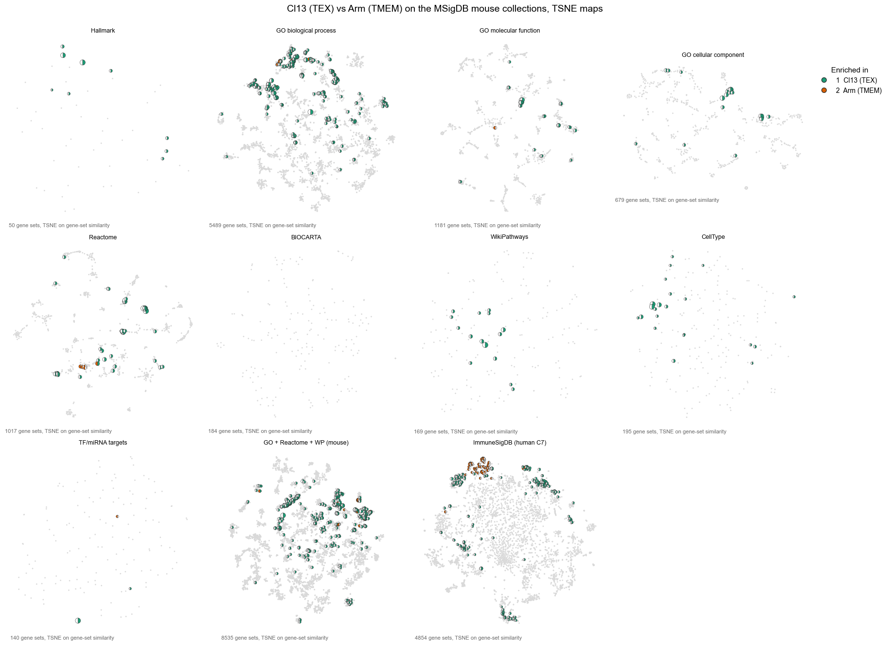](../../docs/images/msigdb_all_mouse_tsne.png) | [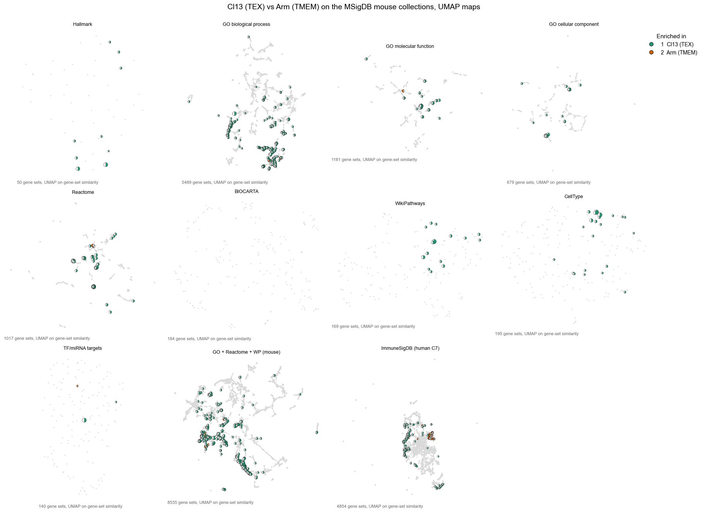](../../docs/images/msigdb_all_mouse_umap.png) |


**The same with the human v7.4 collections** — for comparison, and because KEGG, PID, HPO, C6 and C7 exist only for human: [`run_msigdb_all.py --species human`](https://github.com/helenhuangmath/SimpNetworkViz/blob/main/examples/Cl13_vs_Arm/run_msigdb_all.py) runs the comparison against each human collection map in [`../msigdb_maps`](https://github.com/helenhuangmath/SimpNetworkViz/tree/main/examples/msigdb_maps) (mouse symbols are matched case-insensitively, losing 22 % of the Cl13 and 34 % of the Arm genes) and writes a network, t-SNE and UMAP overlays, the within-Cl13 overlay and region tables per collection to `figures/msigdb_human/`, plus `figures/msigdb_human/summary.csv` and the overview panels [`../../docs/images/msigdb_all_human_tsne.png`](../../docs/images/msigdb_all_human_tsne.png) / [`msigdb_all_umap.png`](../../docs/images/msigdb_all_human_umap.png):

```bash
python examples/Cl13_vs_Arm/run_msigdb_all.py --species human --msigdb-dir /path/to/v7.4_gmts --map-fdr "ImmuneSigDB=1e-8,c7.all=1e-4"
```

| Collection | Sets (on map) | Hits Cl13 / Arm (FDR ≤ 0.05) | Network: sets, edges, clusters | Top Cl13 region (hits / region size) | Top Arm region |
|---|---|---|---|---|---|
| Hallmark | 50 (50) | 9 / 0 | 9, 1, 1 | Interferon signaling response (6/14) | |
| GO biological process | 7481 (5161) | 290 / 18 | 80, 384, 8 | Immune response activation (58/281) | Immune response activation (10/281) |
| GO cellular component | 996 (643) | 28 / 0 | 28, 42, 6 | Mitotic spindle microtubule (9/23) | |
| GO molecular function | 1708 (1064) | 19 / 0 | 19, 22, 4 | Protein regulator binding (5/89) | |
| Human phenotype | 4813 (3468) | 0 / 0 | | | |
| Reactome | 1604 (1260) | 35 / 0 | 35, 84, 4 | TGF transcription genes (8/39) | |
| WikiPathways | 615 (537) | 7 / 0 | 7, 3, 2 | DNA network repair (3/41) | |
| KEGG | 186 (186) | 2 / 0 | 2, 0, 0 | Signaling cancer (2/40) | |
| PID | 196 (196) | 2 / 0 | 2, 0, 0 | P53 downstream pathway (1/53) | |
| BioCarta | 292 (226) | 0 / 0 | | | |
| C3 TF targets, GTRD | 523 (272) | 19 / 5 | 23, 0, 0 | Target genes (4/55) | Target genes (1/55) |
| C3 TF targets, legacy motifs | 610 (571) | 5 / 1 | 6, 2, 2 | Irf1 srf irf (3/17) | Foxo4 foxo1 hfh4 (1/20) |
| C6 oncogenic | 189 (189) | 17 / 3 | 19, 3, 3 | Dn.v1 up.v1 (4/31) | Prc2 stk33 up.v1 (3/26) |
| C7 ImmuneSigDB | 4854 (4854) | 1784 / 961 | 80, 19, 12 | Foxp3 treg tconv (76/182, FDR ≤ 1e-8) | Treg CD8 thymocyte (55/247) |
| C7 vaccine response | 365 (274) | 76 / 16 | 80, 143, 8 | Howard inact 1dy (24/50, FDR ≤ 1e-4) | Eff CD8 tcell (10/28) |
| GO + KEGG + Reactome + WP (overall) | 12590 (8851) | 478 / 18 | 80, 228, 12 | Immune production differentiation (67/410) | Immune production differentiation (10/410) |

Reading the table: the Cl13 (exhausted) genes are enriched everywhere a database describes immune activation, interferon response, proliferation and DNA replication (GO BP, GO CC, Reactome, Hallmark, C7); the Arm (memory) genes give few or no hits outside C7 and GO BP, because the memory signature is small (483 genes, 342 matched to human symbols) and quiescence-related terms are rare in pathway databases. KEGG, PID and BioCarta are small, disease- and signalling-centred collections and contribute almost nothing here; HPO (disease phenotypes) and BioCarta give no hit at all. The overall map places the GO, Reactome and KEGG hits in one coordinate system, and its region table (`figures/msigdb_human/go_kegg_reactome_wp_map_tsne_regions.csv`) is the most compact summary of the comparison.

| t-SNE maps, human collections | UMAP maps, human collections |
|---|---|
| [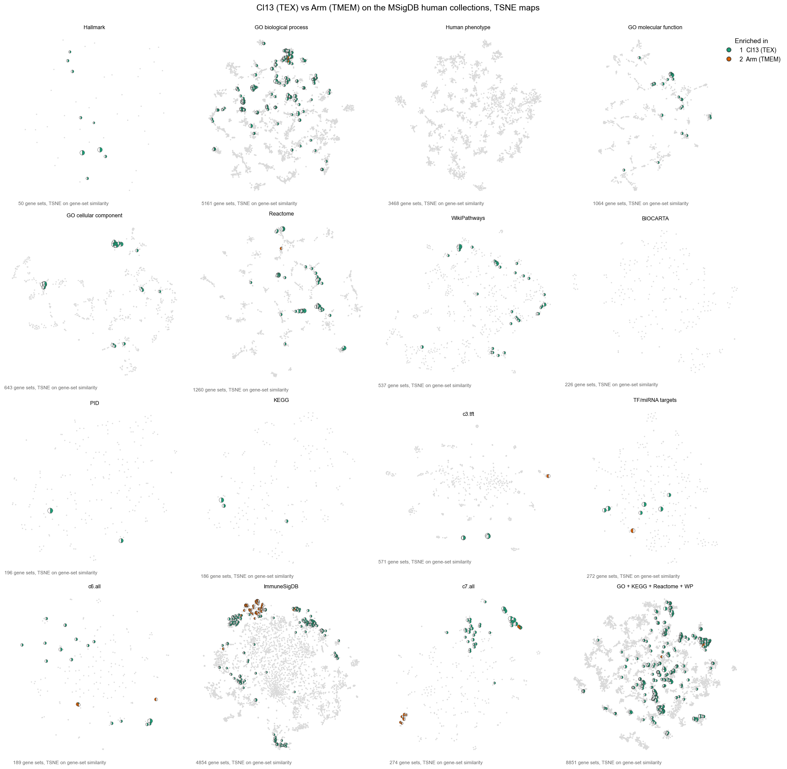](../../docs/images/msigdb_all_human_tsne.png) | [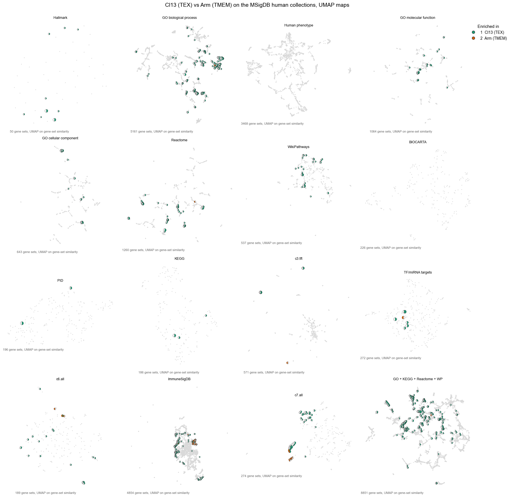](../../docs/images/msigdb_all_human_umap.png) |


**Interactive maps** — the same four maps as HTML, hosted on this site: [Cl13 vs Arm, t-SNE](https://helenhuangmath.github.io/SimpNetworkViz/examples/cl13-vs-arm.html), [Cl13 vs Arm, UMAP](https://helenhuangmath.github.io/SimpNetworkViz/examples/cl13-vs-arm-umap.html), [six Cl13 subgroups, t-SNE](https://helenhuangmath.github.io/SimpNetworkViz/examples/within-cl13.html) and [six Cl13 subgroups, UMAP](https://helenhuangmath.github.io/SimpNetworkViz/examples/within-cl13-umap.html). Hover a pie for the term, condition, FDR and genes, hover an outline for the region name, and lasso any group of terms to list their regions and names in the side panel. Every `--map` run writes `pathway_map.html` like these.

[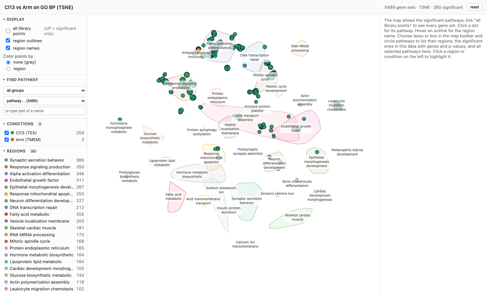](https://helenhuangmath.github.io/SimpNetworkViz/examples/cl13-vs-arm.html)


In Python:

```python
pmap = snv.load_map("genesets/gobp_map.csv")
table = snv.compare_conditions(pooled, gobp)
hits = snv.map_hits(pmap, table)               # enriched terms with x, y, region
snv.region_summary(pmap, hits)                 # hits per region per condition
snv.plot_pathway_map(pmap, table, "map.pdf")
```

## Step 7: Read the tables

`enrichment_matrix.csv` (pathway × condition, signed −log10 FDR) is the quickest way to compare conditions numerically. A blank means the pathway was not tested in that condition (no overlap with the group); 0 means tested but FDR = 1. In Python:

```python
import pandas as pd
m = pd.read_csv("results/1_Cl13_vs_Arm_pooled/GO_BP/enrichment_matrix.csv", index_col=0)
sig = m.abs() > -np.log10(0.05)
cl13_only = m[sig["Cl13 (TEX)"] & ~sig["Arm (TMEM)"]]
shared = m[sig.all(axis=1)]
```

`pathway_network_nodes.csv` adds, per pathway, `fdr__<condition>`, `direction__<condition>`, `genes__<condition>` (the hit genes in that condition), `conditions` (where it is enriched) and `cluster` / `cluster_label`. `pathway_network_clusters.csv` lists each cluster's label, size, best FDR and members. `enrichment.csv` is the full long table with a `condition` column.

## Doing the same with your own groups

1. Put each condition's groups in a wide CSV (one column per group, header = group name), or one gene list per group in separate files.
2. Choose gene sets for the right species: `--msigdb Hallmark --species mouse` (or `human`) fetches the MSigDB collection for that species; Enrichr libraries (`--library MSigDB_Hallmark_2020`) are mostly human; local GMT files work with `--gmt`.
3. Run `snv compare --groups groups.csv --gmt sets.gmt --whole-library -o results` for the overview and the same without `--whole-library` for the detailed network; add `--background measured.txt`.
   For a large library, build its map once (`snv map --gmt sets.gmt -o sets_map.csv`) and add `--map sets_map.csv` to every run.
   For the full MSigDB file, `snv map --gmt msigdb.v2025.1.Mm.symbols.gmt --by-category -o maps` builds a t-SNE and a UMAP map per collection (Hallmark, GO BP, GO CC, GO MF, KEGG, Reactome, WikiPathways ...).
4. Read `enrichment_matrix.csv`, then the PDF, then rename clusters if needed in Python (`net.group_labels[i] = "..."`).

To adapt `run_comparison.py`, change the two file names at the top and the names of the groups to pair in section 2.

## Notes on interpretation

* **Group size drives power.** TEX_G1 (308 genes) finds 35 GO terms against TMEM_G1 (225) with two; the 19-gene TMEM_G6 cannot reach significance for anything. Compare slices by presence/absence and FDR, not by the number of terms alone.
* **Pie shade is significance, not effect size.** Fold enrichment is in `enrichment.csv`.
* **Small, odd GO terms** (photoreceptor development, kidney development) appear when three or four broadly expressed genes coincide. The cluster size and `best_fdr` columns make them easy to filter; `--min-size 20` removes most of them.
* **Labels are automatic.** "Production immune response" stands for *production of molecular mediator of immune response*; "Protein" for a cluster of negative-regulation-of-protein-modification terms. Rename them before publication.
* **No background was used here.** With all measured genes as background the FDRs would be less extreme; the ranking of pathways rarely changes.
