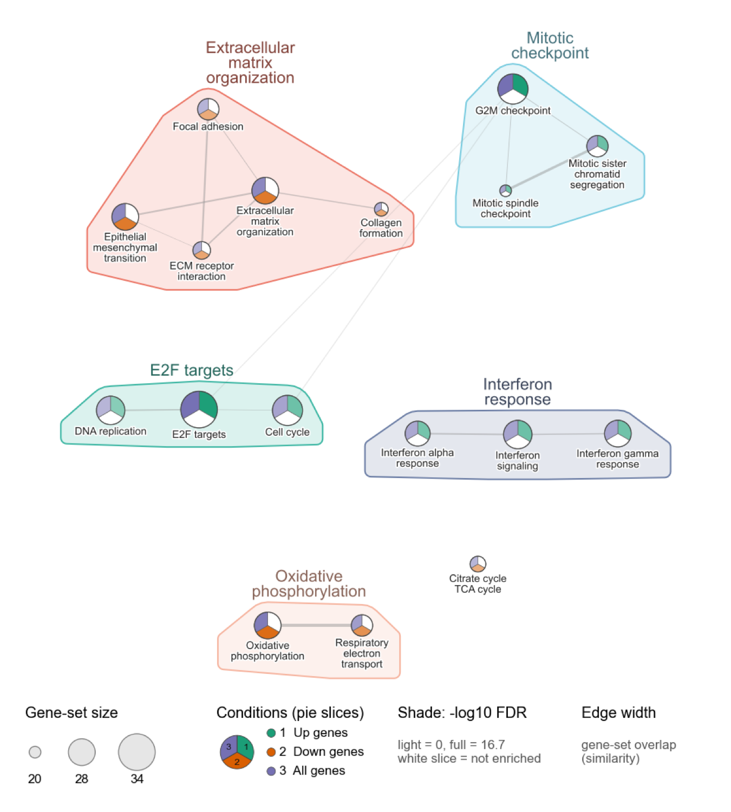
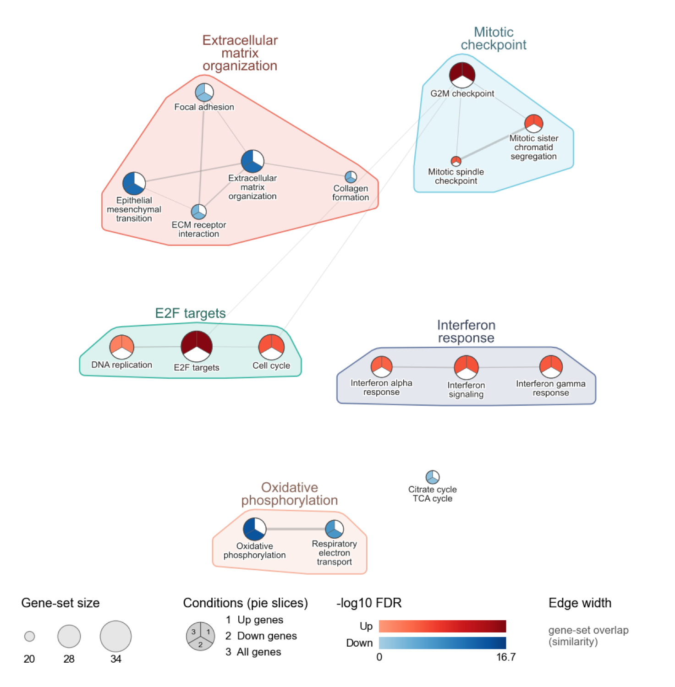
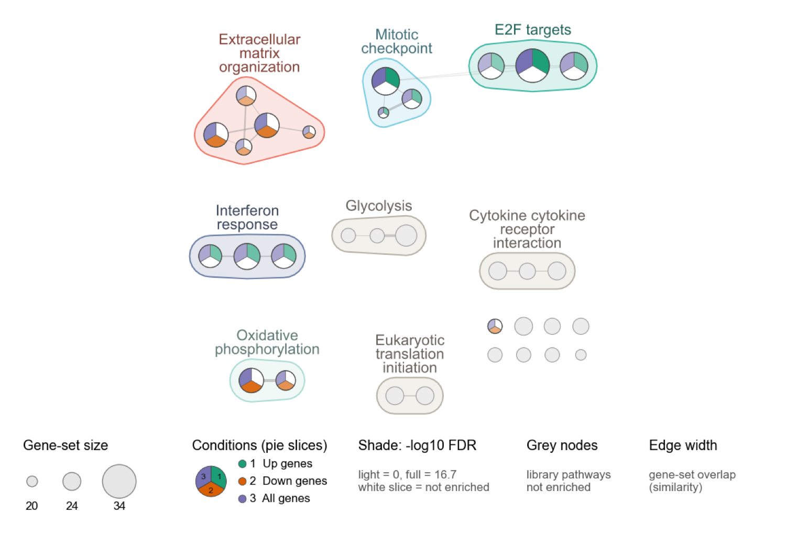

# Comparing conditions in one network

Knock-out versus wild type, several time points, treatments or tissues: each condition has its own gene list, and the question is which pathways they share. This tutorial tests three conditions separately and draws them in one network, where each pathway is a pie chart with one slice per condition.

It runs offline on the demo data. The three conditions are the up-regulated genes, the down-regulated genes and all genes of the demo list. For a comparison on real data, see [Cl13 vs Arm](cl13_vs_arm.md).

## Setup

```python
import simpnetworkviz as snv
from simpnetworkviz.genesets import demo_path

gene_sets = snv.load_gene_sets("demo")
genes = snv.read_gene_list(demo_path("demo_genes.tsv"))
```

## Step 1: Define the conditions

A set of conditions is a dictionary from condition name to gene list. The order of the dictionary is the order of the pie slices.

```python
conditions = {
    "Up genes": {g: v for g, v in genes.items() if v > 0},
    "Down genes": {g: v for g, v in genes.items() if v < 0},
    "All genes": genes,
}
{name: len(g) for name, g in conditions.items()}
```

```text
{'Up genes': 53, 'Down genes': 35, 'All genes': 88}
```

With your own data, read one file per condition, or one wide table with a column per group:

```python
conditions = {"KO": snv.read_gene_list("ko_degs.csv"), "WT": snv.read_gene_list("wt_degs.csv")}
conditions = snv.read_gene_groups("gene_modules.csv")      # header = group name
```

## Step 2: Test each condition

```python
table = snv.compare_conditions(conditions, gene_sets)
table.shape
```

```text
(40, 11)
```

```python
table[["pathway", "condition", "direction", "overlap", "fdr"]].head(6)
```

```text
                                  pathway condition direction  overlap          fdr
                  HALLMARK_G2M_CHECKPOINT  Up genes        up       23 1.828495e-17
                     HALLMARK_E2F_TARGETS  Up genes        up       24 3.200497e-17
GOBP_MITOTIC_SISTER_CHROMATID_SEGREGATION  Up genes        up       13 1.133200e-06
            REACTOME_INTERFERON_SIGNALING  Up genes        up       14 1.133200e-06
                          KEGG_CELL_CYCLE  Up genes        up       14 1.565564e-06
      REACTOME_MITOTIC_SPINDLE_CHECKPOINT  Up genes        up       11 3.614686e-06
```

Each condition is tested on its own, and the results are stacked into one long table with a `condition` column.

## Step 3: Compare the conditions as numbers

`enrichment_matrix` turns the long table into a pathway × condition matrix of signed −log10 FDR. It is the quickest way to compare conditions, and the input for a heatmap.

```python
m = snv.enrichment_matrix(table)
m.round(1).head(8)
```

```text
condition                                   Up genes  Down genes  All genes
pathway
HALLMARK_G2M_CHECKPOINT                         16.7         NaN       16.7
HALLMARK_E2F_TARGETS                            16.5         NaN       16.5
HALLMARK_OXIDATIVE_PHOSPHORYLATION               NaN       -14.3      -14.3
HALLMARK_EPITHELIAL_MESENCHYMAL_TRANSITION       NaN       -11.6      -11.6
REACTOME_EXTRACELLULAR_MATRIX_ORGANIZATION       NaN       -11.6      -11.6
REACTOME_RESPIRATORY_ELECTRON_TRANSPORT          NaN        -7.2       -7.2
GOBP_MITOTIC_SISTER_CHROMATID_SEGREGATION        5.9         NaN        5.9
REACTOME_INTERFERON_SIGNALING                    5.9         NaN        5.9
```

* A positive value means the pathway is enriched among up-regulated genes, a negative value among down-regulated genes.
* A blank (`NaN`) means the pathway was not tested in that condition, because it has no overlap with that gene list.
* A value of 0 means it was tested and has FDR 1.

To pick out the pathways specific to one condition:

```python
import numpy as np
sig = m.abs() > -np.log10(0.05)
up_only = m[sig["Up genes"] & ~sig["Down genes"]]
```

## Step 4: Draw the comparison network

```python
pnet = snv.build_pathway_network(table, gene_sets, similarity_cutoff=0.3)
pnet.graph.number_of_nodes(), pnet.graph.number_of_edges()
```

```text
(17, 16)
```

A pathway enters the network when it passes the FDR cutoff in at least one condition.

```python
pnet.plot("compare_pathways.pdf", color_by="condition")
```

[](../images/vignettes/compare_condition.png)

How to read a pie-chart node:

* **Slices:** one per condition. Slice 1 starts at 12 o'clock, and the rest follow clockwise in the order you gave. The legend shows the order.
* **Colored slice:** the pathway is enriched in that condition. A darker slice is more significant.
* **White slice:** not enriched in that condition.

Here the mitotic and interferon clusters have slices 1 and 3 filled (up genes, all genes), and the matrix and oxidative phosphorylation clusters have slices 2 and 3 filled (down genes, all genes).

:::{note}
The shade of a slice is significance, not effect size. Fold enrichment is in the `fold_enrichment` column of the table.
:::

### Color the slices by direction

```python
pnet.plot("compare_direction.pdf", color_by="direction")
```

[](../images/vignettes/compare_direction.png)

Now a slice is red when the pathway is enriched among the up-regulated genes of that condition and blue among the down-regulated genes. Use this when the conditions are contrasts with fold changes.

## Step 5: Look at the per-condition columns

The node table has one set of columns per condition:

```python
pnet.node_table()[["label", "conditions", "fdr__Up genes", "fdr__Down genes", "fdr__All genes"]].head(4)
```

```text
                            label           conditions  fdr__Up genes  fdr__Down genes  fdr__All genes
Epithelial mesenchymal transition Down genes;All genes            NaN     2.281712e-12    2.281712e-12
         ECM receptor interaction Down genes;All genes            NaN     3.875610e-04    3.875610e-04
                   Focal adhesion Down genes;All genes            NaN     4.684335e-03    4.684335e-03
               Collagen formation Down genes;All genes            NaN     2.143199e-04    2.143199e-04
```

`conditions` lists where the pathway is enriched. There are also `direction__<condition>` and `genes__<condition>` columns, the hit genes in that condition.

## Step 6: Show the whole library

`build_library_network` draws every pathway of the library, clusters the library itself, and highlights the enriched pathways. The rest are grey.

```python
lib = snv.build_library_network(table, gene_sets, similarity_cutoff=0.3)
lib.graph.number_of_nodes(), lib.graph.number_of_edges()
```

```text
(32, 21)
```

```python
lib.plot("library_highlighted.pdf")
```

[](../images/vignettes/compare_library.png)

All 32 demo gene sets are drawn, in eight clusters. Three clusters have a grey outline: glycolysis, cytokine receptor interaction and translation initiation are in the library, but none of the three gene lists hits them. Because the layout describes the library and not the hits, figures from different experiments can be compared directly.

Libraries with more than 400 gene sets are trimmed for this view. For large libraries, use the [pathway map](pathway_map.md).

## The same analysis on the command line

One file per condition:

```bash
snv compare KO=ko_degs.csv WT=wt_degs.csv Day7=day7_degs.csv --library Reactome_2022 -o results
```

One wide table with a column per group:

```bash
snv compare --groups gene_modules.csv --library MSigDB_Hallmark_2020 --whole-library -o results
```

The output folder holds the same files as `snv run`, plus `enrichment_matrix.csv`. To try it on the demo data, run `snv demo --compare`, which writes this tutorial's comparison to `demo_output/compare/`:

```text
Pathway network: 32 pathways, 21 edges, 8 clusters, 17 enriched (highlighted)
Conditions (pie slices): Up genes, Down genes, All genes
```

`--method gsea` works here too when every file is a full ranked table.

## Next

* [Cl13 vs Arm](cl13_vs_arm.md): the same analysis on real data, with six gene groups per condition.
* [Single-cell marker genes](singlecell.md): one pie slice per cell cluster.
