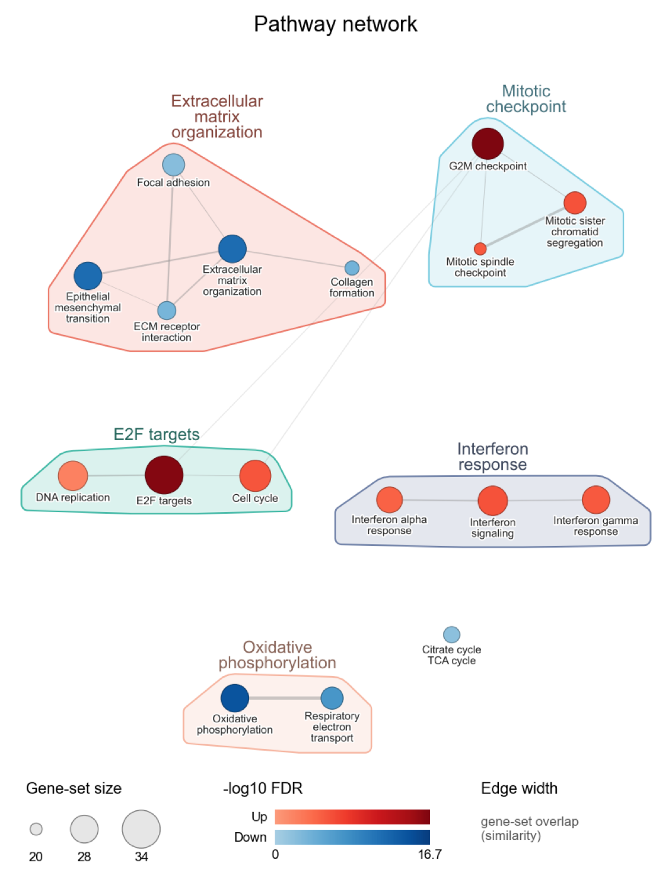
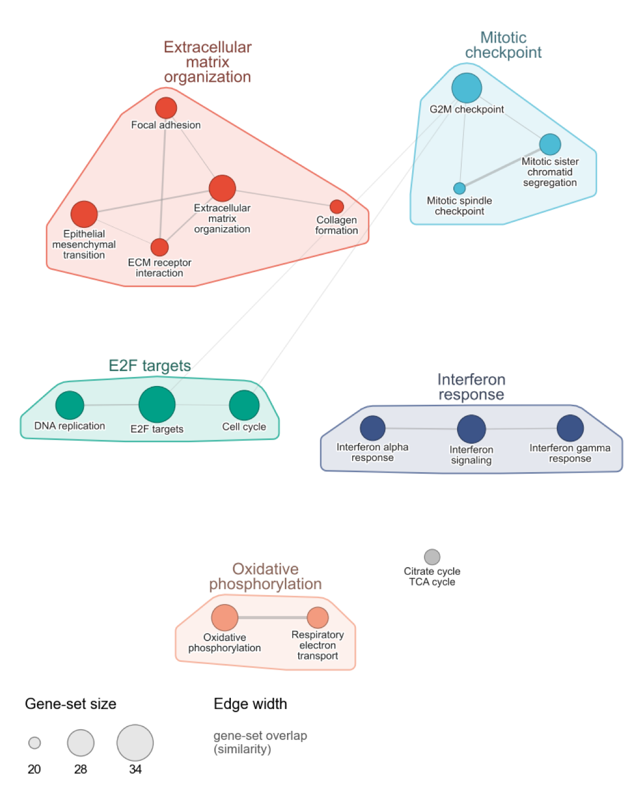
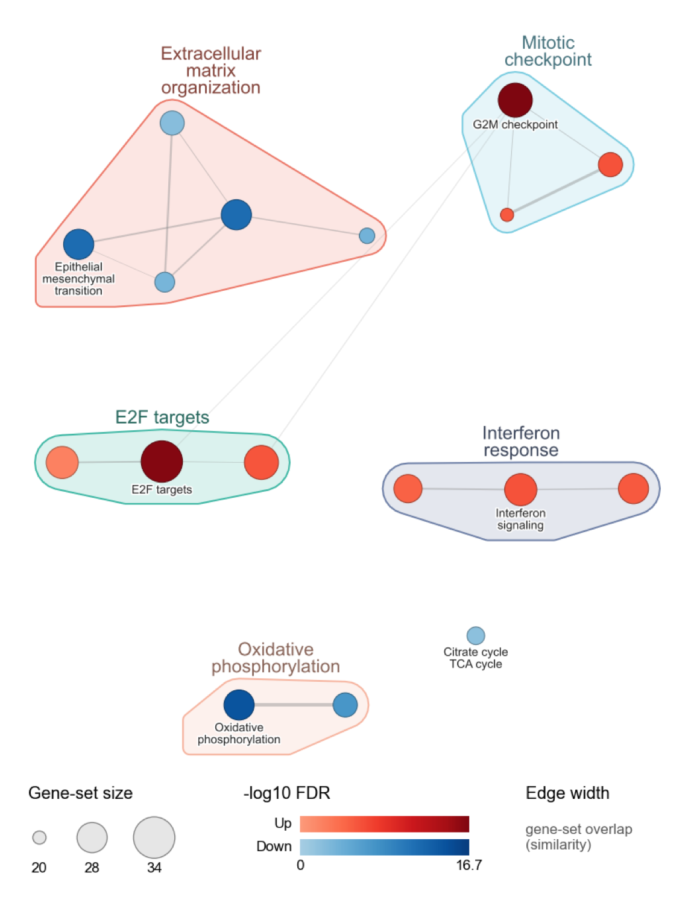
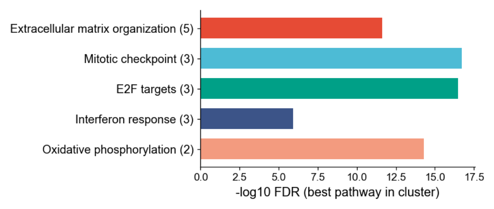
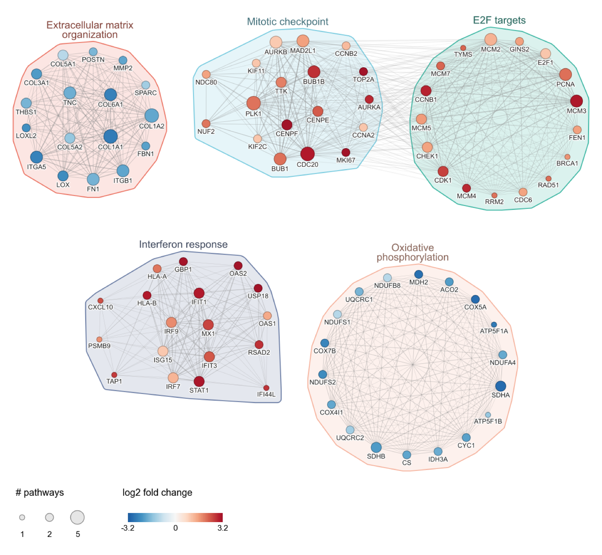
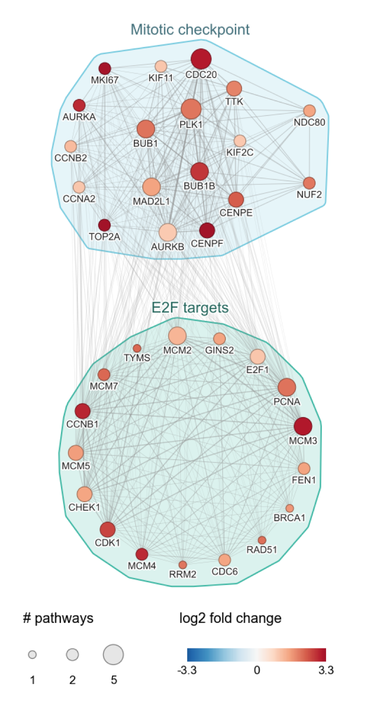
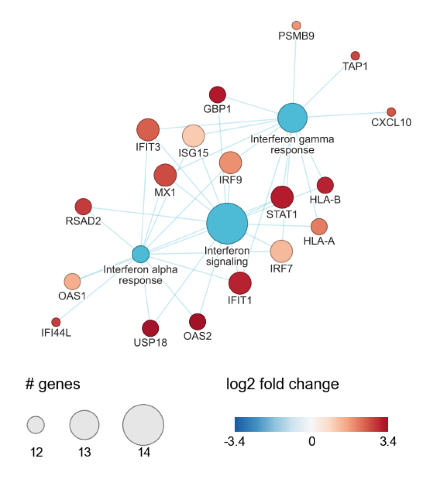
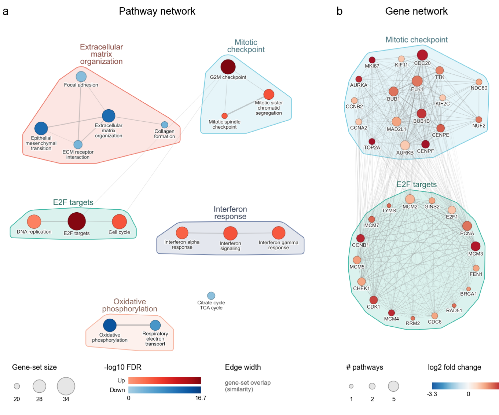

# Guided tutorial: from a gene list to a pathway network

This tutorial goes through a complete analysis of one gene list: enrichment, the pathway network, the gene networks and the exports. It uses the demo data bundled with the package, so every command runs offline and you can compare your output with the output shown here.

The demo data are 88 genes with log2 fold changes (53 up, 35 down) and 32 gene sets.

:::{warning}
The demo gene sets are shortened versions of real pathways, meant only for testing and demos. Do not draw biological conclusions from them.
:::

The same analysis is one command on the command line. This tutorial uses Python so that each step can be inspected, and shows the command-line form at the end.

```bash
snv demo
```

## Setup

```python
import simpnetworkviz as snv
from simpnetworkviz.genesets import demo_path
```

## Step 1: Read the gene list

`read_gene_list` reads a text file with one gene per line, or a CSV/TSV table with the gene in the first column and a fold-change column. It returns a dictionary from gene to fold change.

```python
genes = snv.read_gene_list(demo_path("demo_genes.tsv"))
len(genes)
```

```text
88
```

```python
list(genes.items())[:5]
```

```text
[('MCM2', 1.34), ('MCM3', 3.12), ('MCM4', 2.91), ('MCM5', 1.64), ('MCM7', 2.24)]
```

```python
sum(v > 0 for v in genes.values()), sum(v < 0 for v in genes.values())
```

```text
(53, 35)
```

For your own data, this is the table of significant genes from DESeq2, edgeR or limma. Every gene in the file is treated as a hit, so filter the table first.

## Step 2: Load the gene sets

```python
gene_sets = snv.load_gene_sets("demo")
len(gene_sets)
```

```text
32
```

`load_gene_sets` returns a dictionary from pathway name to its genes. In place of `"demo"` it takes an Enrichr library name such as `"MSigDB_Hallmark_2020"`, the path of a `.gmt` file, or several of these separated by commas. For mouse data, `snv.fetch_msigdb("Hallmark", species="mouse")` downloads the MSigDB mouse collection.

## Step 3: Run the enrichment test

`analyze_genes` runs over-representation analysis: a hypergeometric test for each gene set, with Benjamini–Hochberg FDR. Because the genes have fold changes, the up- and down-regulated genes are tested separately.

```python
table = snv.analyze_genes(genes, gene_sets)
table.shape
```

```text
(20, 10)
```

```python
table[["pathway", "direction", "overlap", "set_size", "fold_enrichment", "fdr"]].head(8)
```

```text
                                   pathway direction  overlap  set_size  fold_enrichment          fdr
                   HALLMARK_G2M_CHECKPOINT        up       23        30         7.030189 1.828495e-17
                      HALLMARK_E2F_TARGETS        up       24        34         6.472808 3.200497e-17
        HALLMARK_OXIDATIVE_PHOSPHORYLATION      down       18        28         8.926531 5.150481e-15
HALLMARK_EPITHELIAL_MESENCHYMAL_TRANSITION      down       16        28         7.934694 2.281712e-12
REACTOME_EXTRACELLULAR_MATRIX_ORGANIZATION      down       16        28         7.934694 2.281712e-12
   REACTOME_RESPIRATORY_ELECTRON_TRANSPORT      down       12        25         6.665143 6.015498e-08
 GOBP_MITOTIC_SISTER_CHROMATID_SEGREGATION        up       13        25         4.768302 1.133200e-06
             REACTOME_INTERFERON_SIGNALING        up       14        29         4.426805 1.133200e-06
```

The table has one row per pathway and direction. `overlap` is the number of your genes in the pathway, `set_size` the size of the pathway, and `genes` (not shown) the overlapping genes.

How many pathways are significant?

```python
sig = table[table.fdr <= 0.05]
len(sig), sig.direction.value_counts().to_dict()
```

```text
(17, {'up': 9, 'down': 8})
```

Seventeen of the 20 tested rows pass FDR 0.05. Look at the top of the table before going on and ask whether it makes sense. Here the up-regulated genes hit cell-cycle and interferon pathways, and the down-regulated genes hit oxidative phosphorylation and the extracellular matrix. The table is also redundant: G2M checkpoint, E2F targets and cell cycle are largely the same genes. The network sorts that out.

:::{important}
With your own data, pass the genes that were measured as the background: `snv.analyze_genes(genes, gene_sets, background=measured)`. Without a background, every gene in the library is used, which overstates significance.
:::

## Step 4: Build the pathway network

`build_pathway_network` does five things in one call: it keeps the significant pathways, measures how much every pair of pathways overlaps, connects the pairs above a similarity cutoff, clusters the network, and labels and lays out the clusters.

```python
pnet = snv.build_pathway_network(table, gene_sets, similarity_cutoff=0.3)
pnet.graph.number_of_nodes(), pnet.graph.number_of_edges()
```

```text
(17, 16)
```

```python
pnet.cluster_table()[["cluster", "label", "n_nodes", "best_fdr"]]
```

```text
 cluster                             label  n_nodes     best_fdr
       1 Extracellular matrix organization        5 2.281712e-12
       2                Mitotic checkpoint        3 1.828495e-17
       3                       E2F targets        3 3.200497e-17
       4               Interferon response        3 1.133200e-06
       5         Oxidative phosphorylation        2 5.150481e-15
```

The 17 pathways form five clusters. Each label is built from the words the member pathways share, or is the name of the most significant pathway when the cluster is small.

:::{note}
Cluster 1 may be labeled "Epithelial mesenchymal transition" on your machine. Its two most significant pathways have the same FDR, and either can give the cluster its name.
:::

The strongest edges show which pathways are nearly the same gene set:

```python
pnet.edge_table().sort_values("weight", ascending=False).head(5)
```

```text
                                    source                                     target  weight  shared
        HALLMARK_OXIDATIVE_PHOSPHORYLATION    REACTOME_RESPIRATORY_ELECTRON_TRANSPORT  0.7030      20
 GOBP_MITOTIC_SISTER_CHROMATID_SEGREGATION        REACTOME_MITOTIC_SPINDLE_CHECKPOINT  0.6250      15
             KEGG_ECM_RECEPTOR_INTERACTION                        KEGG_FOCAL_ADHESION  0.5102      14
HALLMARK_EPITHELIAL_MESENCHYMAL_TRANSITION REACTOME_EXTRACELLULAR_MATRIX_ORGANIZATION  0.4857      16
             REACTOME_INTERFERON_SIGNALING         HALLMARK_INTERFERON_ALPHA_RESPONSE  0.4607      15
```

`weight` is the similarity, ½·Jaccard + ½·overlap coefficient, and `shared` is the number of genes the two gene sets have in common.

### Choosing the similarity cutoff

The cutoff decides how many edges there are, and so how the pathways group. The default is 0.375, the EnrichmentMap default. This tutorial uses 0.3 because the demo gene sets are small. The same table at four cutoffs:

| `similarity_cutoff` | Edges | Clusters | Pathways in no cluster |
|---|---|---|---|
| 0.2 | 21 | 5 | 0 |
| 0.3 | 16 | 5 | 1 |
| 0.375 | 10 | 7 | 1 |
| 0.5 | 3 | 3 | 11 |

A low cutoff connects everything and merges themes. A high cutoff leaves most pathways on their own. Pick the value at which the clusters are themes you would name the same way.

## Step 5: Plot the pathway network

```python
pnet.plot("pathway_network.pdf", title="Pathway network")
```

[](../images/vignettes/guided_pathway_direction.png)

How to read the figure:

* **Node:** a pathway. Its size is the number of genes in the gene set.
* **Color:** red for up-regulated, blue for down-regulated; darker means more significant.
* **Edge:** the two pathways share genes. Its width is the similarity.
* **Shaded outline and label:** a cluster of related pathways.
* **Node without an outline:** a pathway that belongs to no cluster. Here that is the citrate cycle.

The file extension sets the format. PDF and SVG are vector files with editable text; use `.png` with `dpi=300` for a raster image.

### Color by cluster

```python
pnet.plot("pathway_network_by_cluster.pdf", color_by="cluster")
```

[](../images/vignettes/guided_pathway_cluster.png)

`color_by` also takes `"significance"` for a single color scale.

### Label fewer nodes

On a crowded network, label only the best pathway of each cluster:

```python
pnet.plot("pathway_network_top.pdf", node_labels="top")
```

[](../images/vignettes/guided_pathway_top.png)

`node_labels` also takes `"all"` and `"none"`.

### Rename the clusters

The labels are automatic. Replace any of them with your own wording and plot again:

```python
pnet.group_labels
```

```text
{1: 'Extracellular matrix organization', 2: 'Mitotic checkpoint', 3: 'E2F targets',
 4: 'Interferon response', 5: 'Oxidative phosphorylation'}
```

```python
pnet.group_labels[1] = "ECM remodelling"
pnet.group_labels[4] = "Interferon signalling"
pnet.plot("pathway_network_renamed.pdf", color_by="cluster")
```

[](../images/vignettes/guided_pathway_renamed.png)

### Rank the themes

The cluster bar plot is a companion panel: one bar per cluster, ranked by the FDR of its best pathway.

```python
snv.plot_cluster_barplot(pnet, "cluster_barplot.pdf")
```

[](../images/vignettes/guided_barplot.png)

## Step 6: Build the gene networks

A gene network is built from the pathway network, so it knows the clusters. It shows your genes that hit the pathways in the network.

```python
gnet = snv.build_gene_network(pnet, gene_sets, mode="shared", gene_values=genes)
gnet.graph.number_of_nodes(), gnet.graph.number_of_edges()
```

```text
(88, 893)
```

```python
gnet.plot("gene_network.pdf")
```

[](../images/vignettes/guided_gene_all.png)

* **Node:** a gene. Its size is the number of pathways it belongs to, and its color is the log2 fold change.
* **Edge:** the two genes share a pathway.
* **Outline and label:** the pathway cluster the gene belongs to most, with the same color and label as in the pathway figure.

The genes that belong to the most pathways are the hubs of their theme:

```python
gnet.node_table()[["label", "logfc", "n_pathways", "cluster_label"]] \
    .sort_values("n_pathways", ascending=False).head(6)
```

```text
 label  logfc  n_pathways                     cluster_label
COL1A1  -2.69           5 Extracellular matrix organization
COL1A2  -2.01           5 Extracellular matrix organization
  PLK1   2.08           5                Mitotic checkpoint
 CDC20   3.09           5                Mitotic checkpoint
   TNC  -1.88           4 Extracellular matrix organization
  PCNA   2.12           4                       E2F targets
```

### Focus on some clusters

With all clusters the figure is dense. Pick the clusters you want with `clusters=`:

```python
g23 = snv.build_gene_network(pnet, gene_sets, mode="shared", clusters=[2, 3], gene_values=genes)
g23.graph.number_of_nodes(), g23.graph.number_of_edges()
```

```text
(35, 470)
```

[](../images/vignettes/guided_gene_2_3.png)

### Gene–pathway network

`mode="cnet"` links each gene to the pathways it belongs to. This shows which genes bridge several pathways. For the interferon cluster:

```python
cnet = snv.build_gene_network(pnet, gene_sets, mode="cnet", clusters=[4], gene_values=genes)
cnet.graph.number_of_nodes(), cnet.graph.number_of_edges()
```

```text
(21, 39)
```

[](../images/vignettes/guided_cnet_4.png)

`mode="string"` uses protein–protein interactions from STRING. It needs internet; set the species with `string_species=`, 9606 for human and 10090 for mouse.

### Both networks in one figure

```python
snv.plot_pathway_gene_network(pnet, g23, "panel.pdf")
```

[](../images/vignettes/guided_panel.png)

## Step 7: Export

```python
pnet.to_html("pathway_network.html")          # interactive viewer
pnet.to_cytoscape("pathway_network.cyjs")     # Cytoscape desktop, with pathway_network_style.xml
pnet.to_graphml("pathway_network.graphml")    # igraph, Gephi and other tools
```

Or write everything at once:

```python
pnet.save("results", prefix="pathway_network",
          formats=("pdf", "svg", "html", "cyjs", "graphml", "csv"))
```

```text
pathway_network.cyjs           pathway_network.svg             pathway_network_nodes.csv
pathway_network.graphml        pathway_network_clusters.csv    pathway_network_style.xml
pathway_network.html           pathway_network_edges.csv
pathway_network.pdf
```

Open `pathway_network.html` in a browser: click a node for its genes and FDR, click a cluster for its members, drag things around, search for a gene, and export a PNG.

The node table holds everything behind the figure, for your own plots:

```python
pnet.node_table()[["label", "direction", "fdr", "set_size", "overlap", "cluster", "cluster_label"]].head(4)
```

```text
                            label direction          fdr  set_size  overlap  cluster                     cluster_label
Epithelial mesenchymal transition      down 2.281712e-12        28       16        1 Extracellular matrix organization
         ECM receptor interaction      down 3.875610e-04        23        8        1 Extracellular matrix organization
                   Focal adhesion      down 4.684335e-03        25        7        1 Extracellular matrix organization
               Collagen formation      down 2.143199e-04        21        8        1 Extracellular matrix organization
```

## The same analysis on the command line

`snv run` does steps 1 to 7 and writes every file. For the demo data:

```bash
snv run "$(python -c 'from simpnetworkviz.genesets import demo_path; print(demo_path("demo_genes.tsv"))')" \
    --library demo --cutoff 0.3 -o results
```

```text
Pathway network: 17 pathways, 16 edges, 5 clusters
  [ 1] Extracellular matrix organization  (5 pathways)
  [ 2] Mitotic checkpoint  (3 pathways)
  [ 3] E2F targets  (3 pathways)
  [ 4] Interferon response  (3 pathways)
  [ 5] Oxidative phosphorylation  (2 pathways)
Gene network: 88 genes, 893 edges
```

For your own data:

```bash
snv run degs.csv --library MSigDB_Hallmark_2020 --background measured.txt -o results
```

The folder also holds `run_params.json`, a record of every setting of the run, the package version and the date.

## Next

* [Preranked GSEA](gsea.md), if you would rather not choose a cutoff for the gene list.
* [Comparing conditions](compare.md), for several gene lists in one network.
* [Grouping pathways and styling figures](grouping.md), for other ways to cluster and color.
