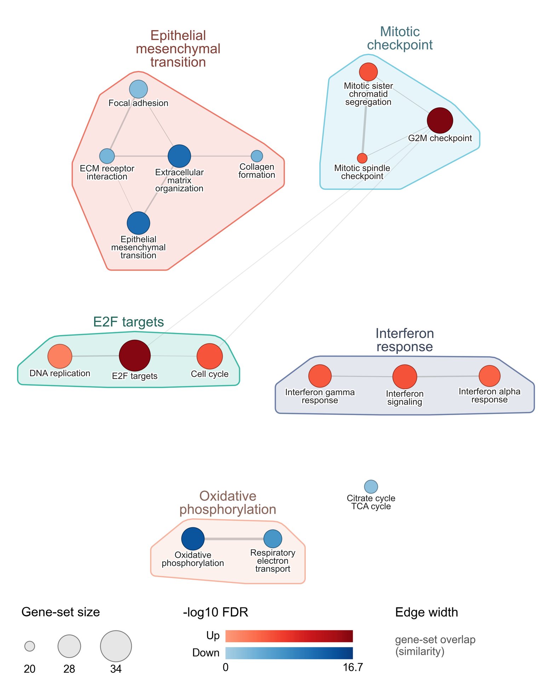
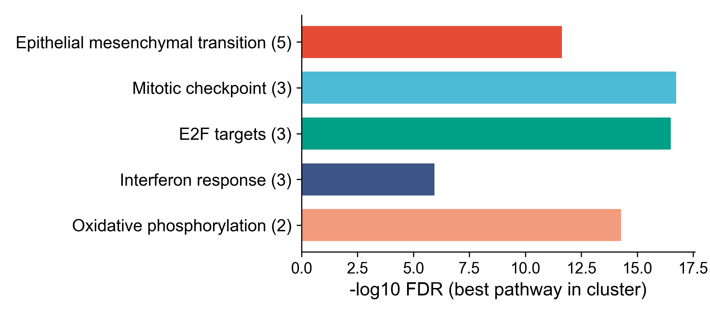
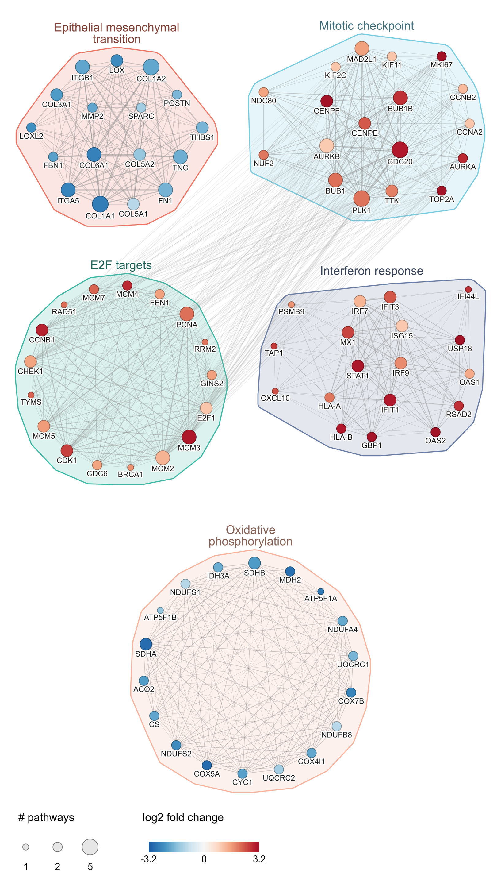
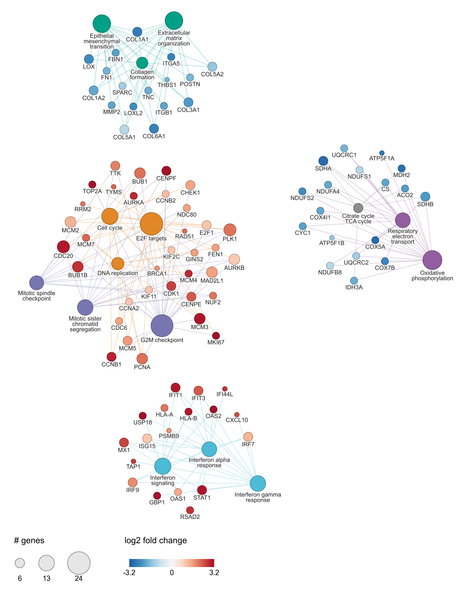
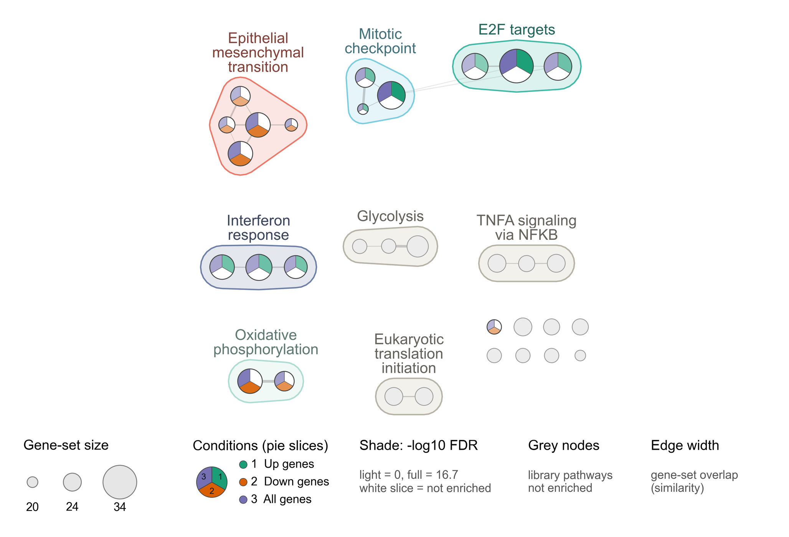

# Demo walkthrough

This tutorial runs the whole workflow once on the bundled demo data and goes through the output. It takes about a minute and needs no input files and no internet.

The demo data are 88 genes with log2 fold changes and 32 gene sets.

:::{warning}
The demo gene sets are shortened versions of real pathways, meant only for testing and demos. Do not draw biological conclusions from them.
:::

## Step 1: Run the demo

```bash
snv demo
```

The command prints a summary and writes everything to `demo_output/`:

```text
Pathway network: 17 pathways, 16 edges, 5 clusters
  [ 1] Extracellular matrix organization  (5 pathways)
  [ 2] Mitotic checkpoint  (3 pathways)
  [ 3] E2F targets  (3 pathways)
  [ 4] Interferon response  (3 pathways)
  [ 5] Oxidative phosphorylation  (2 pathways)
Gene network: 88 genes, 893 edges

Results written to .../demo_output/
```

:::{note}
Cluster 1 may be labeled "Epithelial mesenchymal transition" on your machine, as in the figures below. Its two most significant pathways have the same FDR, and either can give the cluster its name.
:::

## Step 2: Look at the enrichment table

Open `demo_output/enrichment.csv`. The demo genes have fold changes, so up- and down-regulated genes were tested separately, and the `direction` column says which list each row comes from.

20 gene sets were tested with an overlap, and 17 of them have FDR ≤ 0.05. The top rows:

| pathway | direction | overlap | set_size | fold_enrichment | fdr |
|---|---|---|---|---|---|
| HALLMARK_G2M_CHECKPOINT | up | 23 | 30 | 7.0 | 1.8e-17 |
| HALLMARK_E2F_TARGETS | up | 24 | 34 | 6.5 | 3.2e-17 |
| HALLMARK_OXIDATIVE_PHOSPHORYLATION | down | 18 | 28 | 8.9 | 5.2e-15 |

Ask first whether the top pathways make sense. Even in this small example the table is redundant: G2M checkpoint, E2F targets and cell cycle are largely the same genes. The network sorts that out.

## Step 3: Read the pathway network

Open `demo_output/pathway_network.pdf`.

[](../../docs/images/pathway_network.png)

* **Node:** a pathway. Its size is the number of genes in the gene set.
* **Color:** red for up-regulated, blue for down-regulated; darker means more significant.
* **Edge:** the two pathways share genes. Its width is the similarity.
* **Shaded outline and label:** a cluster of related pathways.
* **Node without an outline:** a pathway that belongs to no cluster.

The 17 significant pathways collapse into five themes. `pathway_network_clusters.csv` lists the pathways in each cluster, and `cluster_barplot.pdf` ranks the themes by the FDR of their best pathway:

[](../../docs/images/cluster_barplot.png)

## Step 4: Read the gene networks

Open `demo_output/gene_network.pdf` and `gene_pathway_network.pdf`.

| Gene network | Gene–pathway network |
|---|---|
| [](../../docs/images/gene_network.png) | [](../../docs/images/gene_pathway_network.png) |

* **Node:** one of your genes that hits a pathway in the network. Its size is the number of pathways it belongs to, and its color is your log2FC.
* **Edge:** the two genes share a pathway.
* **Outlines and labels:** the same as in the pathway network, so each gene module matches its pathway theme.

In the gene–pathway network, each gene is linked to the pathways it belongs to.

## Step 5: Explore the interactive viewer

Open `demo_output/pathway_network.html` in a browser. Click a node for its genes and FDR, click a cluster for its members, drag things around, search for a gene, and export a PNG.

## Step 6: Compare conditions

```bash
snv demo --compare
```

This also runs a three-condition comparison into `demo_output/compare/`: the up-regulated genes, the down-regulated genes and all genes, drawn on the whole demo library.

```text
Pathway network: 32 pathways, 21 edges, 8 clusters, 17 enriched (highlighted)
Conditions (pie slices): Up genes, Down genes, All genes
```

Each pathway is now a pie chart with one slice per condition. A colored slice means the pathway is enriched in that condition, and a white slice means it is not. Pathways that are enriched nowhere are grey.

[](../../docs/images/compare_library.png)

`compare/enrichment_matrix.csv` holds the same information as numbers: one row per pathway, one column per condition, with the signed −log10 FDR.

## Step 7: Know the other files

| File | Use |
|---|---|
| `*.svg` | The figures as SVG, with editable text |
| `*.cyjs`, `*_style.xml` | Cytoscape desktop; see [Fine-tuning in Cytoscape](../guide/figures.md#fine-tuning-in-cytoscape) |
| `*.graphml` | igraph, Gephi and other network tools |
| `*_nodes.csv`, `*_edges.csv` | Everything behind a figure, for your own plots |
| `run_params.json` | Every setting of the run, the package version and the date |

## Next

* Run it on your data: the [standard workflow](../workflow.md).
* A full comparison on real data: [Cl13 vs Arm](cl13_vs_arm.md).
