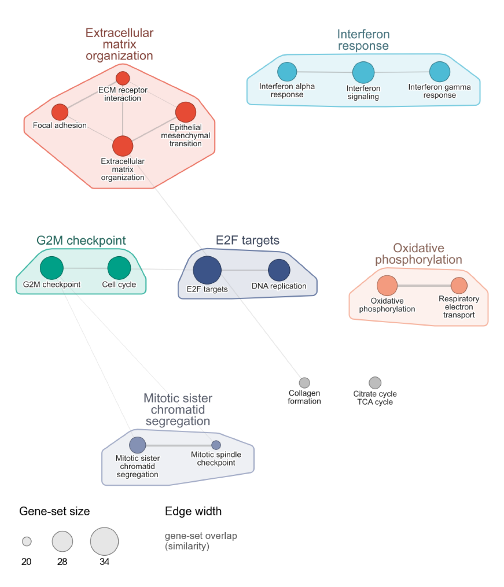
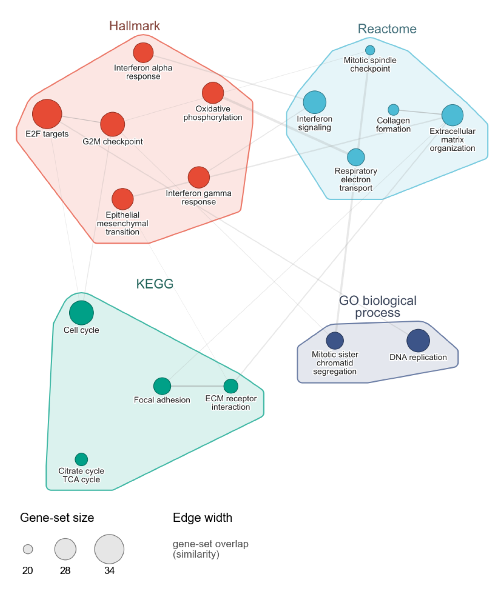
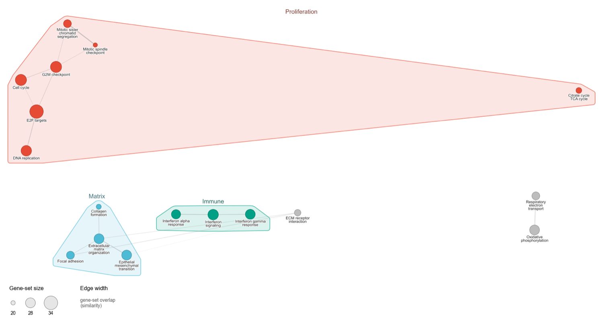
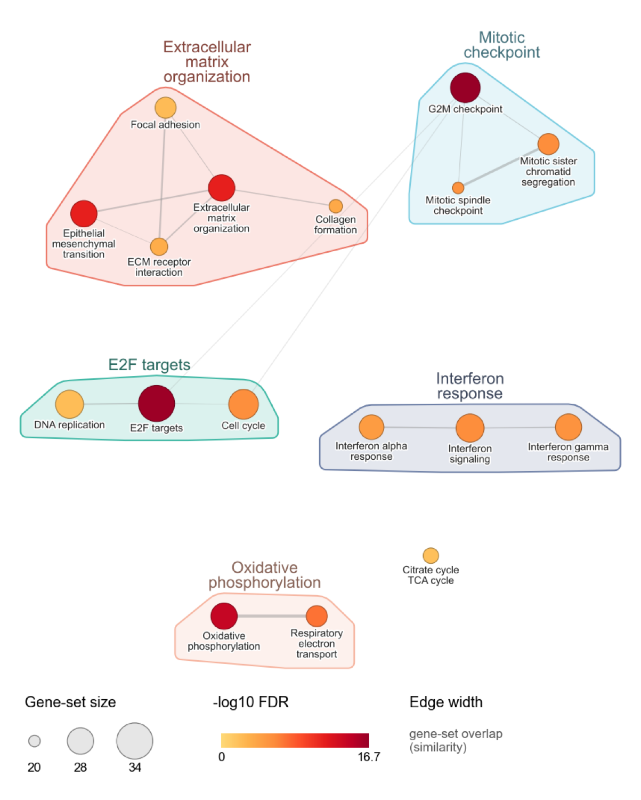
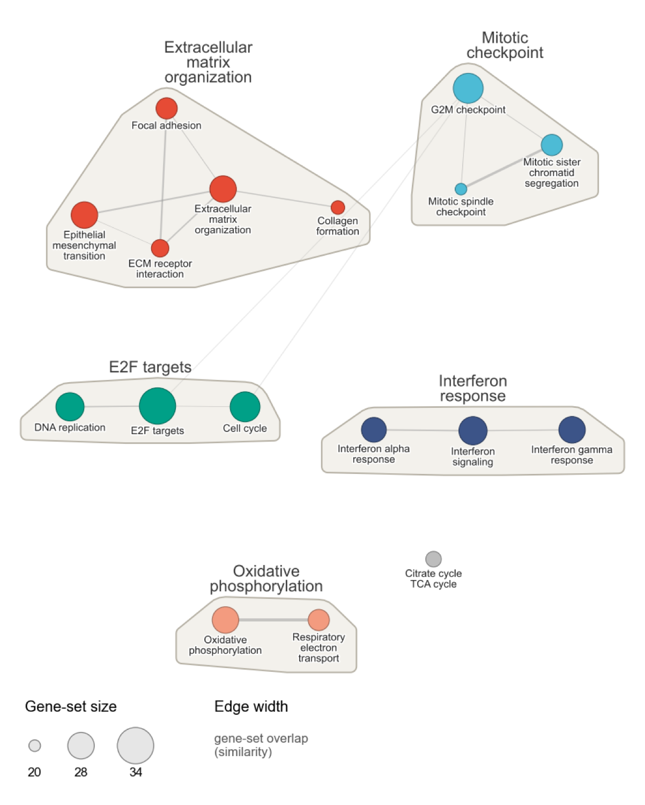

# Grouping pathways and styling figures

The default network groups pathways by Markov clustering and colors them by direction. This tutorial shows the other ways to group the same pathways, and the options that change how the figure looks. It runs offline on the demo data.

## Setup

```python
import simpnetworkviz as snv
from simpnetworkviz.genesets import demo_path

gene_sets = snv.load_gene_sets("demo")
genes = snv.read_gene_list(demo_path("demo_genes.tsv"))
table = snv.analyze_genes(genes, gene_sets)
```

## Part 1: Ways to group pathways

### Compare the clustering methods

The grouping method is the `cluster_method` argument, or `--cluster` on the command line. Run the same table through each:

```python
for method in ["mcl", "louvain", "greedy", "label_propagation", "hierarchical", "components"]:
    net = snv.build_pathway_network(table, gene_sets, similarity_cutoff=0.3, cluster_method=method)
    ct = net.cluster_table()
    print(method, len(ct), "|", "; ".join(f"{r.label} ({r.n_nodes})" for r in ct.itertuples()))
```

| Method | Clusters | Clusters found (number of pathways) |
|---|---|---|
| `mcl` | 5 | Extracellular matrix organization (5); Mitotic checkpoint (3); E2F targets (3); Interferon response (3); Oxidative phosphorylation (2) |
| `louvain` | 4 | Mitotic checkpoint (6); Extracellular matrix organization (5); Interferon response (3); Oxidative phosphorylation (2) |
| `greedy` | 4 | the same four |
| `label_propagation` | 4 | the same four |
| `hierarchical` | 6 | Extracellular matrix organization (4); Interferon response (3); G2M checkpoint (2); E2F targets (2); Oxidative phosphorylation (2); Mitotic sister chromatid segregation (2) |
| `components` | 4 | the same four as `louvain` |

On this small network the methods differ in one place: whether the six cell-cycle pathways are one theme or several. MCL splits them into a mitotic and a replication cluster, the community-detection methods keep them together, and hierarchical clustering splits them into three.

[](../images/vignettes/grouping_hierarchical.png)

What each method does:

| Method | What it does | Tuning |
|---|---|---|
| `mcl` (default) | Markov clustering on the similarity graph, as in AutoAnnotate | `mcl_inflation`, `--inflation`: higher gives more, smaller clusters (default 2) |
| `louvain`, `greedy` | Community detection | `louvain_resolution`, `--resolution`: higher gives more clusters (default 1) |
| `label_propagation` | Fast community detection | |
| `hierarchical` | Average-linkage clustering on gene-set distance; also groups pathways related through intermediates | `hierarchical_threshold`, `--linkage-threshold` (default 1 − cutoff) |
| `components` | Each connected group of pathways is one cluster | |

For MCL on the demo data, inflation 1.5 gives four clusters, and 2 and 4 both give five.

### Group by source database

`cluster_method="category"` ignores gene overlap and groups the pathways by where they come from, read from the prefix of the name:

```python
net = snv.build_pathway_network(table, gene_sets, similarity_cutoff=0.3, cluster_method="category")
net.plot("grouping_category.pdf", color_by="cluster")
```

```text
Hallmark (6); Reactome (5); KEGG (4); GO biological process (2)
```

[](../images/vignettes/grouping_category.png)

To group by something else, such as MSigDB sub-collections, pass your own mapping: `categories={"PATHWAY_NAME": "My category", ...}` in Python, or `--categories FILE` with `pathway<TAB>category` on each line.

### Group by your own themes

`cluster_method="keyword"` assigns each pathway to the first theme whose keyword appears in its name:

```python
themes = {
    "Proliferation": ["cycle", "mitotic", "E2F", "replication", "checkpoint"],
    "Immune": ["interferon", "cytokine", "antigen"],
    "Matrix": ["matrix", "collagen", "mesenchymal", "adhesion"],
}
net = snv.build_pathway_network(table, gene_sets, similarity_cutoff=0.3,
                                cluster_method="keyword", themes=themes)
net.plot("grouping_keyword.pdf", color_by="cluster")
```

```text
Proliferation (7); Matrix (4); Immune (3)
```

[](../images/vignettes/grouping_keyword.png)

The first matching theme wins, so list specific themes before general ones. Pathways that match nothing stay unclustered: here the two oxidative phosphorylation pathways and ECM receptor interaction.

A keyword matches anywhere in the name. Here `cycle` also catches the citrate cycle and puts it under Proliferation, so check the result and choose keywords that are specific enough.

On the command line, put the themes in a file with one theme per line:

```text
Proliferation	cycle, mitotic, E2F, replication, checkpoint
Immune	interferon, cytokine, antigen
Matrix	matrix, collagen, adhesion
```

```bash
snv run degs.csv --library MSigDB_Hallmark_2020 --cluster keyword --themes themes.tsv
```

### Change what "similar" means

Two more switches change the edges, and so the clusters:

* `similarity_metric`, `--similarity`: `"combined"` (default), `"jaccard"` or `"overlap"`.
* `use_full_gene_sets=False`, `--similarity-genes hits`: compare the pathways by your hit genes only, not by their full gene sets. This asks which of *your* genes the pathways share. On the demo data it gives 23 edges where the full gene sets give 16.

## Part 2: Styling the figure

```python
pnet = snv.build_pathway_network(table, gene_sets, similarity_cutoff=0.3)
```

### Colors

| `color_by` | Look |
|---|---|
| `"direction"` | Red for up, blue for down, shade by FDR. The default when the table has directions. |
| `"cluster"` | One pastel color per cluster |
| `"significance"` | One color scale, by −log10 FDR |
| `"nes"` | By normalized enrichment score, for [GSEA](gsea.md) |
| `"condition"` | Pie slices by condition, for [comparisons](compare.md) |

```python
pnet.plot("significance.pdf", color_by="significance")
```

[](../images/vignettes/fig_significance.png)

### Cluster outlines

Each cluster has its own outline color, so that the pathway figure and the gene figure match. For grey outlines:

```python
pnet.plot("neutral.pdf", color_by="cluster", hull_style="neutral")
```

[](../images/vignettes/fig_neutral.png)

### Text, labels and size

```python
pnet.plot("figure.pdf",
          title="My comparison",
          node_labels="top",            # "auto", "all", "none", "top" or a list of pathway names
          cluster_label_size=16,
          node_label_size=8,
          max_width=12)                 # inches
```

Node labels are shown by default on pathway networks with up to 30 nodes. All text is Arial, or Liberation Sans where Arial is not installed.

### Rename a cluster

```python
pnet.group_labels[3] = "DNA replication"
pnet.plot("renamed.pdf")
```

Build the gene network after renaming, so that it carries the new labels.

### Formats

| Format | Use it for |
|---|---|
| PDF, SVG | Journal figures. Vector graphics with editable text. |
| PNG | Slides. Set the resolution with `dpi=300`, or `--dpi` on the command line. |
| HTML | Exploring the network, or sharing it with collaborators |
| `.cyjs` + `_style.xml` | Finishing by hand in Cytoscape |

On the command line, figures are written as PDF and SVG by default. Add `png` to `--formats` for a raster copy:

```bash
snv run degs.csv --library MSigDB_Hallmark_2020 --formats png,pdf,html,csv --dpi 600
```

### Finish in Cytoscape

1. *File ▸ Import ▸ Network from File*: choose `pathway_network.cyjs`. Positions are kept.
2. *File ▸ Import ▸ Styles from File*: choose `pathway_network_style.xml`, then apply the **SimpNetworkViz** style.
3. Optionally run AutoAnnotate on the existing `cluster` column.

The options are listed in full in [Grouping pathways](../guide/grouping.md) and [Customizing the figures](../guide/figures.md).
