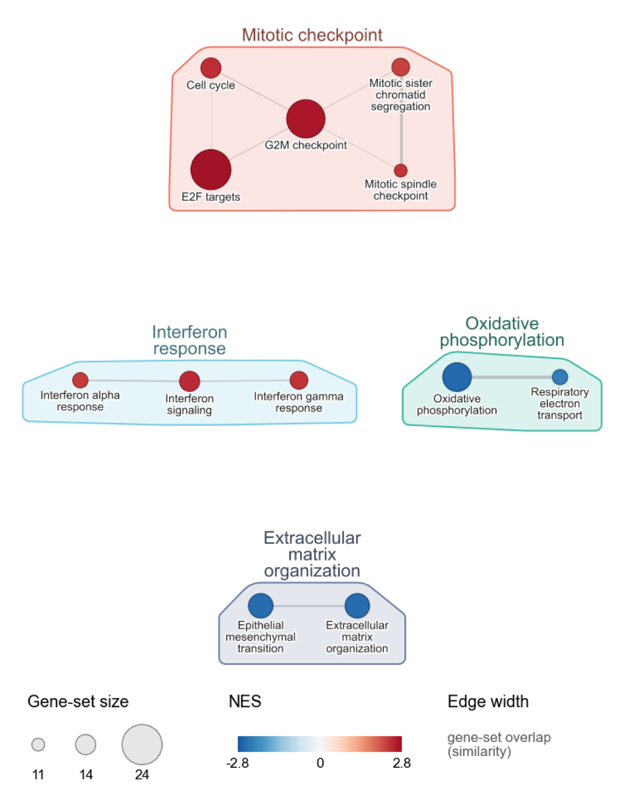
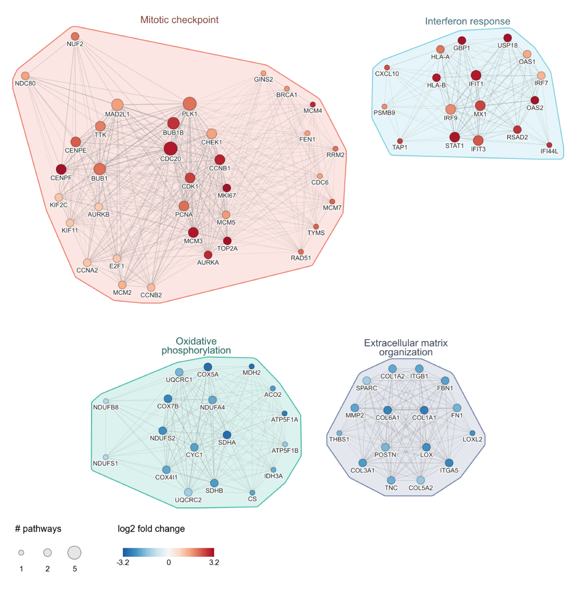

# Preranked GSEA

Over-representation analysis needs a list of significant genes, which means choosing a fold-change or p-value cutoff. Preranked GSEA takes **all** measured genes with a statistic for each, and asks whether the genes of a pathway sit at the top or the bottom of that ranking. This tutorial runs GSEA and draws the network colored by normalized enrichment score.

It runs offline on the demo data. Because the demo has only 88 genes, the tutorial pads them with 3,000 random background genes to make a ranking; with real data you pass the full result table.

## Setup

```python
import numpy as np
import pandas as pd
import simpnetworkviz as snv
from simpnetworkviz.genesets import demo_path

gene_sets = snv.load_gene_sets("demo")
genes = snv.read_gene_list(demo_path("demo_genes.tsv"))
```

## Step 1: Make the ranking

A ranking is a pandas Series from gene to statistic, where higher means up-regulated. Good statistics are the DESeq2 `stat` column, the limma `t` column, or the log2 fold change.

```python
rng = np.random.default_rng(0)
ranking = pd.Series(rng.normal(size=3000), index=[f"GENE{i}" for i in range(3000)])
ranking = pd.concat([ranking, pd.Series(genes)])
len(ranking)
```

```text
3088
```

```python
ranking.sort_values(ascending=False).head(4)
```

```text
OAS2     3.48
TOP2A    3.36
CENPF    3.35
USP18    3.34
```

With real data, read the full table instead. `read_ranking` takes the same file formats as a gene list:

```python
ranking = snv.read_ranking("deseq2_all_genes.csv")
```

## Step 2: Run GSEA

```python
gsea = snv.gsea_prerank(ranking, gene_sets, min_size=10)
gsea.shape
```

```text
(12, 12)
```

```python
gsea[["pathway", "es", "nes", "pvalue", "fdr", "direction"]].head(8)
```

```text
                                   pathway        es       nes   pvalue      fdr direction
                   HALLMARK_G2M_CHECKPOINT  0.839804  2.712720 0.001876 0.002062        up
       REACTOME_MITOTIC_SPINDLE_CHECKPOINT  0.890485  2.379281 0.001898 0.002062        up
        HALLMARK_INTERFERON_ALPHA_RESPONSE  0.860433  2.335209 0.001934 0.002062        up
                           KEGG_CELL_CYCLE  0.851659  2.452631 0.001961 0.002062        up
             REACTOME_INTERFERON_SIGNALING  0.866748  2.496084 0.001961 0.002062        up
        HALLMARK_OXIDATIVE_PHOSPHORYLATION -0.849334 -2.630976 0.001969 0.002062      down
HALLMARK_EPITHELIAL_MESENCHYMAL_TRANSITION -0.875490 -2.577230 0.001988 0.002062      down
REACTOME_EXTRACELLULAR_MATRIX_ORGANIZATION -0.876073 -2.578948 0.001988 0.002062      down
```

The table has the columns of an ORA table plus two more:

* `es`: the enrichment score, the maximum of the weighted Kolmogorov–Smirnov running sum.
* `nes`: the normalized enrichment score, ES divided by the mean of the null scores of the same sign. Positive means the pathway is at the up-regulated end of the ranking.

P-values come from 1,000 gene permutations (`n_perm=`), so they cannot be smaller than about 0.001. The permutations use a fixed random seed (`seed=0`), so the same input gives the same table. By default, gene sets with 15 to 500 genes in the ranking are tested; this tutorial lowers `min_size` to 10 because the demo gene sets are small.

The `genes` column holds the leading-edge genes, the ones that drive the score:

```python
gsea.genes.iloc[0]
```

```text
TOP2A;CENPF;MKI67;MCM3;CDC20;CCNB1;AURKA;CDK1;CENPE;PCNA;BUB1;PLK1;TTK;MCM5;MAD2L1;CHEK1;MCM2;CCNB2;KIF11;CCNA2;E2F1;...
```

## Step 3: Build and plot the network

FDR 0.25 is the customary cutoff for GSEA.

```python
gnet = snv.build_pathway_network(gsea, gene_sets, fdr_cutoff=0.25, similarity_cutoff=0.3)
gnet.graph.number_of_nodes(), gnet.graph.number_of_edges()
```

```text
(12, 10)
```

```python
gnet.cluster_table()[["cluster", "label", "n_nodes"]]
```

```text
 cluster                             label  n_nodes
       1                Mitotic checkpoint        5
       2               Interferon response        3
       3         Oxidative phosphorylation        2
       4 Extracellular matrix organization        2
```

```python
gnet.plot("gsea_network.pdf", color_by="nes")
```

[](../images/vignettes/gsea_nes.png)

With `color_by="nes"`, red nodes are pathways enriched at the up-regulated end of the ranking and blue nodes at the down-regulated end; the shade is the size of the NES.

## Step 4: Draw the leading-edge genes

For GSEA, the gene network shows the leading-edge genes of the pathways. Pass the ranking as `gene_values` to color them by statistic:

```python
ggenes = snv.build_gene_network(gnet, gene_sets, gene_values=dict(ranking))
ggenes.graph.number_of_nodes(), ggenes.graph.number_of_edges()
```

```text
(86, 818)
```

[](../images/vignettes/gsea_genes.png)

## The same analysis on the command line

```bash
snv run deseq2_all_genes.csv --method gsea --library MSigDB_Hallmark_2020 --fdr 0.25 -o results
```

| Option | Default | Meaning |
|---|---|---|
| `--method gsea` | `ora` | Run preranked GSEA |
| `--permutations` | 1000 | Number of gene permutations |
| `--min-size`, `--max-size` | 15, 500 | Gene-set size limits |
| `--fdr` | 0.05 | Use 0.25 for GSEA |

To get the table without figures, use `snv enrich deseq2_all_genes.csv --method gsea --library ... -o gsea.csv`.

## ORA or GSEA?

| | ORA | Preranked GSEA |
|---|---|---|
| Input | A list of significant genes | All measured genes with a statistic |
| Needs a cutoff for the gene list | Yes | No |
| Needs a background | Yes, the measured genes | No; the ranking is the background |
| Direction | Up and down lists tested separately | The sign of the NES |
| Speed | Instant | Seconds to minutes, depending on the library |

The method is described in [Theory behind SimpNetworkViz](../theory.md).
