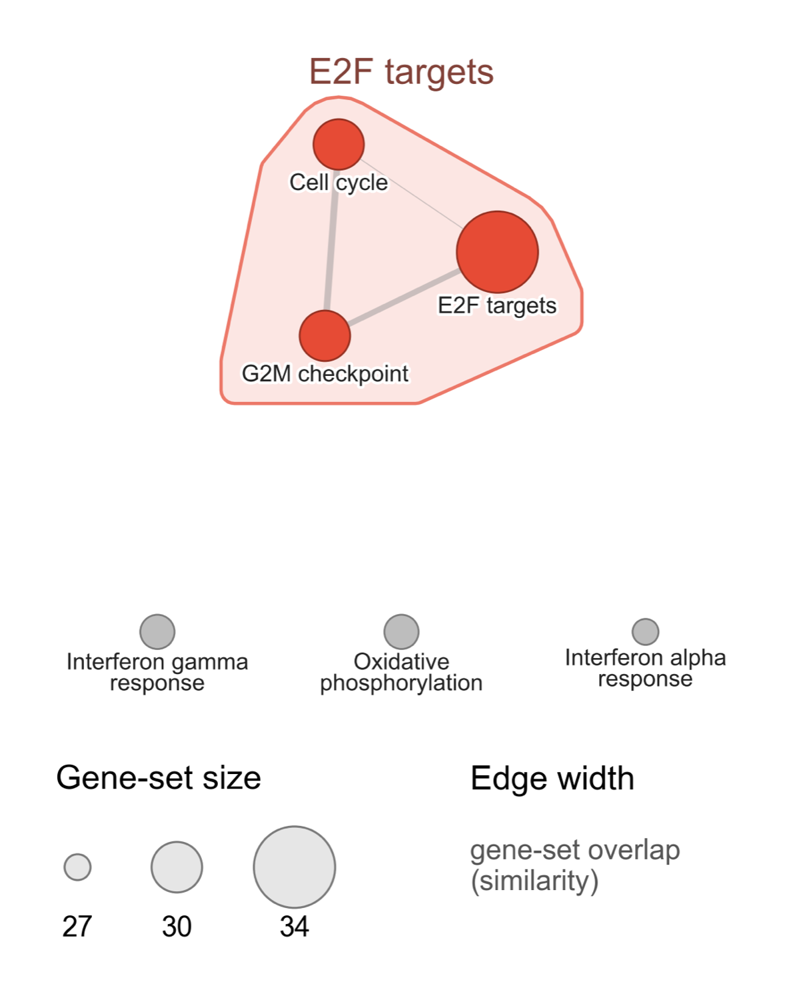
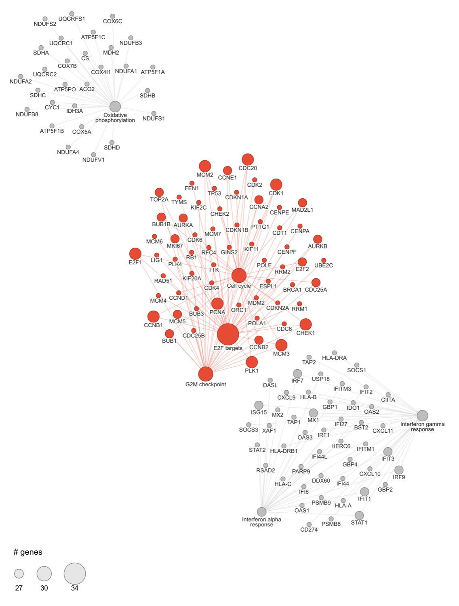

# Starting from other tools' results or a pathway list

You do not have to run the enrichment in SimpNetworkViz. If you already have results from Enrichr, clusterProfiler, g:Profiler or GSEA, or just a set of pathways you want to draw, start from those. This tutorial does both. It runs offline on the demo data.

## Part 1: From an enrichment table

### Step 1: Export the table

Save the result of the other tool as CSV or TSV, with the column names the tool gives it. For clusterProfiler, in R:

```r
ego <- enrichGO(gene = degs, OrgDb = org.Hs.eg.db, keyType = "SYMBOL", ont = "BP")
write.csv(as.data.frame(ego), "clusterProfiler_result.csv", row.names = FALSE)
```

To have a file to work with offline, this tutorial writes the demo enrichment in clusterProfiler's layout:

```python
import pandas as pd
import simpnetworkviz as snv
from simpnetworkviz.genesets import demo_path

genes = snv.read_gene_list(demo_path("demo_genes.tsv"))
t = snv.analyze_genes(genes, snv.load_gene_sets("demo"))

cp = pd.DataFrame({
    "ID": t.pathway, "Description": t.pathway,
    "GeneRatio": t.overlap.astype(str) + "/" + t.query_size.astype(str),
    "BgRatio": t.set_size.astype(str) + "/" + t.background_size.astype(str),
    "pvalue": t.pvalue, "p.adjust": t.fdr,
    "geneID": t.genes.str.replace(";", "/"), "Count": t.overlap,
})
cp.to_csv("clusterProfiler_result.csv", index=False)
```

The file now looks like a clusterProfiler export:

```text
ID,Description,GeneRatio,BgRatio,pvalue,p.adjust,geneID,Count
HALLMARK_G2M_CHECKPOINT,HALLMARK_G2M_CHECKPOINT,23/53,30/486,5.71e-19,1.83e-17,AURKA/AURKB/BUB1/CCNA2/...,23
```

### Step 2: Check how the table is read

`read_enrichment` detects the columns by name and maps them to the package's standard columns:

```python
r = snv.read_enrichment("clusterProfiler_result.csv")
r.columns.tolist()
```

```text
['pathway', 'fdr', 'pvalue', 'genes', 'overlap', 'set_size', 'nes', 'direction']
```

```python
r[["pathway", "fdr", "overlap", "set_size"]].head(2)
```

```text
                pathway          fdr  overlap  set_size
HALLMARK_G2M_CHECKPOINT 1.828495e-17     23.0        30
   HALLMARK_E2F_TARGETS 3.200497e-17     24.0        34
```

`Description` became `pathway`, `p.adjust` became `fdr`, `geneID` became `genes`, and the set size was read from `BgRatio`. The recognized layouts:

| Source | Pathway | Significance | Genes |
|---|---|---|---|
| Enrichr | `Term` | `Adjusted P-value` | `Genes` |
| clusterProfiler | `Description` | `p.adjust` | `geneID` |
| g:Profiler | `term_name` | `p_value` | `intersections` |
| GSEA desktop | `NAME` | `FDR q-val` | none; `NES` is read |
| SimpNetworkViz | `pathway` | `fdr` | `genes` |

### Step 3: Draw the network

Pass the table with `--enrichment`, and the gene sets it was computed from:

```bash
snv run --enrichment clusterProfiler_result.csv --library demo --cutoff 0.3 -o results
```

```text
Pathway network: 17 pathways, 16 edges, 5 clusters
  [ 1] Extracellular matrix organization  (5 pathways)
  [ 2] Mitotic checkpoint  (3 pathways)
  [ 3] E2F targets  (3 pathways)
  [ 4] Interferon response  (3 pathways)
  [ 5] Oxidative phosphorylation  (2 pathways)
Gene network: 88 genes, 893 edges
```

No test is run. The FDR values of the table are used as they are, and `--fdr` and `--max-pathways` still choose which pathways are drawn. The result is the same network as in the [guided tutorial](demo.md), because the table holds the same numbers.

### Why pass the gene sets?

The gene sets are used to measure how much two pathways overlap. Without them, the overlap is computed from the genes listed in the table, which are only your hits in each pathway:

```bash
snv run --enrichment clusterProfiler_result.csv --cutoff 0.3 -o results_no_gene_sets
```

```text
Pathway network: 17 pathways, 23 edges, 5 clusters
```

The same 17 pathways now have 23 edges where the full gene sets give 16, and the clusters change. Pass the gene sets with `--library`, `--gmt` or `--msigdb` to get the network EnrichmentMap would draw. For a GSEA table, which lists no genes, they are required.

### Color the genes by fold change

The table has no fold changes. To color the gene network, pass the gene list as well:

```bash
snv run degs.csv --enrichment clusterProfiler_result.csv --library demo --cutoff 0.3 -o results
```

For a GSEA table, `--color-by nes` colors the pathways by normalized enrichment score.

### In Python

```python
table = snv.read_enrichment("clusterProfiler_result.csv")
pnet = snv.build_pathway_network(table, snv.load_gene_sets("demo"), similarity_cutoff=0.3)
pnet.plot("pathway_network.pdf")
```

## Part 2: From a pathway list

Use this to draw a chosen set of pathways, for example the ones you discuss in a paper.

### Step 1: Write the list

One pathway name per line, in a file called `my_pathways.txt`. Matching ignores case and punctuation, so `G2M checkpoint` finds `HALLMARK_G2M_CHECKPOINT`.

```text
G2M checkpoint
E2F targets
KEGG cell cycle
Interferon gamma response
Interferon alpha response
Oxidative phosphorylation
```

### Step 2: Draw the pathways

```bash
snv run --pathways my_pathways.txt --library demo --cutoff 0.3 --gene-network cnet -o results
```

```text
Pathway network: 6 pathways, 3 edges, 1 clusters
  [ 1] E2F targets  (3 pathways)
Gene network: 145 genes, 177 edges
```

All six pathways are drawn. There is no enrichment test, so there is no FDR, no red and blue, and no FDR cutoff. The three cell-cycle pathways overlap enough to form a cluster, and the other three stay single nodes:

[](../images/vignettes/pathways_network.png)

With `--gene-network cnet`, the gene network links each gene to its pathways. No gene list was given, so it shows the full gene sets, 145 genes in all:

[](../images/vignettes/pathways_cnet.png)

### Step 3: Restrict to your genes

Pass a gene list as well to draw only your genes in those pathways, colored by fold change:

```bash
snv run degs.csv --pathways my_pathways.txt --library demo --cutoff 0.3 --gene-network cnet -o results
```

### In Python

```python
gene_sets = snv.load_gene_sets("demo")
names = snv.read_pathway_list("my_pathways.txt")
table = snv.table_from_pathways(names, gene_sets)
pnet = snv.build_pathway_network(table, gene_sets, fdr_cutoff=None, similarity_cutoff=0.3)
pnet.plot("pathway_network.pdf")
```

The input formats are listed in full in [File formats](../fileformats.md).
