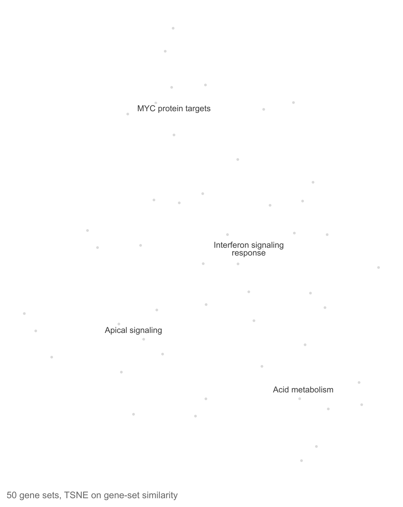
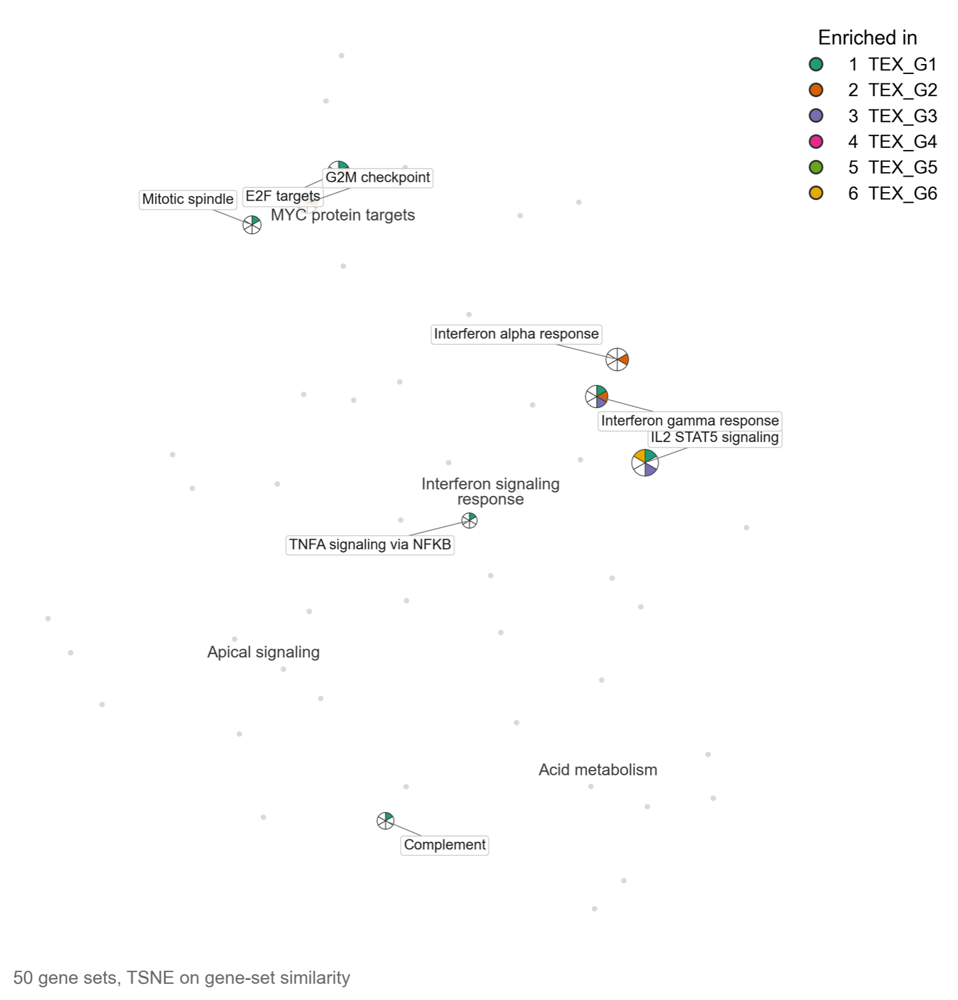
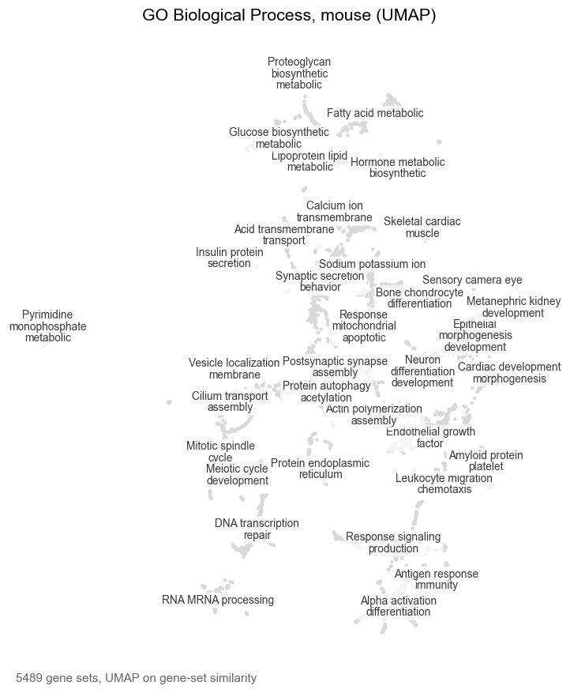
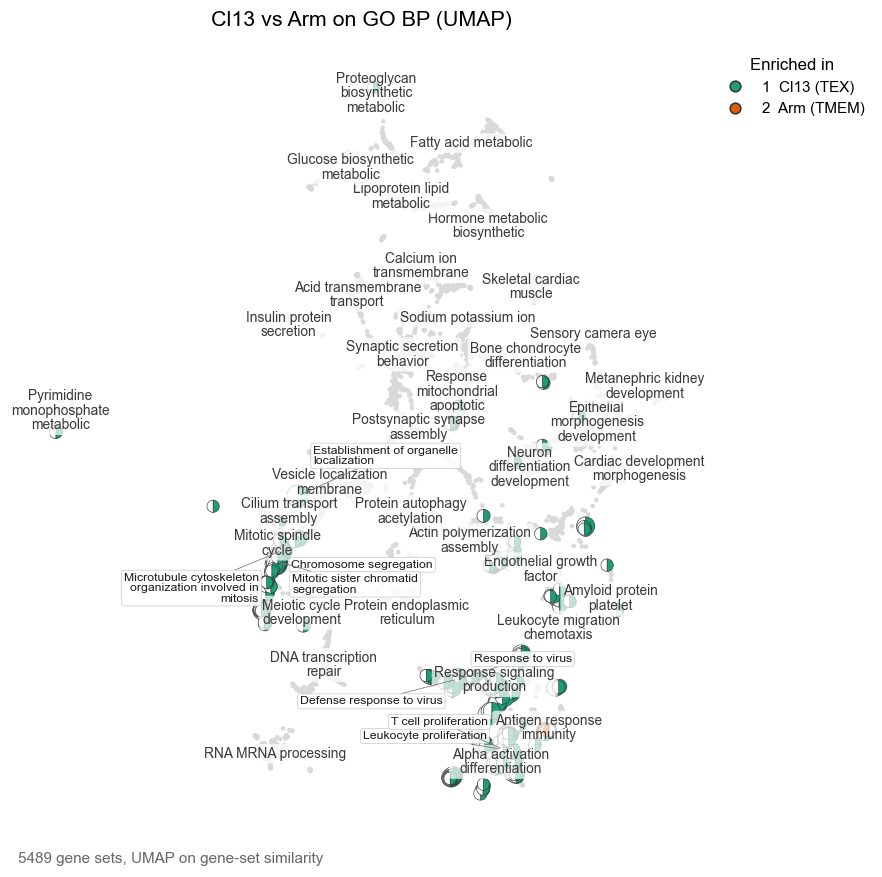

# The pathway map: one coordinate system for a whole library

A pathway network is laid out afresh for each analysis, so two figures cannot be compared position by position, and a large library such as GO is too big to draw whole. The **pathway map** solves both. Every gene set of a library is placed once in two dimensions from gene-set similarity, the map is divided into labeled regions, and every later analysis is drawn on that same background.

This tutorial builds a small map and draws an analysis on it. It uses files from the repository, so it runs offline:

* the 50 mouse Hallmark gene sets, `examples/Cl13_vs_Arm/genesets/mh.all.v2025.1.Mm.symbols.gmt`
* six gene groups from exhausted CD8 T cells, `examples/Cl13_vs_Arm/data/Cl13_groups.csv`

The maps need the `map` extra:

```bash
pip install -e ".[map]"
```

Run the commands from the repository root.

## Step 1: Build the map

Build a map once per library. The result is a CSV that you keep and reuse.

```bash
snv map --gmt examples/Cl13_vs_Arm/genesets/mh.all.v2025.1.Mm.symbols.gmt --method tsne -o hallmark_map.csv
```

```text
50 gene sets; building the map (tsne) ...
50 pathways placed with TSNE, 4 labelled regions -> hallmark_map.csv, hallmark_map.pdf, hallmark_map.html (interactive)
  [ 1] Interferon signaling response  (13 pathways)
  [ 2] MYC protein targets  (13 pathways)
  [ 3] Apical signaling  (11 pathways)
  [ 4] Acid metabolism  (10 pathways)
Use it with:  snv run genes.txt --library ... --map hallmark_map.csv
```

Three files are written:

| File | Contents |
|---|---|
| `hallmark_map.csv` | The map: one row per gene set, with its coordinates and region |
| `hallmark_map.pdf` | The map drawn without hits |
| `hallmark_map.html` | The interactive map |

```text
method,pathway,x,y,set_size,cluster,cluster_label
tsne,HALLMARK_ADIPOGENESIS,62.22,-50.28,200,4,Acid metabolism
tsne,HALLMARK_ALLOGRAFT_REJECTION,24.07,25.69,192,1,Interferon signaling response
```

[](../images/vignettes/map_hallmark_library.png)

Each point is a gene set. Gene sets that share genes are close together, and each region is named from the words its gene sets share. Open the [interactive Hallmark map](https://helenhuangmath.github.io/SimpNetworkViz/examples/hallmark-map.html) to hover over the points.

How the map is made:

1. Every gene set becomes a vector of its genes, weighted so that rare genes count more (TF-IDF).
2. The vectors are reduced to 50 dimensions (SVD).
3. The 50-dimensional vectors are embedded in two dimensions with t-SNE or UMAP.
4. Regions are Louvain communities in the 50-dimensional space, so they do not depend on the 2-D layout.

Options that change the map:

| Option | Default | Meaning |
|---|---|---|
| `--method` | `auto` | `umap`, `tsne`, or `auto` (UMAP if installed, else t-SNE) |
| `--min-size`, `--max-size` | 10, 500 | Only gene sets of this size are placed |
| `--neighbors` | 15 | Neighbours used for the embedding and the regions |
| `--resolution` | 1.0 | Higher gives more, smaller regions |
| `--seed` | 0 | Random seed |

:::{tip}
Pick one map per library and keep it. The point of the map is that every later analysis uses the same coordinates.
:::

## Step 2: Draw an analysis on the map

Add `--map` to any `snv run`, `snv compare` or `snv markers` command. Here the six gene groups are compared against Hallmark and drawn on the map from Step 1:

```bash
snv compare --groups examples/Cl13_vs_Arm/data/Cl13_groups.csv \
    --gmt examples/Cl13_vs_Arm/genesets/mh.all.v2025.1.Mm.symbols.gmt \
    --map hallmark_map.csv -o results
```

```text
6 groups: TEX_G1 (308 genes), TEX_G2 (146 genes), TEX_G3 (114 genes), TEX_G4 (78 genes), TEX_G5 (65 genes), TEX_G6 (46 genes)
Pathway network: 8 pathways, 1 edges, 1 clusters
Conditions (pie slices): TEX_G1, TEX_G2, TEX_G3, TEX_G4, TEX_G5, TEX_G6
  [ 1] Interferon alpha response  (2 pathways)
Gene network: 150 genes, 3185 edges
```

Eight Hallmark sets are enriched in at least one group. Hallmark sets share few genes, so the network has a single edge and says little. The map is more useful here.

Besides the usual files, the run writes four map files:

| File | Contents |
|---|---|
| `pathway_map.pdf` | The enriched pathways drawn on the map |
| `pathway_map.html` | The interactive version |
| `pathway_map_hits.csv` | Every enriched pathway with its coordinates and region |
| `pathway_map_regions.csv` | The number of hits in each region, per condition |

[](../images/vignettes/map_hallmark_cl13.png)

How to read it:

* **Grey points:** the gene sets of the library that are not enriched.
* **Pies:** the enriched gene sets, with one slice per condition, as in a [comparison network](compare.md). A larger pie is more significant.
* **Boxed labels:** the most significant hits.
* **Plain labels:** the region names.

The hits fall in two of the four regions. The interferon and IL2–STAT5 sets, TNFα signaling and complement are in *Interferon signaling response*; G2M checkpoint, E2F targets and mitotic spindle are in *MYC protein targets*. Nothing lands in the other two regions.

Explore the same result in the [interactive map of the six groups](https://helenhuangmath.github.io/SimpNetworkViz/examples/hallmark-cl13-subgroups.html).

## Step 3: Count the hits per region

`pathway_map_regions.csv` turns the picture into a table:

| Region | Sets in region | TEX_G1 | TEX_G2 | TEX_G3 | TEX_G4 | TEX_G5 | TEX_G6 |
|---|---|---|---|---|---|---|---|
| Interferon signaling response | 13 | 4 | 2 | 2 | 0 | 0 | 1 |
| MYC protein targets | 13 | 3 | 2 | 0 | 0 | 0 | 0 |
| Apical signaling | 11 | 0 | 0 | 0 | 0 | 0 | 0 |
| Acid metabolism | 10 | 0 | 0 | 0 | 0 | 0 | 0 |

TEX_G1 and TEX_G2 hit both active regions; TEX_G3 and TEX_G6 hit only the interferon region; TEX_G4 and TEX_G5 have no Hallmark hit. The file also has a `fraction_<condition>` column for each condition, the share of the region's gene sets that are hits.

`pathway_map_hits.csv` lists each hit with its region and genes:

```text
pathway,condition,fdr,direction,x,y,cluster,cluster_label,overlap,genes
HALLMARK_IL2_STAT5_SIGNALING,TEX_G3,4.37e-07,,48.54,13.11,1,Interferon signaling response,14,ADAM19;BCL2;CTLA4;FGL2;...
HALLMARK_INTERFERON_ALPHA_RESPONSE,TEX_G2,1.72e-05,,42.48,35.56,1,Interferon signaling response,10,CASP1;CCRL2;DHX58;...
```

## The same in Python

```python
import simpnetworkviz as snv

gene_sets = snv.load_gene_sets("examples/Cl13_vs_Arm/genesets/mh.all.v2025.1.Mm.symbols.gmt")
pmap = snv.build_pathway_map(gene_sets, method="tsne")       # or snv.load_map("hallmark_map.csv")
snv.save_map(pmap, "hallmark_map.csv")

groups = snv.read_gene_groups("examples/Cl13_vs_Arm/data/Cl13_groups.csv")
table = snv.compare_conditions(groups, gene_sets)

hits = snv.map_hits(pmap, table)                 # enriched pathways with x, y, region
snv.region_summary(pmap, hits)                   # hits per region per condition
snv.plot_pathway_map(pmap, table, "pathway_map.pdf")
snv.write_map_html(pmap, "pathway_map.html", table)
```

## A large library: GO biological process

The map matters most for libraries that cannot be drawn as a network. The [Cl13 vs Arm tutorial](cl13_vs_arm.md#step-6-place-every-analysis-on-the-pathway-map) uses a map of all 5,489 mouse GO biological process terms, in 35 regions:

| The library | With the Cl13 vs Arm hits |
|---|---|
| [](../../docs/images/pathway_map_umap_library.png) | [](../../docs/images/pathway_map_umap.png) |

To build it, let the package download the collection:

```bash
snv map --msigdb GO_BP --species mouse -o gobp_map.csv
snv run degs.csv --msigdb GO_BP --species mouse --map gobp_map.csv
```

Explore it in the [interactive Cl13 vs Arm map](https://helenhuangmath.github.io/SimpNetworkViz/examples/cl13-vs-arm.html): search for a pathway, select a group with the lasso, and read the enrichment statistics and overlapping genes in the side panel.

## One map per MSigDB collection

MSigDB bundles its collections in one file and prefixes every set with its collection (`HALLMARK_`, `GOBP_`, `REACTOME_`, …). `--by-category` splits a library by these prefixes and builds a t-SNE and a UMAP map for each collection:

```bash
snv map --gmt msigdb.v2025.1.Mm.symbols.gmt --by-category -o msigdb_maps
snv run genes.txt --gmt msigdb.v2025.1.Mm.symbols.gmt --map msigdb_maps/go_biological_process_map_umap.csv
```

Ready-made maps of the MSigDB collections are in [`examples/msigdb_maps`](https://github.com/helenhuangmath/SimpNetworkViz/tree/main/examples/msigdb_maps) in the repository, so you can skip Step 1 for those libraries.

## t-SNE or UMAP?

Both maps of a library have the same regions and labels, because regions are found in similarity space and not in the picture. Only the layout differs: UMAP keeps related regions closer together and leaves more white space, and t-SNE spreads the regions more evenly.

More detail is in [The whole-library view and the pathway map](../guide/library_map.md).
