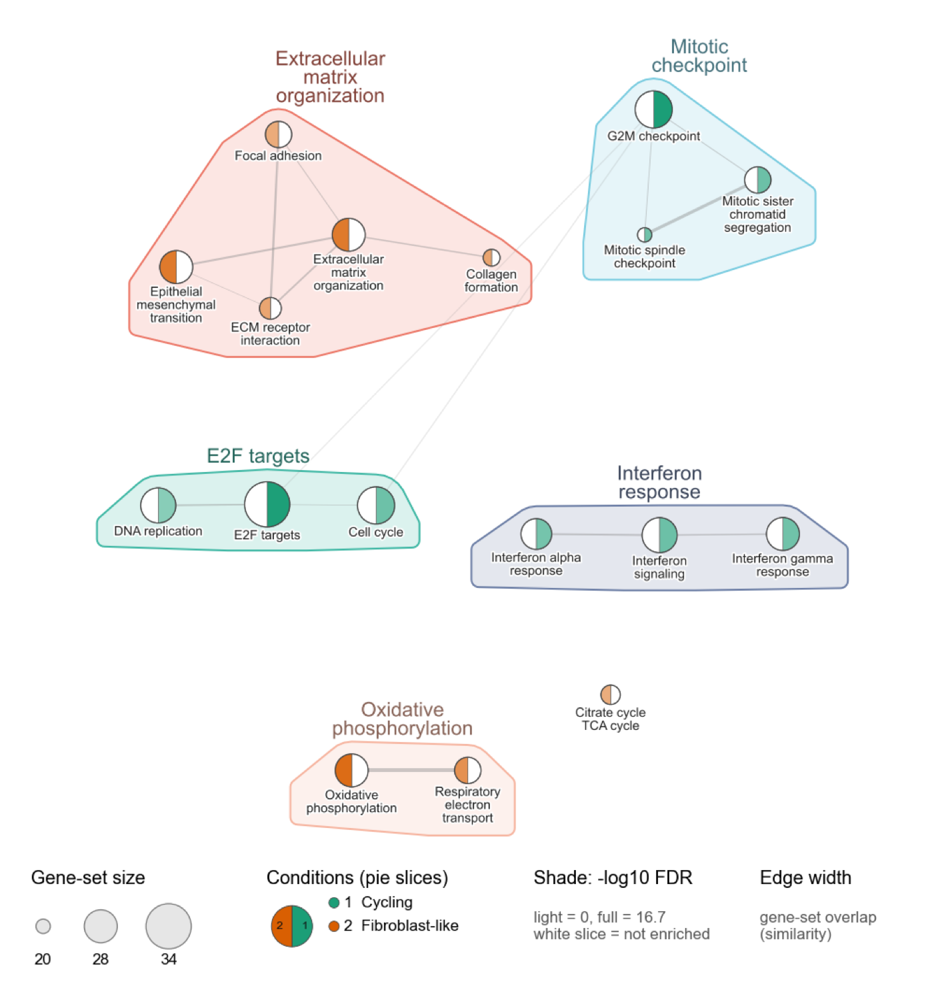
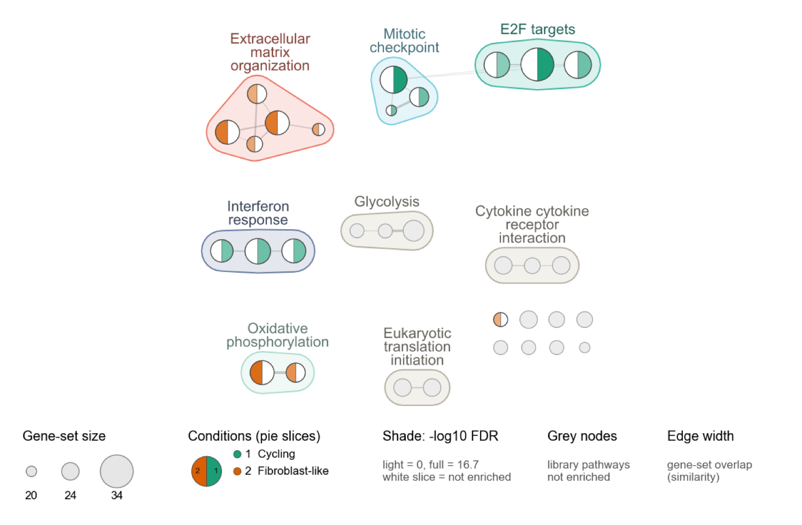

# Single-cell marker genes

A single-cell analysis ends with a marker table: the genes that distinguish each cell cluster. This tutorial turns that table into one pathway network in which each cell cluster is a pie slice, so you can see which pathways each cluster carries.

The tutorial runs offline. It builds a small stand-in marker table from the demo genes, with two "cell clusters". With your own data, you start from the export in Step 1.

## Step 1: Export the markers

From Seurat, in R:

```r
markers <- FindAllMarkers(obj)
write.csv(markers, "markers.csv")
```

From scanpy, in Python:

```python
sc.tl.rank_genes_groups(adata, "leiden")
sc.get.rank_genes_groups_df(adata, None).to_csv("markers.csv")
```

Both layouts are recognized by their column names: Seurat's `cluster`, `gene`, `avg_log2FC`, `p_val_adj`, and scanpy's `group`, `names`, `logfoldchanges`, `pvals_adj`. Any table with cluster, gene, log fold-change and adjusted p-value columns works.

For this tutorial, make a stand-in table in the Seurat layout. The up-regulated demo genes become the markers of a "Cycling" cluster and the down-regulated ones of a "Fibroblast-like" cluster:

```python
import pandas as pd
import simpnetworkviz as snv
from simpnetworkviz.genesets import demo_path

gene_sets = snv.load_gene_sets("demo")
genes = snv.read_gene_list(demo_path("demo_genes.tsv"))

markers = pd.DataFrame({
    "gene": list(genes),
    "cluster": ["Cycling" if v > 0 else "Fibroblast-like" for v in genes.values()],
    "avg_log2FC": [abs(v) for v in genes.values()],
    "p_val_adj": 1e-6,
})
markers.to_csv("markers.csv", index=False)
markers.head(4)
```

```text
gene cluster  avg_log2FC  p_val_adj
MCM2 Cycling        1.34   0.000001
MCM3 Cycling        3.12   0.000001
MCM4 Cycling        2.91   0.000001
MCM5 Cycling        1.64   0.000001
```

## Step 2: Turn the markers into conditions

`markers_to_conditions` filters the markers and returns one gene list per cell cluster. It takes a file, a data frame or an AnnData object.

```python
per_cluster = snv.markers_to_conditions("markers.csv", top_n=100)
{name: len(g) for name, g in per_cluster.items()}
```

```text
{'Cycling': 53, 'Fibroblast-like': 35}
```

The filters and their defaults:

| Argument | Default | Meaning |
|---|---|---|
| `padj_cutoff` | 0.05 | Keep markers at or below this adjusted p-value |
| `min_logfc` | 0.25 | Keep markers with at least this log2 fold change |
| `top_n` | 200 | Keep the strongest markers per cluster |
| `direction` | `"up"` | `"up"` for positive markers, `"down"` for negative, `"both"` to test them separately |
| `clusters` | all | Only these cell clusters |

## Step 3: Test each cluster

From here on, the analysis is the same as [comparing conditions](compare.md): each cell cluster is one condition.

```python
table = snv.compare_conditions(per_cluster, gene_sets)
snv.enrichment_matrix(table).round(1).head(6)
```

```text
condition                                   Cycling  Fibroblast-like
pathway
HALLMARK_G2M_CHECKPOINT                        16.7              NaN
HALLMARK_E2F_TARGETS                           16.5              NaN
HALLMARK_OXIDATIVE_PHOSPHORYLATION              NaN             14.3
HALLMARK_EPITHELIAL_MESENCHYMAL_TRANSITION      NaN             11.6
REACTOME_EXTRACELLULAR_MATRIX_ORGANIZATION      NaN             11.6
REACTOME_RESPIRATORY_ELECTRON_TRANSPORT         NaN              7.2
```

Nine pathways are enriched in the Cycling cluster and eight in the Fibroblast-like cluster. All values are positive, because only positive markers were kept.

## Step 4: Draw the network

```python
pnet = snv.build_pathway_network(table, gene_sets, similarity_cutoff=0.3)
pnet.plot("singlecell_network.pdf")
```

[](../images/vignettes/singlecell_network.png)

Each node is a pie with one slice per cell cluster. The cell-cycle and interferon themes belong to the Cycling cluster, and the matrix and oxidative phosphorylation themes to the Fibroblast-like cluster.

## Step 5: Show the whole library

With many cell clusters, the whole-library view is the most readable: every pathway of the library is drawn once, and each cell cluster lights up its part.

```python
lib = snv.build_library_network(table, gene_sets, similarity_cutoff=0.3)
lib.plot("singlecell_library.pdf")
```

[](../images/vignettes/singlecell_library.png)

Grey clusters are parts of the library that no cell cluster hits.

## The same analysis on the command line

```bash
snv markers markers.csv --library demo --whole-library --cutoff 0.3 -o results
```

```text
2 clusters: Cycling (53 markers), Fibroblast-like (35 markers)
Pathway network: 32 pathways, 21 edges, 8 clusters, 17 enriched (highlighted)
Conditions (pie slices): Cycling, Fibroblast-like
  [ 1] Extracellular matrix organization  (5 pathways)
  [ 2] Mitotic checkpoint  (3 pathways)
  [ 3] E2F targets  (3 pathways)
  [ 4] Interferon response  (3 pathways)
  [ 5] Glycolysis  (3 pathways)
  [ 6] Cytokine cytokine receptor interaction  (3 pathways)
  [ 7] Oxidative phosphorylation  (2 pathways)
  [ 8] Eukaryotic translation initiation  (2 pathways)
Gene network: 88 genes, 893 edges
```

With real data:

```bash
snv markers markers.csv --library MSigDB_Hallmark_2020 --whole-library
```

The marker filters on the command line:

```bash
--padj 0.01 --min-logfc 0.5 --top-genes 100     # stricter markers
--direction both                                # keep negative markers too; up/down tested separately
--clusters "CD8 T,NK,B cells"                   # only these clusters
```

## Tips

* Marker lists are short and the universe is the whole library, so Hallmark, KEGG or Reactome give more readable results than GO.
* For mouse data, use `--msigdb Hallmark --species mouse`.
* With many cell clusters, use `--clusters` to compare a few at a time, or read `enrichment_matrix.csv` as a heatmap.
* To place every cell cluster on a fixed map of a large library, see [The pathway map](pathway_map.md).
